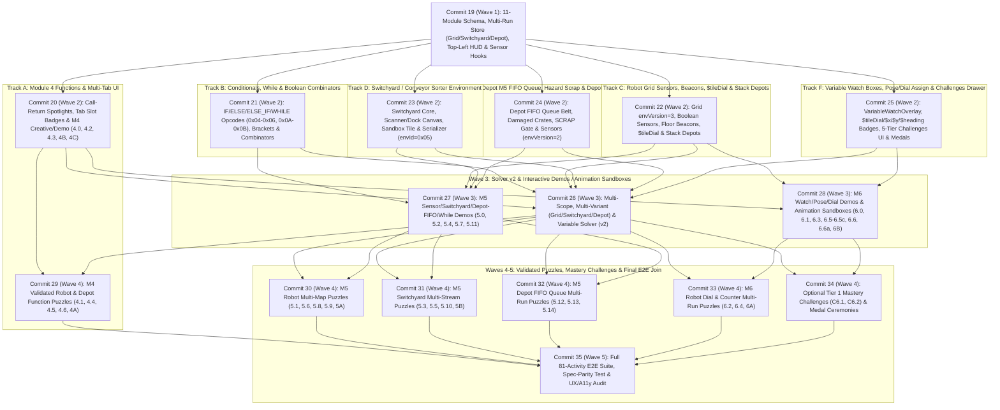

# Progressive Implementation Plan: Curriculum Modules 4–6 & Tier 1 Mastery Challenges

This document defines the progressive, commit-by-commit implementation plan as the direct follow-up to [`specs/curriculum_m1_m3_plan.md`](./curriculum_m1_m3_plan.md) (`Commits 1–18`) **plus the Module 1–3 `cc92eef` curriculum update** (10-color LOGO/Beat palettes with `White`/`Black` selective erasing, frame-animation lessons `2.5a`, `3.2a`, `3.3a`, `3.4a` + `v2` animated sandboxes, `ENV_ID_PROFILE = 0x06` binary profile backups, `CurriculumNextLessonBar`, and the **🏗️ Crate Depot** M3 LIFO stack environment `ENV_ID_DEPOT = 0x07` with lessons `3.8`–`3.10` — **39 baseline activities** and **16 baseline validated puzzles**), covering:
- [📚 Programming Curriculum (`docs/curriculum.md`)](../docs/curriculum.md) — focusing on **Module 4, Module 5, and Module 6** plus **Optional 🔥 Mastery Challenges Tier 1** (**42 new activities total**: 40 core lessons/capstones + 2 Tier 1 Mastery Challenges, bringing the live catalog to **81 activities**)
- [🏗️ Depot Environment, 📼 Sparse Memory Tape & Typed Variables (`docs/env_depot_and_tape.md`)](../docs/env_depot_and_tape.md) — specifically **M4 Double Stack Reversal (`4.6`)** and **M5 Depot FIFO Conveyor Queue & Hazard Routing (`5.11`–`5.14`)** + forward-compatible wire reservations for Modules 7–11
- [🎬 Animation Features Integration (`docs/env_animation_lessons.md`)](../docs/env_animation_lessons.md) — specifically **M6 `TELEPORT` & Pose Sensors (`6.5a`)**, **LOGO Paced/Frame Animations (`6.5b`, `6.5c`)**, and **Beat Scanner/Wipe Transitions (`6.6a`)**
- [🧒 Kid-Friendly UI Principles & Guidelines (`docs/ui_guidelines.md`)](../docs/ui_guidelines.md)
- [🛠️ Shared Language, Lesson Mechanics & Platform Requirements (`docs/platform_requirements.md`)](../docs/platform_requirements.md)
- [🚂 Switchyard / Conveyor Sorter Environment (`docs/env_switchyard.md`)](../docs/env_switchyard.md)
- [🤖 Robot Grid Planned Extensions (`docs/env_robot_extensions.md`)](../docs/env_robot_extensions.md)
- [🎵 Beat & Light Matrix Environment (`docs/env_beat_light.md`)](../docs/env_beat_light.md)
- [💾 Binary Serialization Format (`docs/binary_format.md`)](../docs/binary_format.md)

---

## 1. Engineering Principles & Commit Invariants

Every commit in this plan (`Commits 19–35`) MUST satisfy all six invariants inherited from `specs/curriculum_m1_m3_plan.md` plus the workspace UI contract in `docs/ui_guidelines.md` before merging/advancing:

1. **Standalone & Green CI:**
   - Compiles cleanly (`npm run build`) with zero TypeScript errors inside the standard sandbox (`BypassSandbox: false`).
   - Passes all unit tests (`npm run test:unit`, `BypassSandbox: false`) and Playwright E2E tests (`npm run test:e2e`, executed directly outside the sandbox with `BypassSandbox: true` per `AGENTS.md`).
2. **Always in a Working State:**
   - No half-wired buttons, dead modals, or broken existing features across all **5 environments**—**🤖 Robot Grid**, **🐢 Turtle LOGO** (incl. 10-color palette, `SET_INSTANT`/`CLEAR_CANVAS`/`WAIT`/`TELEPORT`, `Loop Mode ∞`, `Hide Turtle`), **🎵 Beat & Light Matrix** (incl. 10-color palette, `Black` pixel-off cutout, `SET_BEAT_DELAY`, `Loop Mode ∞`), **🏗️ Crate Depot** (LIFO stacks + M5 FIFO queue), and **🚂 Switchyard**—as well as Undo/Redo, Instant mode, QR Export/Import, Local Save/Load, Binary Whole-Profile Backup (`ENV_ID_PROFILE = 0x06`), PWA update restore, `CurriculumNextLessonBar`, and compact `360px`–`1920px+` layout.
3. **Humanly Testable:**
   - Every commit delivers a concrete, interactive capability in the live UI—never an invisible plumbing-only commit—accompanied by an explicit **"Human Verification"** checklist.
4. **Strict Save, Binary Compatibility & Same-Commit Spec Sync:**
   - Every existing Base64URL string (`envVersion = 1..2` Grid, v1 Generic, v1 Turtle `0x10..0x1F`, v1 Beat `0x10..0x1F`, v1 Depot `ENV_ID_DEPOT = 0x07`, `ENV_ID_LESSON = 0x04`, `ENV_ID_PROFILE = 0x06` `AQYB...` + legacy JSON backups, and multi-QR chunks), every existing `localStorage` entry (`robotemu_saved_programs`, `robotemu_profiles_v1`, `robotemu_lesson_autosave_v1`, `robotemu_curriculum_progress_v1`), and every PWA update snapshot (`robotemu_pending_update_state`) continues to load and run identically without data loss.
   - **Same-Commit `docs/binary_format.md` Sync:** Every commit that introduces or activates a wire opcode, bitmask, sensor index, environment ID, or `envVersion` (`C21`, `C22`, `C23`, `C24`, `C25`) MUST update `docs/binary_format.md` in that **same commit**—never leaving intermediate commits with undocumented wire bytes—enforced by an automated spec-parity unit test in `C35`.
5. **Provably Constrained Validated Exercises (Anti-Bypass Gate):**
   - Every validated puzzle, puzzle capstone, and validated Mastery Challenge (**21 new validated exercises** in Modules 4–6 + Tier 1 across **🤖 Robot Grid, 🚂 Switchyard, and 🏗️ Depot**, bringing the automated suite from **16** M1–M3 puzzles to **37 verified puzzles**) MUST pass **Anti-Bypass Constraint Checks** within a **`< 200 ms` CI performance budget per puzzle** (`50 ms` diagnostic warning threshold), proving two facts:
     1. The reference solution (and any filled partial `?` scaffold) solves **all** configured map/stream/depot variants within every per-tab and global slot/palette limit.
     2. **Attempting to solve the activity *without* applying the lesson's target concept** (e.g., unrolling in `Main` instead of calling `F1`/`F2` on Grid or Depot `4.6`/`5.14`, omitting loops in `Main` or `F1`, hardcoding moves/switches/stacks across multi-variant runs without `If`/`Else`/`Else If`/`While`, omitting boolean combinators `NOT`/`AND`/`OR`, or hardcoding numbers instead of reading `$tileDial` and stepping variables with `VAR_OP`) **yields zero valid solutions** within the lesson's palette and physical slot budget.
6. **Accessibility, Kid-Friendly Zero-Reading UX & Mandatory `docs/ui_guidelines.md` Contract:**
   - **5–7y Zero-Reading Rule & Frame-Loop Authoring Rule:** Communicate through unmistakable icons, physical slot trays, color+shape memory boxes (`📦 a ●`), glowing top-of-stack / front-of-queue highlights, painted dock rules, and animated spotlights; keep educator prose inside collapsed **`📖 Parent / Teacher Tip`** disclosures (`aria-expanded="false"` by default). All M6 frame animations (`6.5b`, `6.6a`) set `defaultLoopPlayback: true` and place `CLEAR_CANVAS` / `CLEAR_LEDS` at the **start** of the frame loop (never at the end) so static Variation Card thumbnails and non-looping runs finish with the artwork visible (`docs/env_animation_lessons.md` §1).
   - **Strict Single-Row `<header>` Budget:** Never add world tabs, `VARS` bars, multi-run pips, or editor tools to `Toolbar.tsx`; maintain `header.scrollWidth <= header.clientWidth` from `360px` upward.
   - **Non-Overlapping `pane-simulation` HUD Slots:** Stack `BackpackHud` (`🎒` / `🎒 ×N` / Depot claw cargo) and `VariableWatchOverlay` (`toolbar-variables`) inside the shared **Top-Left Stack** (`absolute top-3 left-3 flex flex-col items-start gap-1.5`), render multi-map / multi-stream / multi-queue status pips (`[1 ✓] [2 ✗] [3 ·] [4 ·]`) inside the **Top-Center Pill** (`absolute top-3 left-1/2 -translate-x-1/2`), and preserve Bottom-Dock `CurriculumNextLessonBar` / `VariationCardsPanel`.
   - **One Icon = One Meaning & 2-Tap Destructive Safety:** Structural closers (`LOOP_END`, `END_IF`, `END_WHILE`) use `CornerDownLeft` / closing-bracket glyphs (**never** `Undo2` or `RotateCcw`); preserve single smart 2-tap `btn-trash` and universal 1-tap Undo protection.
   - **Victory Celebration Multi-Run Spam Guards & Zustand v5 SSR:** `VictoryCelebrationModal` (and solved-state `CurriculumNextLessonBar`) triggers **only** when *all* variants in a multi-map/multi-stream/multi-depot run transition to `'SUCCESS'` (never on partial variant pass, `explanation` demos, `loadSolution()`, `importCode()`, or `undo()`/`redo()`), and all store-connected components follow the Zustand v5 SSR-safe read pattern (`useAppStore(); const { ... } = useAppStore.getState();`).
   - **Keyboard & Color-Blind Safety:** Logical `Tab` / `Enter` / `Space` / `Escape` navigation, `aria-live="polite"` status cues, high-contrast rings on `White` (`#ffffff`) and `Black` (`#0f172a`) swatches, and redundant shape+color coding (`● / ▲ / ■ / ◆`) on all beacons, keys/gates, Switchyard cars, Depot crates, variable boxes, and conditional/loop brackets.

---

## 2. Scope Boundary: Updated M1–M3 Baseline vs. Modules 4–6 vs. Modules 7–11

| Capability Area | Updated M1–M3 Baseline (`C1–C18` + `cc92eef` M1–M3 Update) | Included in Modules 4–6 Plan (`Commits 19–35`) | Deferred to Modules 7–11 (Designed for Clean Extension) |
| :--- | :--- | :--- | :--- |
| **Curriculum Content** | **39 activities** in Modules 1–3 (`1.0`–`1C` [12], `2.1`–`2B` incl. `2.5a` [10], `3.0`–`3C` incl. `3.2a`, `3.3a`, `3.4a`, `3.8`–`3.10`, `v2` animated cards [17]; **16 validated puzzles**) | **42 activities** across the 11-module track: Module 4 (`4.0`–`4.6`, `4A`–`4C`, 10), Module 5 (`5.0`–`5.14`, `5A`–`5B`, 17), Module 6 (`6.0`–`6.6a`, `6A`–`6B`, 13) + **Tier 1 `🔥 Mastery Challenges`** (`C6.1`, `C6.2`, 2) (**21 new validated puzzles**) | Modules 7–11 lessons/capstones (`7.0`–`11B`: **M7** Sparse Tape & Color Data, **M8** Comparisons/Modulo, **M9** Sorting & Symmetry, **M10** Parameterized Functions & Stored Programs, **M11** Recursion/Hanoi/Fractals) & **Tiers 2–5 `🔥 Mastery Challenges`** (`C8.1`–`C11.4`) |
| **Environments** | **🤖 Robot Grid** (`envVersion 1..2`), **🐢 Turtle LOGO** (10 colors + `WAIT`/`SET_INSTANT`/`CLEAR_CANVAS`/`TELEPORT` + `Loop ∞`), **🎵 Beat & Light** (10 colors + `SET_BEAT_DELAY` + `Loop ∞`), **🏗️ Crate Depot** (`envId = 0x07`, `envVersion = 1`: LIFO `Stacks 1..3` + `OUTPUT`) | **🚂 Switchyard / Conveyor Sorter** (`envId = 0x05`: 1–2 switches, scanner, docks, scrap chute) + **🏗️ Depot `envVersion = 2`** (horizontal **FIFO `QUEUE` belt**, cracked hazard crates, `SCRAP` gate, Depot sensors) + **🤖 Grid `envVersion = 3`** | **📼 Sparse Memory Tape** (`1..10,000` cells + windowed 7–9 cell `TapeDock` / Depot floor rail, M7), Switchyard weight/quota gauges (`itemWeight`, `dockQuota`, M8), Depot `INPUT` stream & `ACCEPT`/`REJECT` verdict gates (M8–M9), Hanoi disc size-order enforcement (M11) |
| **Pedagogical Mechanics** | Staged palettes, Read-only maps, Physical slot trays, `?` Placeholders (`0..4`), Ghost-Step, 2-Tier Solutions, Multi-env `📖 Explanation` tabs, `defaultLoopPlayback`, Variation Cards, `CurriculumNextLessonBar`, M1–M3 Grid+Depot Solver | **Simultaneous Multi-Map / Multi-Stream / Multi-Queue Validation** (`[1 ✓] [2 ✗] [3 ·] [4 ·]`), **Visual Memory Watch Boxes** (`toolbar-variables`), `?` Hint Categories `5..8`, Pose/Dial/FIFO Spotlights, **Multi-Scope / Multi-Variant / Variable Anti-Bypass Solver v2** | **`TypedValue` (`number` vs `color`) & `TYPE_ERROR` Watch-Tray Bounce** + Tape out-of-bounds bumper shake (M7), Relational & `% /` spotlights (M8), Converging-pointer spotlights (M9), Shape-socket plug spotlights (M10), **Call-Stack Recursion Visualizer** (M11) |
| **Language & Control Flow** | Sequences, `×N` badges, action params, `LOOP_START` / `LOOP_END`, sandbox `CALL_F1..F3`, sandbox numeric `VAR_ASSIGN` / `VAR_OP` + `$x`/`$y`/`$heading` serializer hooks (`SENSOR_REF_FLAG = 0x80`) | Curriculum `F1..F3` decomposition & per-tab slot caps (*`F1..F2` in validated puzzles; `F3` in creative `4B`, `4C`, `6.5b`*), **`IF` / `ELSE_IF` / `ELSE` / `END_IF`**, **`WHILE` / `END_WHILE`**, **Boolean combinators (`NOT`, `AND`, `OR`)**, curriculum sensor assignments (`a = $tileDial`, `a = $x`, `b = $y`) | **`TAPE_SEEK` / `TAPE_STEP` / `TAPE_WRITE`** (`0x0C..0x0E`) & color equality `$cellColor == ...` + `COLOR_LITERAL_FLAG = 0x40` (M7), Numeric comparisons (`<`, `>`, `==`, `!=`, `%`, `/`, M8), **Shape-socket inputs `F1(●, ▲, ■)`** incl. `● - 1` (M10), self-calls (M11) |
| **Robot Grid Extensions** | Ordered padlocks (`1 → 2 → Goal`), Keys/Gates, Planks/Water, Crates/Switches, 1-slot backpack | **Boolean sensors** (`pathAhead`, `pathLeft`, `pathRight`, `itemHere`, `carryingItem`, `atGoal`, `tileColor`), **Floor Beacons**, **Numbered Floor Dials (`$tileDial`)**, **Stackable Supply Depots (`🎒 ×N`)** | `unvisitedAhead` footprint breadcrumb sensor & cave Relics (M11) |
| **Profiles, Saves & Rewards** | Avatar multi-profile, per-lesson auto-save, dual-path saves, `ENV_ID_PROFILE = 0x06` binary backup (with `PROGRESS_FLAG_EARNED_MEDALS = 0x20` pre-wired), Module 1–3 Mastery Badges | **Module 4–6 Mastery Badges**, **Optional `🔥 Mastery Challenges` Drawer** (5-tier schema `M6/M8/M9/M10/M11`, Tier 1 unlocked after M6, non-gating), **Tier 1 Challenge Medals** (`medal-c6-1`, `medal-c6-2`) | Module 7–11 Mastery Badges, Sparse Tape creative sandbox persistence, & Tiers 2–5 `🔥 Challenge Medals` (`C8.1`–`C11.4`) |

---

## 3. Save & Binary Compatibility Architecture

### 3.1 Binary Serialization Compatibility (`FORMAT_VERSION = 1`)

All binary additions stay inside `FORMAT_VERSION = 1` without altering a single existing byte layout, and **harmonize 100% with the 11-module wire allocation in [`docs/env_depot_and_tape.md` §7](../docs/env_depot_and_tape.md)**:

1. **Existing Opcodes & Envelopes Untouched:**
   - Universal opcodes `0x01..0x03` (`LOOP_START`, `LOOP_END`, `CALL_FN`) and `0x07..0x09` (`VAR_ASSIGN`, `VAR_OP`, `PLACEHOLDER`), Grid `0x10..0x15`, Turtle `0x10..0x1F` (incl. `WAIT`, `SET_INSTANT`, `CLEAR_CANVAS`, `TELEPORT` and 10-color `0..9`), Beat `0x10..0x1F` (incl. `SET_BEAT_DELAY`, `WAIT_DURATION` and 10-color `0..9`), `ENV_ID_LESSON = 0x04`, `ENV_ID_PROFILE = 0x06`, and M3 `ENV_ID_DEPOT = 0x07` (`0x10..0x13`) keep their exact byte representations.
2. **Conditional & `While` Universal Opcodes (`0x04..0x06`, `0x0A..0x0B`) — Preserving `0x0C..0x0F` for M7 Tape:**
   - Per [`docs/env_depot_and_tape.md` §7.1](../docs/env_depot_and_tape.md), universal opcodes `0x0C..0x0E` are reserved for Module 7 (`0x0C = OP_TAPE_SEEK`, `0x0D = OP_TAPE_STEP`, `0x0E = OP_TAPE_WRITE`, `0x0F` reserved).
   - Therefore, Module 5 activates:
     - `OP_IF = 0x04` (followed immediately by `ConditionExpr`),
     - `OP_ELSE = 0x05`: plain `ELSE` writes `Byte 0 = 0x05` (0 parameter bytes, 1 byte total); **`ELSE_IF`** sets header bit 5 (`MASK_ELSE_HAS_COND = 0x20`, i.e. `Byte 0 = 0x25`) followed immediately by `ConditionExpr`—consuming **zero** extra universal opcode slots in `0x0A..0x0F`!
     - `OP_END_IF = 0x06` (0 parameter bytes, 1 byte total),
     - `OP_WHILE = 0x0A` (followed immediately by `ConditionExpr`),
     - `OP_END_WHILE = 0x0B` (0 parameter bytes, 1 byte total).
   - `ConditionExpr` (`writeConditionExpr` / `readConditionExpr` in `src/engine/serialization/conditionSerializer.ts`) uses a compact prefix-tree encoding:
     - **Grid Boolean Sensors (`0x01..0x08`):** `0x01` `pathAhead`, `0x02` `pathLeft`, `0x03` `pathRight`, `0x04` `itemHere`, `0x05` `carryingItem`, `0x06` `atGoal`, `0x07` `tileColor` (+ `colorIdx: uint8` in `PALETTE_COLORS` `0..9`), `0x08` `unvisitedAhead` (reserved M11).
     - **Switchyard Boolean Sensors (`0x10..0x13`):** `0x10` `hasNextItem`, `0x11` `itemDamaged`, `0x12` `itemColor` (+ `colorIdx: uint8`), `0x13` `itemIcon` (+ `iconIdx: uint8` for `0=crate`, `1=battery`, `2=gear`, `3=crystal`).
     - **Depot Boolean & Color-Match Sensors (`0x18..0x1C`):** `0x18` `stationEmpty` (+ `stationCode: uint8` — `0=CURRENT`, `1=STACK_1`, `2=STACK_2`, `3=STACK_3`, `4=QUEUE`, `5=INPUT`), `0x19` `hasItem`, `0x1A` `itemDamaged` (held or front/top crate cracked), `0x1B` `heldColor` (+ `colorIdx: uint8` `0..9`, encoding M5 `If ($heldColor == Red)`), `0x1C` `topColor` (+ `colorIdx: uint8` `0..9`, encoding M5 `If ($topColor == Blue)`).
     - **Boolean Combinators (`0x20..0x22`):** `0x20` `NOT(innerExpr)`, `0x21` `AND(leftExpr, rightExpr)`, `0x22` `OR(leftExpr, rightExpr)`.
     - **Reserved Typed Equality & Relational Tag (`0x30`, M7–M8):** Reserved for Module 7 `$cellColor == [Swatch | var]` / `$cellEmpty` and Module 8 numeric comparisons (`<`, `>`, `==`, `!=`, `% 2 == 0`) so Modules 7–11 require zero opcode changes.
     - *Compactness:* `IF (itemHere)` = **2 bytes** (`[0x04, 0x04]`); `ELSE_IF ($heldColor == Blue)` = **3 bytes** (`[0x25, 0x1B, 0x02]`); `WHILE (NOT stationEmpty[Queue])` = **4 bytes** (`[0x0A, 0x20, 0x18, 0x04]`).
3. **Unified Sensor Operands in `OP_VAR_ASSIGN (0x07)` & `OP_VAR_OP (0x08)` (`Byte 0` Header vs. `Byte 1` `operandDescMask` + `SENSOR_REF_FLAG = 0x80`):**
   - **Envelope Disambiguation (`docs/binary_format.md` §6.1 vs. §6.2):** Unlike standard opcodes (`§6.1`), where `Byte 0` (`blockHeader`) sets `MASK_HAS_VAR_PARAM (0x80)` to gate an *optional* `Byte 1` (`paramVarMask`), `OP_VAR_ASSIGN (0x07)` and `OP_VAR_OP (0x08)` (`§6.2`) **never** set `HasVarParam` or `HasRep` (`Byte 0` is raw `0x07` or `0x08` with `bits 7..5 = 0`) and **always** emit an unconditional `Byte 1` operand descriptor (`operandDescMask`—renamed from `paramVarMask` in `src/engine/serialization/codeScopes.ts` in `C25` to eliminate confusion with `§6.1`):
     ```
     OP_VAR_ASSIGN (0x07):
       Byte 0: 0x07 (raw opcode — bits 7..5 MUST be 0; HasVarParam = 0, HasRep = 0)
       Byte 1: operandDescMask = [000000 (b7..b2) | typeB (b1..b0)]
       Byte 2: targetVarIdx (uint8: 0..25 for 'a'..'z')
       Byte 3+: operandData(typeB)

     OP_VAR_OP (0x08):
       Byte 0: 0x08 (raw opcode — bits 7..5 MUST be 0; HasVarParam = 0, HasRep = 0)
       Byte 1: operandDescMask = [0000 (b7..b4) | typeC (b3..b2) | typeB (b1..b0)]
       Byte 2: targetVarIdx (uint8: 0..25 for 'a'..'z')
       Byte 3: opByte (uint8: 0x00..0x0C)
       Byte 4+: operandData(typeB), followed immediately by operandData(typeC)
     ```
   - **Disjoint 1-Byte Sub-Spaces Inside `OPERAND_TYPE_VAR (0b00)` ([`docs/env_depot_and_tape.md` §7.2](../docs/env_depot_and_tape.md) & `serialization/types.ts`):**
     - `src/engine/serialization/types.ts` (`encodeVarOrSensorIndex` / `decodeVarOrSensorIndex`) already encodes sensor tokens inside `OPERAND_TYPE_VAR (0b00)` using `SENSOR_REF_FLAG = 0x80`:
       - `0x00..0x19`: Variable `'a'..'z'` (`0..25`)
       - `0x40..0x49`: Reserved for Module 7 `COLOR_LITERAL_FLAG = 0x40 | colorIdx` (`PALETTE_COLORS` `0..9`)
       - `0x80..0xFF`: `SENSOR_REF_FLAG = 0x80 | sensorIdx` indexing `SERIALIZED_SENSOR_IDS`:
         - `0` (`0x80`): `'$x'` · `1` (`0x81`): `'$y'` · `2` (`0x82`): `'$heading'` *(already active in Turtle LOGO for Lesson `6.5a`!)*
         - `3` (`0x83`): `'$tileDial'` *(added in `C19`/`C22` for Module 6 Robot floor dials `1..20`, `0` if none)*
         - `4+` (`0x84+`): Reserved for Module 7–8 (`'$cellValue'`, `'$cellColor'`, `'$headPos'`, `'$tapeLength'`, `'$heldValue'`, `'$topValue'`, `'$itemWeight'`, `'$dockQuota'`, `'$dockCount'`).
     - Thus `a = $tileDial` encodes cleanly in **4 bytes** (`[0x07, 0x00, varIdx, 0x83]`) using the exact same live mechanism as `a = $x` (`[0x07, 0x00, varIdx, 0x80]`), with **zero** changes to `operandDescMask` bit layouts and 100% compatibility with M7 `COLOR_LITERAL_FLAG = 0x40`!
4. **Backward-Compatible Grid `envVersion = 3` (`1` vs. `2` vs. `3`):**
   - Classic maps still emit `envVersion = 1`; maps using only M2 elements (`waterCells`, `lockedGates`, `floorSwitches`, single `worldItems`) still emit **`envVersion = 2`** (preserving byte-for-byte compatibility with `tests/worldItemsAndGridV2.test.ts`).
   - Maps using Module 5–6 extensions (`beaconTiles`, `dialTiles`, stackable depot items with `count > 1`, or validation flags `requireAllItemsCollected` / `requireEmptyBackpackAtGoal` / `strictInteractionCollision`) emit **`envVersion = 3`** following the exact `envVersion = 2` prefix.
5. **New `🚂 Switchyard` Environment (`ENV_ID_SWITCHYARD = 0x05`, `ENV_VERSION_SWITCHYARD = 1`):**
   - Activates reserved `0x05` (and already-reserved `SIM_CODE_SWITCHYARD = 3` in `profileSerializer.ts`).
   - Action opcodes `0x10..0x13`: `0x10` `SWITCH_LEFT` (`junctionId: uint8`), `0x11` `SWITCH_RIGHT` (`junctionId: uint8`), `0x12` `SEND_NEXT` (supports `HasRep` + `MASK_HAS_VAR_PARAM`), `0x13` `SCRAP_ITEM`.
   - Supports `hasLayout: uint8` in `0x05` streams and `innerEnvByte = 0x05` inside `ENV_ID_LESSON = 0x04`.
6. **Backward-Compatible `🏗️ Depot` `envVersion = 2` (`ENV_ID_DEPOT = 0x07`):**
   - M3–M4 stack-only Depot layouts (`3.8`–`3.10`, `4.6`) continue emitting **`envVersion = 1`** byte-for-byte identically.
   - Sandbox Depot layouts authored with Module 5 additions (`queueItems` with optional `damaged` flag, `QUEUE` worker start/station, or `SCRAP` dock gate on `DEPOT_SEND_OUT`) emit **`envVersion = 2`**, appending the optional FIFO queue & gate flags after the `envVersion = 1` stack payload.
7. **Activation of `?` Placeholder Hint Categories `5..8`:**
   - `OP_PLACEHOLDER = 0x09` activates runtime palette highlighting and replacement matching in `placeholderHelpers.ts` for `5 = 'function'`, `6 = 'conditional'`, `7 = 'sensor'`, and `8 = 'variable'`.

### 3.2 Local Storage, Binary Profile Backups, 5-Tier Mastery Challenges & Slot Guardrails

- **Unambiguous Mastery Challenge IDs (`'C6.1'`, `'C6.2'`) & 5-Tier Schema (`M6`, `M8`, `M9`, `M10`, `M11`):**
  - Canonical IDs **`'C6.1'`** and **`'C6.2'`** (`format: 'challenge'`, `challengeTier: 1`, `unlockAfterModuleId: 'module-6'`) avoid colliding with Lessons `'6.1'` and `'6.2'` and already pack into **2 bytes** (`[0xFE, 0x50]`, `[0xFE, 0x51]`) in `profileSerializer.ts` (§2.3.2).
  - Sub-letter lesson IDs (`'6.5a'`, `'6.5b'`, `'6.5c'`, `'6.6a'`) and 2-digit lesson numbers (`'5.11'`–`'5.14'`) sort inline before module capstones via `compareCurriculumActivityIds` and pack cleanly via `CompactLessonId` `0x01..0x7F` in `profileSerializer.ts`.
  - `MASTERY_CHALLENGE_TIERS` declares the 5-tier unlock structure (`Tier 1 → module-6`, `Tier 2 → module-8`, `Tier 3 → module-9`, `Tier 4 → module-10`, `Tier 5 → module-11`), with Tier 1 (`medal-c6-1`, `medal-c6-2`) active in Modules 4–6 and serialized automatically via `PROGRESS_FLAG_EARNED_MEDALS = 0x20` in `ENV_ID_PROFILE = 0x06`.
- **Physical Slot Tray Convention on Structural Closers:**
  - Every `CodeBlock` card placed in `workspace[scope]`—including `LOOP_END`, `ELSE`, `ELSE_IF`, `END_IF`, and `END_WHILE`—occupies **1 physical slot** (`1 visual card = 1 [■] slot`).
  - *Exact Physical Card Note on Depot Queue Puzzles (`5.12`–`5.14`):* In [`docs/env_depot_and_tape.md` §9.3](../docs/env_depot_and_tape.md), `5.12`'s reference program (`While + Move[Queue] + Grab + If + Move[Stack 1] + Else + Move[Stack 2] + EndIf + Place + EndWhile`) comprises **10 physical cards** (`8` non-closer/else statements + `EndIf` + `EndWhile`), and `5.13`'s 3-way `Else If` version comprises **12 physical cards** (matching `docs/curriculum.md` §3's `4–12` lesson range; or `Main: 5 + F1: 8` if factored). Their `slotCap` budgets are set to **`10`** (`5.12`), **`12`** (`5.13`), and **`Main: 5, F1: 9` (`maxTotal: 14`)** (`5.14`) so every reference card fits `1:1` in the physical slot tray.
- **Dual-Cap Slot Budgets (`perScope` + `maxTotal`) & Capstone `4A` Guardrail Relationship:**
  - `docs/curriculum.md` §3 specifies `8–14` total workspace cards and `≤ 8` cards in any single tab for validated puzzle capstones.
  - On Capstone `4A` (*Modular Station Repair*), `slotCap` sets `{ perScope: { MAIN: 5, F1: 5, F2: 5 }, maxTotal: 14 }`: each individual scope tab is tightened below the `≤ 8` single-tab guardrail to a physical **5-slot tray**, while `maxTotal: 14` simultaneously enforces the §3 global `≤ 14` capstone ceiling via `computeSlotBudget`'s `remainingForScope = Math.min(remByScope, remByTotal)` clamp in `src/utils/curriculumStagePolicy.ts`.

---

## 4. Automated Anti-Bypass Constraint Solver Design (Modules 4–6)

To uphold Principle #3 (*"Constraint-Driven Discovery — No Brute Force"*) across multi-tab functions (Grid & Depot), adaptive multi-run conditionals (Grid, Switchyard & Depot), and stepping variables, `src/engine/verification/constraintSolver.ts` (already generalized for single-variant `grid` and `depot` in M3) is upgraded with three fast, exact verification strategies while maintaining the **`< 200 ms` per-puzzle CI performance gate**.

### 4.1 Solver Algorithms & Performance CI Gate (`constraintSolver.ts` v2)

1. **Multi-Scope Function Decomposition Search (Module 4 & `5.14` — Grid & Depot):**
   - Validates `referenceSolution` and filled `?` scaffolds across active scopes (`MAIN`, `F1`, `F2`, `F3`) against both `slotCap.perScope` and `slotCap.maxTotal` for `simId === 'grid'` (`4.1`, `4.4`, `4.5`, `4A`) and `simId === 'depot'` (`4.6`, `5.14`).
   - For `forbidBlocks: ['CALL_F1']` / `['CALL_F2']`, restricts candidate generation to remaining scopes within their tight `perScope` tray limits (e.g., `MAIN <= 7` on Depot `4.6` where reversing twice unrolled or in two flat loops needs `12` blocks!). Memoizes deterministic helper transitions `state -> nextState | COLLISION | SUCCESS` in **`< 10 ms`**.
2. **Joint Multi-Variant Product-State BFS & Conditional/Loop Pruning (Module 5 — Grid, Switchyard & Depot):**
   - Executes candidate bypass programs simultaneously over the variant vector `[V_1, V_2, ..., V_k]` (`k = 3..4`) across `gridSimulationEnvironment`, `switchyardSimulationEnvironment`, and `depotSimulationEnvironment`.
   - **Early Joint Pruning:** The instant *any* single variant `V_i` collides (hits a wall, routes a car to a mismatched Switchyard dock, places a wrong-color crate onto a Depot stack, sends an intact crate to `SCRAP` or damaged crate to a stack, or triggers `strictInteractionCollision`), that entire search branch is pruned immediately across all `k` variants—completing in **`< 15 ms`**.
   - For `forbidCombinators` (`5.9`) and `forbidBlocks: ['ELSE']` / `['ELSE_IF']` (`5.5`, `5.6`, `5.10`, `5.12`, `5.13`), enumerates bounded conditional AST templates (`slotCost` matched to `slotCap`) and proves **0 winning programs** pass all `k` variants.
3. **Variable-Free, Arithmetic-Free & Sensor-Readout Impossibility Proofs (Module 6 & `C6.1`):**
   - `allowVariables: false` (`forbidBlocks: ['VAR_ASSIGN', 'VAR_OP']`) proves no fixed constant repeat/loop program (`×2..×9`) passes all 3 dial/warehouse variants (`6.2`, `6.4`, `6A`, `C6.1`).
   - `forbidBlocks: ['VAR_OP']` allows `VAR_ASSIGN` (`a = const` and `a = $tileDial`) while forbidding arithmetic updates (`+`, `-`, `*`), proving stepping counters (`a = a + 1` in `6.4`, `c = c + 1` in `6A`) and multi-dial expressions (`a + b`, `b * 2` in `C6.1`) are strictly required.
   - `forbidSensors: ['$tileDial']` proves `6.2`, `6.4`, and `C6.1` cannot be solved without reading the world floor dials.

### 4.2 Extended Anti-Bypass Rule Types (`AntiBypassRule`)

In addition to all M1–M3 fields (`forbidBlocks`, `allowRepeatBadges`, `maxLoopNestingDepth`, `pureSingleLoopOnly`, `maxActionExecutions`, `unmodifiedStarterMustFail`, `directToGoalMustFailLock`), `AntiBypassRule` adds:
- `allowVariables?: boolean` — when `false`, forbids variable badges (`a..z`) on action/loop `repeatCount` and params alongside `VAR_ASSIGN` / `VAR_OP`.
- `forbidCombinators?: ('NOT' | 'AND' | 'OR')[]` — restricts `IF` / `ELSE_IF` / `WHILE` conditions to omit the specified boolean combinators.
- `forbidSensors?: string[]` — forbids specific boolean or numeric world sensors (e.g., `['$tileDial']`, `['tileColor']`, `['itemDamaged']`, `['heldColor']`).
- `maxLoopNestingDepthPerScope?: Partial<Record<ScopeType, number>>` — e.g., `{ MAIN: 0 }` or `{ F1: 0 }` on `4.4` to prove *both* `Main` and `F1` must use loops.
- `singleVariantBypassMustExist?: boolean` — optional sanity assertion for Module 5–6 multi-run puzzles verifying that at least 1 individual variant *could* be beaten by a hardcoded sequence, proving multi-variant validation is genuinely required.

### 4.3 Module 4–6 & Tier 1 Anti-Bypass Verification Matrix (All 21 Validated Puzzles)

| ID | Env & Target Concept | Variants | Physical Slot Cap | Automated Anti-Bypass Proofs Enforced in `npm run test:unit` |
| :--- | :--- | :---: | :---: | :--- |
| **`4.1`** | 🤖 Define & Call Helper `F1` (non-adjacent maneuvers) | `1` | `Main: 6`, `F1: 4` (`≤ 9`) | • `forbidBlocks: ['CALL_F1']` (`Main ≤ 6` slots) → **0 solutions** *(unrolled maneuver needs ≥ 11 slots; uneven gaps defeat a single loop)* |
| **`4.4`** | 🤖 Functions + Loops Together (`Loop` in `Main` & `F1`) | `1` | `Main: 4`, `F1: 4` (`≤ 8`) | • `forbidBlocks: ['CALL_F1']` (`Main ≤ 4`) → **0 solutions**<br>• `maxLoopNestingDepthPerScope: { MAIN: 0 }` & `{ F1: 0 }` → **0 solutions** |
| **`4.5`** | 🤖 Layered Composition (`Main → F1 → F2`) | `1` | `Main: 4, F1: 4, F2: 3` (`≤ 10`) | • `forbidBlocks: ['CALL_F1']` → **0 solutions**<br>• `forbidBlocks: ['CALL_F2']` (`Main + F1` only) → **0 solutions** |
| **`4.6`** | 🏗️ Double Stack Reversal = Original Order (`S1 → S2 → S3`) | `1` | `Main: 7`, `F1: 6` (`≤ 13`) | • `forbidBlocks: ['CALL_F1']` (`Main ≤ 7` slots) → **0 solutions** *(direct `S1 → S3` reverses order `[🟥,🟦,🟩,🟨]` != `[🟨,🟩,🟦,🟥]`; 2 sequential loops need 12 cards > 7!)*<br>• `maxLoopNestingDepth: 0` → **0 solutions** |
| **`4A`** | 🏆 🤖 *Modular Station Repair* (`Main + F1 + F2`) | `1` | `Main/F1/F2: 5` (`≤ 14`) | • `forbidBlocks: ['CALL_F1']` → **0 solutions**<br>• `forbidBlocks: ['CALL_F2']` → **0 solutions**<br>• `maxLoopNestingDepth: 0` → **0 solutions** |
| **`5.1`** | 🤖 Sensing & Simple `If (itemHere)` | `3` maps | `6` | • `forbidBlocks: ['IF', 'END_IF']` → **0 solutions** across 3 halls *(skipping `PICK_UP` fails `requireAllItemsCollected`; blind `PICK_UP` fails `strictInteractionCollision`)*<br>• `singleVariantBypassMustExist: true` |
| **`5.3`** | 🚂 Switchyard Warmup — `If (itemDamaged) { Scrap }` | `3` streams | `6` | • `forbidBlocks: ['IF', 'END_IF']` → **0 solutions**<br>• `forbidBlocks: ['SCRAP_ITEM']` → **0 solutions** |
| **`5.5`** | 🚂 Binary `If / Else` Sorting (`Red` vs. `Blue`) | `3` streams | `8` | • `forbidBlocks: ['IF', 'ELSE', 'END_IF']` → **0 solutions**<br>• `forbidBlocks: ['ELSE']` (`≤ 8` slots) → **0 solutions** |
| **`5.6`** | 🤖 Spatial `If / Else` (`tileColor`, `pathLeft`, `pathRight`) | `3` maps | `7` | • `forbidBlocks: ['IF', 'ELSE', 'END_IF']` → **0 solutions**<br>• `forbidBlocks: ['ELSE']` (`≤ 7` slots) → **0 solutions** |
| **`5.8`** | 🤖 Conditional Loops (`While (pathAhead)`) | `3` maps | `6` | • `forbidBlocks: ['WHILE', 'END_WHILE']` (with `Loop 2..9` & `×2..×9` enabled, `≤ 6` slots) → **0 solutions** across 3 different-sized tunnels |
| **`5.9`** | 🤖 Boolean Combinators (`NOT`, `AND`, `OR`) | `3` maps | `7` | • `forbidBlocks: ['IF', 'END_IF']` → **0 solutions**<br>• `forbidCombinators: ['AND', 'NOT', 'OR']` (`≤ 7` slots) → **0 solutions** |
| **`5.10`** | 🚂 Chained Multi-Way Routing (`If / Else If / Else`) | `3` streams | `11` | • `forbidBlocks: ['IF', 'ELSE_IF', 'ELSE', 'END_IF']` → **0 solutions**<br>• `forbidBlocks: ['ELSE_IF']` (`≤ 11` slots) → **0 solutions** |
| **`5.12`** | 🏗️ Binary Queue Color Sort (`Queue → Stack 1 / Stack 2`) | `4` queues | `10` | • `forbidBlocks: ['IF', 'ELSE', 'END_IF']` → **0 solutions** across 4 randomized 🔴/🔵 FIFO queues<br>• `forbidBlocks: ['ELSE']` (`≤ 10` slots) → **0 solutions** |
| **`5.13`** | 🏗️ 3-Way Cargo Sort (`Queue → Stacks 1 / 2 / 3`) | `4` queues | `12` | • `forbidBlocks: ['IF', 'ELSE_IF', 'ELSE', 'END_IF']` → **0 solutions** across 4 🔴/🔵/🟢 queues<br>• `forbidBlocks: ['ELSE_IF']` (`≤ 12` slots) → **0 solutions** *(nested `If` inside `Else` requires an extra `End If`, needing 13 cards!)* |
| **`5.14`** | 🏗️ Filter & Route (`Main` drains Queue + `F1` Scraps/Routes) | `4` queues | `Main: 5, F1: 9` (`≤ 14`) | • `forbidBlocks: ['CALL_F1']` (`Main ≤ 5` slots) → **0 solutions**<br>• `forbidBlocks: ['IF', 'ELSE_IF', 'ELSE', 'END_IF']` → **0 solutions** across 4 hazard+color queues |
| **`5A`** | 🏆 🤖 *Autonomous Maze Rover* (4 Simultaneous Mazes) | `4` mazes | `Main: 8, F1: 6` (`≤ 12`) | • `forbidBlocks: ['WHILE', 'END_WHILE']` → **0 solutions**<br>• `forbidBlocks: ['IF', 'ELSE', 'ELSE_IF', 'END_IF']` → **0 solutions** |
| **`5B`** | 🏆 🚂 *Hazard & Priority Router* (Damaged + 3 Cargo Colors) | `4` streams | `Main: 8, F1: 6` (`≤ 13`) | • `forbidBlocks: ['SCRAP_ITEM']` → **0 solutions**<br>• `forbidBlocks: ['IF', 'ELSE_IF', 'ELSE', 'END_IF']` → **0 solutions** |
| **`6.2`** | 🤖 Reading & Recalling a Dial Value (`a = $tileDial`) | `3` maps | `6` | • `allowVariables: false` → **0 solutions** across 3 dial variants (`a ∈ {2, 3, 4}`)<br>• `forbidSensors: ['$tileDial']` → **0 solutions** |
| **`6.4`** | 🤖 Stepping Counters & Staircases (`a = a + 1`) | `3` maps | `7` | • `allowVariables: false` (`≤ 7` slots) → **0 solutions**<br>• `forbidBlocks: ['VAR_OP']` (`≤ 7` slots) → **0 solutions** |
| **`6A`** | 🏆 🤖 *Inventory Quartermaster* (Count `c`, Fetch `×c`, Install) | `3` maps | `Main: 8, F1: 6` (`≤ 13`) | • `allowVariables: false` → **0 solutions** *(hardcoding `Pick Up ×4` fails `requireEmptyBackpackAtGoal` on `<4`-node variants!)*<br>• `forbidBlocks: ['VAR_OP']` → **0 solutions** |
| **`C6.1`** | 🔥 🤖 *Multi-Dial Vault Combination* (`a + b`, `b * 2`) | `3` maps | `Main/F1/F2: 8` (`≤ 18`) | • `allowVariables: false` → **0 solutions**<br>• `forbidBlocks: ['VAR_OP']` → **0 solutions**<br>• `forbidSensors: ['$tileDial']` → **0 solutions** |

---

## 5. Concurrency Plan & Parallel Worktracks

**Commit 19 (Wave 1)** establishes the shared 11-module M4–M6 + 5-Tier Challenge schema, multi-variant store contract (`gridVariants` / `switchyardVariants` / `depotVariants`), non-overlapping `<SimulationTopLeftHud />` & `<MultiRunPipsBar />` containers, `<GridOverlayLayer />` `beaconAndDialSlot`, and sensor/opcode constants so the remaining **16 commits (`C20`–`C35`)** fan out cleanly across **6 parallel tracks** in **5 waves** without merge bottlenecks.

### 5.1 Parallel Dependency Graph (DAG)

*(Every edge below matches the exact `Depends On` list in §6; transitive `C19` edges through Wave 2 parents are omitted for clarity.)*



### 5.2 Wave-by-Wave Concurrent Execution Schedule

| Wave | Commits Runnable in Parallel | File-Ownership & Conflict Prevention Summary |
| :---: | :--- | :--- |
| **Wave 1** | **`C19`** *(Foundation)* | Establishes M4–M6 `CurriculumModule`s & 5-Tier `MASTERY_CHALLENGE_TIERS`, multi-variant runner (`gridVariants`, `switchyardVariants`, `depotVariants`) in `useAppStore.ts` & `CurriculumNextLessonBar.tsx`, `<SimulationTopLeftHud />`, `<MultiRunPipsBar />`, `beaconAndDialSlot` in `<GridOverlayLayer />`, reserved opcodes + `'$tileDial'` in `serialization/types.ts`, and `evaluateSensor` in `simulation/types.ts`. |
| **Wave 2** | **`C20`** + **`C21`** + **`C22`** + **`C23`** + **`C24`** + **`C25`** *(6-way parallel!)* | • `C20`: Scope tab slot pills, `call-stack-jump` spotlight, `module4CreativeAndDemo.ts` (`4.0`, `4.2`, `4.3`, `4B`, `4C`)<br>• `C21`: `conditionSerializer.ts`, `ConditionBadge.tsx`, `IF/ELSE/ELSE_IF/WHILE` in `codeScopes.ts`, `interpreter.ts` & `WorkspaceCanvas.tsx` + `docs/binary_format.md` (§7.1)<br>• `C22`: `src/simulations/grid/sensors.ts`, `BeaconAndDialLayer.tsx`, `physics.ts`, `gridSerializer.ts` (`envVersion = 3`) + `docs/binary_format.md` (§4.3)<br>• `C23`: `src/simulations/switchyard/*`, `switchyardSerializer.ts` (`0x05`), 5th Sandbox World Tile + `docs/binary_format.md` (§2/§4.4/§7.5)<br>• `C24`: `src/simulations/depot/*` FIFO `QUEUE` belt, `damaged` crates, `SCRAP` gate, `evaluateDepotSensor`, `depotSerializer.ts` (`envVersion = 2`) + `docs/binary_format.md` (§4.5/§7.6)<br>• `C25`: `VariableWatchOverlay.tsx` (`toolbar-variables`), `operandDescMask` + `$tileDial`/`$x`/`$y`/`$heading` sensor badges, `LessonPickerModal` Challenges drawer & medals + `docs/binary_format.md` (§6.2) |
| **Wave 3** | **`C26`** + **`C27`** + **`C28`** *(3-way parallel!)* | • `C26`: `src/engine/verification/constraintSolver.ts` v2 (Grid + Switchyard + Depot multi-scope & multi-variant), `tests/curriculumConstraintCheck.test.ts`, `SolutionModal.tsx`<br>• `C27`: M5 spotlights (`sensor-beam`, `branch-skip`, FIFO queue vs LIFO stack) + `module5Demos.ts` (`5.0`, `5.2`, `5.4`, `5.7`, `5.11`)<br>• `C28`: M6 spotlights (`dial-read`, `pose-bookmark`, `variable-watch`) + `module6CreativeAndDemo.ts` (`6.0`, `6.1`, `6.3`, `6.5`, `6.5a`, `6.5b`, `6.5c`, `6.6`, `6.6a`, `6B`) |
| **Wave 4** | **`C29`** + **`C30`** + **`C31`** + **`C32`** + **`C33`** + **`C34`** *(6-way parallel!)* | Disjoint curriculum slice files, all verified automatically by `C26`:<br>• `C29`: `module4Puzzles.ts` (`4.1`, `4.4`, `4.5`, `4.6`, `4A`)<br>• `C30`: `module5Robot.ts` (`5.1`, `5.6`, `5.8`, `5.9`, `5A`)<br>• `C31`: `module5Switchyard.ts` (`5.3`, `5.5`, `5.10`, `5B`)<br>• `C32`: `module5Depot.ts` (`5.12`, `5.13`, `5.14`)<br>• `C33`: `module6Robot.ts` (`6.2`, `6.4`, `6A`)<br>• `C34`: `masteryTier1.ts` (`C6.1`, `C6.2`) |
| **Wave 5** | **`C35`** *(Final Join)* | Aggregates all 42 new activities (`81` total) in `src/data/curriculum/index.ts`, adds `tests/binaryFormatSpecSync.test.ts`, and runs `e2e/curriculumM4M6.spec.ts` + full save/profile-backup/anti-bypass/HUD/accessibility regression suite. |

### 5.3 File-Isolation Rules & Shared-Component Merge Protocol

1. **HUD & Simulation Environment Isolation:**
   - **Commit 19** mounts `<SimulationTopLeftHud />` (`absolute top-3 left-3`) and `<MultiRunPipsBar />` (`absolute top-3 left-1/2 -translate-x-1/2`) cleanly inside `pane-simulation`, and adds `beaconAndDialSlot` inside `GridOverlayLayer.tsx`.
   - `C22` (`src/simulations/grid/`), `C23` (`src/simulations/switchyard/`), `C24` (`src/simulations/depot/`), and `C25` (`VariableWatchOverlay.tsx`) stay strictly isolated inside their respective folders/components.
2. **Wave 2 Shared Wiring & `docs/binary_format.md` Merge Order:**
   - `C22` and `C24` require zero edits to `codeScopes.ts` or `interpreter.ts` (touching only their simulation packages, `gridSerializer.ts` / `depotSerializer.ts`, and disjoint subsections of `docs/binary_format.md`).
   - Each Wave 2 wire-format commit updates its own section of `docs/binary_format.md` in the same commit (`C21`: §7.1, `C22`: §4.3, `C23`: §2/§4.4/§7.5, `C24`: §4.5/§7.6, `C25`: §6.2); merge Wave 2 branches in order **`C20 → C21 → C22 → C23 → C24 → C25`**.
3. **Wave 3 Spotlight Component Isolation:**
   - Keep spotlight renderers in separate components (`SensorAndBranchSpotlight.tsx` in `C27`, `VariableAndDialSpotlight.tsx` in `C28`) and merge **`C27 → C28`**.
4. **One File per Curriculum Slice:**
   - Keep `module4CreativeAndDemo.ts`, `module4Puzzles.ts`, `module5Demos.ts`, `module5Robot.ts`, `module5Switchyard.ts`, `module5Depot.ts`, `module6CreativeAndDemo.ts`, `module6Robot.ts`, and `masteryTier1.ts` in separate files spread into `CURRICULUM_ACTIVITIES` in canonical order (`4.0`..`4C`, `5.0`..`5B`, `6.0`..`6B`, `C6.1`..`C6.2`).

---

## 6. Detailed Commit-by-Commit Breakdown

### Commit 19: 11-Module Schema, Multi-Variant Runner (Grid / Switchyard / Depot), Non-Overlapping HUD Stack & Sensor/Opcode Contracts
- **Wave:** 1 (Foundation) · **Depends On:** Updated M1–M3 Baseline (`C1`–`C18` + `cc92eef` M1–M3 Update) · **Unlocks:** `C20`, `C21`, `C22`, `C23`, `C24`, `C25`
- **Goal:** Establish shared types for Modules 4–6 within the 11-module roadmap, multi-variant store execution across Grid, Switchyard, and Depot, non-overlapping `pane-simulation` HUD containers (`docs/ui_guidelines.md` §3), and harmonized opcode/sensor constants so all six Wave 2 tracks run in parallel.
- **Changes:**
  - **[MODIFY] `src/data/curriculum/types.ts` & `src/data/curriculum/index.ts`**:
    - Add static `CURRICULUM_MODULES` entries for `module-4` (*Functions — Abstraction, Naming & Decomposition* `🧩`), `module-5` (*Sensors, Conditionals & FIFO Queues* `📡`), and `module-6` (*Variables, Pose Sensors & Stepping Counters* `📦`), plus the 5-Tier `MASTERY_CHALLENGE_TIERS` metadata (`tier-1`: `unlockAfterModuleId: 'module-6'`, `challengeIds: ['C6.1', 'C6.2']`; `tier-2`..`tier-5` declared for `module-8`..`module-11`).
    - Extend `ActivityVersionPayload` with `gridVariants?: CurriculumGridDefinition[]`, `switchyard?: CurriculumSwitchyardDefinition`, `switchyardVariants?: CurriculumSwitchyardDefinition[]`, `depotVariants?: CurriculumDepotDefinition[]`, `ConditionExpr` AST types, and extended `AntiBypassRule` fields (§4.2).
  - **[MODIFY] `src/engine/simulation/types.ts` & `src/engine/serialization/types.ts`**:
    - Add optional `evaluateSensor?(sensor, state, params): boolean` hook on `SimulationEnvironment<TState>` (alongside the existing `readSensor?(sensorName, state): number` hook).
    - Declare `MASK_ELSE_HAS_COND = 0x20` (on `OP_ELSE = 0x05`), `OP_WHILE = 0x0A`, `OP_END_WHILE = 0x0B` (leaving `0x0C..0x0E` free for M7 `OP_TAPE_*`), `ENV_ID_SWITCHYARD = 0x05`, `ENV_VERSION_GRID_V3 = 3`, `ENV_VERSION_DEPOT_V2 = 2`, and append `'$tileDial'` (`index 3` → `0x83`) to `SERIALIZED_SENSOR_IDS`.
  - **[NEW] `src/components/SimulationTopLeftHud.tsx` & `src/components/MultiRunPipsBar.tsx`** + **[MODIFY] `GridOverlayLayer.tsx`, `GridCanvas.tsx`, `DepotCanvas.tsx`, `CurriculumNextLessonBar.tsx`, `App.tsx`, `useAppStore.ts`**:
    - Mount `<SimulationTopLeftHud />` (`absolute top-3 left-3 flex flex-col items-start gap-1.5`) hosting `BackpackHud` / Depot claw badge and a slot for `VariableWatchOverlay` (`C25`), and mount `<MultiRunPipsBar />` (`absolute top-3 left-1/2 -translate-x-1/2`) displaying interactive `[1 ✓] [2 ✗] [3 ·] [4 ·]` pips whenever an activity defines multiple variants.
    - Add `beaconAndDialSlot` to `<GridOverlayLayer />`.
    - Wire synchronized multi-variant execution in `useAppStore.ts` (`variantRuns`, `focusedVariantIndex`, `setFocusedVariantIndex`): `VictoryCelebrationModal` and solved-state `CurriculumNextLessonBar` activate **if and only if** all variants reach `'SUCCESS'` on an active user run/edit.
- **Save & Test Compatibility:** Single-variant M1–M3 activities (`39` lessons/capstones across Grid, LOGO, Beat, and Depot) run identically with zero visual pips; all existing unit & E2E suites stay green.
- **Human Verification:**
  1. Open `LessonPickerModal` (`🎓 Learn`) and verify Modules 4, 5, and 6 appear cleanly after the updated 17-lesson Module 3 roadmap.
  2. Verify `<header>` stays strictly single-row (`360px`–`1920px+`) and `<SimulationTopLeftHud />` never collides with canvas controls.
  3. Test keyboard focus and `aria-live` announcements on `<MultiRunPipsBar />` using a multi-variant test fixture.

---

### Commit 20: Multi-Tab Slot Badges, Call-Return Spotlights, Hint Category `5` & Module 4 Creative/Demo Activities (`4.0`, `4.2`, `4.3`, `4B`, `4C`)
- **Wave:** 2 · **Depends On:** `C19` · **Concurrent With:** `C21`, `C22`, `C23`, `C24`, `C25`
- **Goal:** Make multi-tab helper functions (`Main`, `F1`, `F2`, `F3`) effortless for non-readers to follow and budget, and ship Module 4's interactive explanation demo plus all LOGO & Beat creative composition activities.
- **Changes:**
  - **[MODIFY] `src/components/BlockPalette.tsx`, `WorkspaceCanvas.tsx`, `src/engine/placeholderHelpers.ts`**:
    - Display compact visual per-tab slot pills (`e.g. 2/5`) on `[Main]`, `[1]`, `[2]`, `[3]` scope tabs whenever `slotCap.perScope` is configured, and auto-switch/highlight the active tab during stepped playback when execution enters `F1`..`F3` and returns to `Main` (in non-instant speeds).
    - Activate `PlaceholderHintCategory = 'function'` (`5`) so `?` function placeholders highlight `CALL_F1..F3` in the palette.
    - Align `LOOP_END` icon in `BlockPalette.tsx` / `BlockItem.tsx` to `CornerDownLeft` closing-bracket family per `docs/ui_guidelines.md` §4 (keeping `Undo2` strictly for top-bar `btn-undo`).
  - **[MODIFY] `src/components/ExplanationDemoBar.tsx`**: Add `call-stack-jump` visual spotlight badge animating `Main → F1 → Main` call/return transitions.
  - **[NEW] `src/data/curriculum/module4CreativeAndDemo.ts`**:
    - `4.0` [📖 🤖 Demo]: *Jumping to `F1` and Returning* (2 runnable stepped tabs tracing `Call F1` jump and return).
    - `4.2` [🐢 Sandbox]: *Shape Stamps & State Hygiene* (`F1` star stamp restoring heading/pen + 3 illustrated variations: 4-window house, 3 pine trees, Big Dipper).
    - `4.3` [🎵 Sandbox]: *Chorus & Verse Composition (`F1`, `F2`)* (starter `F1, F1, F2, F1` + 3 playable variations: `A–B–A–B` dance track, 4-frame sprite animation with `CLEAR_LEDS` at frame start, call-and-response melody).
    - `4B` [🎨 🐢 Capstone]: *Castle Architect* (`F1` Tower, `F2` Wall, `F3` Flag + 3 illustrated variations: city skyline, sailboat fleet, flower garden).
    - `4C` [🎨 🎵 Capstone]: *Full Song Choreography* (`F1` Intro, `F2` Verse, `F3` Chorus + 3 playable variations: chiptune boss theme, fireworks finale, pixel story).
    - *(Intentional `F3` Staging Note: In Module 4, 4-tab scope access `['MAIN', 'F1', 'F2', 'F3']` is reserved for unbounded creative capstones `4B` and `4C`—and later M6's `6.5b` Breathing Star—whereas validated M4 puzzles `4.1`, `4.4`, `4.5`, `4.6`, and `4A` cap at `['MAIN', 'F1', 'F2']` to prevent 4-tab cognitive overhead during constrained puzzle solving.)*
- **Save & Test Compatibility:** Uses existing `SCOPE_ID_F1..F3` (`0x81..0x83`) and `OP_CALL_FN` (`0x03`).
- **Human Verification:**
  1. Step through Lesson `4.0` at `1×` speed and watch execution jump visibly from `Call F1` into tab `1`, run `F1`, and resume at the next block in `Main`.
  2. Explore `4.2`, `4.3`, `4B`, and `4C`, testing `VariationCardsPanel` SVG thumbnails (`4.2`, `4B`) and in-card `▶` audio/LED previews (`4.3`, `4C`) plus 1-tap Undo after **Load Code**.

---

### Commit 21: Conditional & `While` Control Blocks (`IF`, `ELSE_IF`, `ELSE`, `END_IF`, `WHILE`, `END_WHILE`), Boolean Combinators & Binary Serialization
- **Wave:** 2 · **Depends On:** `C19` · **Concurrent With:** `C20`, `C22`, `C23`, `C24`, `C25`
- **Goal:** Implement universal structured branching and conditional loops (`0x04..0x06`, `0x0A..0x0B` — preserving `0x0C..0x0F` for M7 Tape) with color-blind safe visual brackets, zero-reading sensor/combinator badges (`NOT`, `AND`, `OR`), structural validation, and same-commit `docs/binary_format.md` updates.
- **Changes:**
  - **[NEW] `src/engine/serialization/conditionSerializer.ts`** & **[MODIFY] `src/engine/serialization/codeScopes.ts`, `docs/binary_format.md`**:
    - Encode/decode `OP_IF (0x04)`, `OP_ELSE (0x05)` (`0x05` = plain `ELSE`, `0x25` = `ELSE_IF` via `MASK_ELSE_HAS_COND = 0x20`), `OP_END_IF (0x06)`, `OP_WHILE (0x0A)`, `OP_END_WHILE (0x0B)` and prefix-tree `ConditionExpr` covering Grid (`0x01..0x08`), Switchyard (`0x10..0x13`), Depot (`0x18..0x1C`), Boolean Combinators (`0x20..0x22`), and reserved M7/M8 comparison tag `0x30` (§3.1.2).
    - Update `docs/binary_format.md` §7.1 with universal opcodes `0x04..0x06`, `0x0A..0x0B` (noting `0x0C..0x0E` reserved for M7 `OP_TAPE_*`) and §7.1.2 `ConditionExpr` tag table.
  - **[MODIFY] `src/engine/interpreter.ts` & `src/engine/placeholderHelpers.ts`**:
    - Extend `validateControlStructure` (aliasing `validateLoopStructure`) to detect unmatched `IF` / `ELSE` / `ELSE_IF` / `END_IF` and `WHILE` / `END_WHILE` blocks before running.
    - Execute `IF` / `ELSE_IF` / `ELSE` / `END_IF` and `WHILE` / `END_WHILE` (guarded by existing `MAX_TOTAL_STEPS = 10000`), delegating atomic sensors to `simEnv.evaluateSensor`.
    - Activate `PlaceholderHintCategory` `6 ('conditional')` and `7 ('sensor')`.
  - **[NEW] `src/components/ConditionBadge.tsx`** & **[MODIFY] `BlockPalette.tsx`, `BlockSubpalette.tsx`, `BlockItem.tsx`, `WorkspaceCanvas.tsx`, `curriculumStagePolicy.ts`**:
    - Add staged control blocks (`IF`, `ELSE_IF`, `ELSE`, `END_IF`, `WHILE`, `END_WHILE`) using distinct branch/loop icons and `CornerDownLeft` / closing-bracket glyphs on `END_IF` and `END_WHILE` (`docs/ui_guidelines.md` §4).
    - Render nested visual bracket connectors in `WorkspaceCanvas.tsx` pairing color with stroke style (`purple` solid/dashed for `Loop`, `cyan` solid for `If/Else`, `amber` dotted/double for `While`).
    - Render zero-reading visual sensor & combinator pills (`NOT` `!`, `AND` `&`, `OR` `∥`, 10-color swatches with high-contrast rings + shape emblems) in `BlockSubpalette.tsx` gated by `PaletteConfig` (`allowedSensors`, `allowedCombinators`).
- **Save & Test Compatibility:** Unit tests in `tests/conditionalsAndWhile.test.ts` and `tests/codeSerializer.test.ts` verify round-trip serialization of nested `IF/ELSE_IF/ELSE`, `WHILE`, and `NOT/AND/OR` trees (including inside `ENV_ID_PROFILE = 0x06` backups) while confirming all existing fixtures remain byte-identical.
- **Human Verification:**
  1. In **🛠️ Sandbox**, build nested `If / Else If / Else` and `While` programs; verify visual bracket connectors, color+stroke redundancy, and disabled Play indicator when an `END_IF` or `END_WHILE` is missing.
  2. Export to Base64URL/QR and re-import; verify exact `ConditionExpr` reconstruction and keyboard operation of `BlockSubpalette`.

---

### Commit 22: Robot Grid Sensors, Floor Beacons, Numbered `$tileDial` Tiles, Stackable Depots & `envVersion = 3`
- **Wave:** 2 · **Depends On:** `C19` · **Concurrent With:** `C20`, `C21`, `C23`, `C24`, `C25`
- **Goal:** Equip **🤖 Robot Grid** with all Module 5–6 world sensors, color+shape floor beacons, numbered floor dials (`1..20`), stackable repair-cell depots (`🎒 ×N`), and backward-compatible `envVersion = 3` serialization documented in `docs/binary_format.md`.
- **Changes:**
  - **[NEW] `src/simulations/grid/sensors.ts` & `src/simulations/grid/components/BeaconAndDialLayer.tsx`**:
    - Implement `evaluateGridSensor` (`pathAhead`, `pathLeft`, `pathRight`, `itemHere`, `carryingItem`, `atGoal`, `tileColor`) and `readSensor('$tileDial', state)` (`1..20` on dial tiles, `0` otherwise).
    - Render color+shape floor beacons (`Red ●`, `Blue ▲`, `Green ■`, `Yellow ◆`), bold high-contrast floor dials (`1..20`), subtle sensor scan-pulse highlights on evaluated tiles, and stack count badges (`×N`) on floor depots & `BackpackHud` (`🎒 ×3`).
  - **[MODIFY] `src/types/index.ts`, `src/engine/physics.ts`, `gridEnvironment.tsx`, `GridToolbarTools.tsx`, `mapThumbnailGenerator.ts`**:
    - Support stackable `WorldItem.count` + `RobotState.carriedCount` so `PICK_UP ×c` / `USE_DROP` works seamlessly with Module 6 supply depots while keeping 1-slot capacity on standard non-stackable M2–M5 items.
    - Support optional read-only curriculum rules `requireAllItemsCollected`, `requireEmptyBackpackAtGoal`, and `strictInteractionCollision` (making blind `PICK_UP` on empty tile / full backpack or invalid `USE_DROP` trigger `COLLISION` on M5–M6 sensor puzzles, while preserving gentle non-fatal feedback in Sandbox and M2 lessons).
    - Add `Beacon`, `Dial (1..20)`, and `Stack Depot` placement tools inside `GridToolbarTools` (`World Items` popover in Sandbox).
  - **[MODIFY] `src/engine/serialization/env/gridSerializer.ts` & `docs/binary_format.md`**:
    - Emit `envVersion = 1` on classic maps, `envVersion = 2` on M2 interactive maps, and `envVersion = 3` only when beacons, dials, stack counts, or M5/M6 rule flags are present (§3.1.4).
    - Document Grid `envVersion = 3` (`gridRulesMask`, `beaconTiles`, `dialTiles`, and stack-count overrides) in `docs/binary_format.md` §4.3.
- **Save & Test Compatibility:** Unit tests in `tests/gridSensorsAndV3.test.ts` assert classic `v1` and M2 `v2` payloads remain byte-for-byte unchanged while `envVersion = 3` maps round-trip losslessly.
- **Human Verification:**
  1. Open **🛠️ Sandbox → 🤖 Robot Grid**, place Floor Beacons (`●/▲/■/◆`), Floor Dials (`1..20`), and a Stack Depot; verify `GridToolbarTools` stays inside the Top Dock and `BackpackHud` updates cleanly in `<SimulationTopLeftHud />`.
  2. Save/Load and QR Export/Import a custom `envVersion = 3` map.

---

### Commit 23: `🚂 Switchyard / Conveyor Sorter` Simulation Environment (`envId = 0x05`), Scanner/Dock Canvas & Sandbox World Tile
- **Wave:** 2 · **Depends On:** `C19` · **Concurrent With:** `C20`, `C21`, `C22`, `C24`, `C25`
- **Goal:** Ship the complete **🚂 Switchyard** constrained-puzzle & sandbox environment (`docs/env_switchyard.md`) with zero-reading painted docks, hazard scrap chute, 1–2 track switches, animated scanner gate, and binary serialization documented in `docs/binary_format.md`.
- **Changes:**
  - **[NEW] `src/simulations/switchyard/types.ts`, `physics.ts`, `presets.ts`, `switchyardEnvironment.tsx`, `components/SwitchyardCanvas.tsx`, `components/SwitchyardToolbarTools.tsx`**:
    - Incoming conveyor/rail queue rendering high-contrast car colors (`Red`, `Blue`, `Green`, `Yellow`) paired with distinct cargo emblems (`Crate`, `Battery`, `Gear`, `Crystal`), cracked/sparking hazard visuals (`itemDamaged`), and optional numeric weight tags (ready for M8).
    - Illuminated **Inspection Scanner Gate** highlighting active sensor readouts (`hasNextItem`, `itemDamaged`, `itemColor`, `itemIcon`), 1–2 animated track diverters (`Switch A`, `Switch B`), **Scrap Chute**, and **Self-Documenting Target Docks** with painted acceptance emblems/swatches and collision mismatch highlights if a wrong/damaged item enters or unsorted cars remain at program end.
    - Action blocks: `SWITCH_LEFT` (`A`/`B` junction badge shown only on 2-switch maps), `SWITCH_RIGHT`, `SEND_NEXT` (supports `×N` & variable count), `SCRAP_ITEM`.
    - Sandbox Top-Dock editor (`SwitchyardToolbarTools.tsx`, hidden in Read-Only Curriculum mode where Top-Right shows `🔒` `switchyard-readonly-badge`).
  - **[NEW] `src/engine/serialization/env/switchyardSerializer.ts`** & **[MODIFY] `codeScopes.ts`, `codeSerializer.ts`, `profileSerializer.ts`, `registry.ts`, `LessonPickerModal.tsx`, `CurriculumNextLessonBar.tsx`, `useAppStore.ts`, `localSaveService.ts`, `pwaStateRestoreService.ts`, `mapThumbnailGenerator.ts`, `docs/binary_format.md`**:
    - Register `'switchyard'` (`ENV_ID_SWITCHYARD = 0x05`, `innerEnvByte = 0x05` inside `ENV_ID_LESSON = 0x04`, and `SWITCHYARD_EXCLUSIVE_BLOCKS` / `SIM_CODE_SWITCHYARD = 3` in `profileSerializer.ts`), generate SVG Switchyard thumbnails, and expand `LessonPickerModal` Sandbox World Tiles cleanly to all **5 environments** (`🤖`, `🐢`, `🎵`, `🏗️`, `🚂`).
    - Document `ENV_ID_SWITCHYARD = 0x05` (`hasLayout` stream/switch/dock payload in §4.4, `innerEnvByte = 0x05` in §2.2, and action opcodes `0x10..0x13` in §7.5) in `docs/binary_format.md`.
- **Save & Test Compatibility:** Uses `ENV_ID_SWITCHYARD = 0x05`; `0x00..0x04` and `0x06..0x07` untouched. Unit tests in `tests/switchyardEnvironment.test.ts`.
- **Human Verification:**
  1. Open `LessonPickerModal → 🛠️ Sandbox → 🚂 Switchyard`; test `Switch Left`, `Switch Right`, `Send Next`, and `Scrap Item` via **Play** and **Step**, verifying wrong-dock / unscrapped-hazard collisions and clean **Rewind (`⏮`)**.
  2. Test Local Save/Load, QR Export/Import, Whole-Profile Backup (`ENV_ID_PROFILE = 0x06`), and mobile (`375×667`) + desktop (`1280×800`) layout non-overlap.

---

### Commit 24: `🏗️ Depot` Module 5 Extensions — FIFO Conveyor `QUEUE`, Damaged Crates, `SCRAP` Gate & Depot Sensors (`envVersion = 2`)
- **Wave:** 2 · **Depends On:** `C19` · **Concurrent With:** `C20`, `C21`, `C22`, `C23`, `C25`
- **Goal:** Extend the Module 3 **🏗️ Crate Depot** (`ENV_ID_DEPOT = 0x07`) with the horizontal **FIFO Conveyor `QUEUE`** station, cracked hazard crates, `DEPOT_SEND_OUT [SCRAP]` gate, and Depot sensors (`stationEmpty`, `hasItem`, `itemDamaged`, `heldColor`, `topColor`) per [`docs/env_depot_and_tape.md` §6](../docs/env_depot_and_tape.md) so learners contrast FIFO queues directly beside LIFO stacks in Module 5.
- **Changes:**
  - **[MODIFY] `src/simulations/depot/types.ts`, `depotPhysics.ts`, `depotEnvironment.tsx`, `components/DepotCanvas.tsx`, `components/DepotToolbarTools.tsx`, `VisualParamBadges.tsx`, `ParamSelectionPopover.tsx`**:
    - Add horizontal **FIFO `QUEUE`** conveyor belt station: items enter at the back, **only the front crate glows**, `DEPOT_MOVE_TO [QUEUE]` slides the worker to the belt front, `DEPOT_GRAB` dequeues the front item (advancing remaining items forward smoothly), and `DEPOT_PLACE` enqueues at the back.
    - Support `damaged?: boolean` on Depot crates (cracked/sparking visual matching Switchyard) and gate parameter on `DEPOT_SEND_OUT` (`OUT` default vs. `SCRAP` hazard chute — hidden on M3–M4 lessons where only `OUT` is used; sending a damaged crate onto a target stack/`OUT` or sending an intact crate into `SCRAP` triggers `COLLISION`).
    - Implement `evaluateDepotSensor` for `stationEmpty(CURRENT | STACK_1..3 | QUEUE | INPUT)`, `hasItem`, `itemDamaged`, `heldColor(colorIdx)`, and non-destructive `topColor(colorIdx)` peek.
    - Add Sandbox Queue editor controls in `DepotToolbarTools.tsx`.
  - **[MODIFY] `src/engine/serialization/env/depotSerializer.ts` & `docs/binary_format.md`**:
    - Keep M3–M4 stack-only Depot layouts emitting byte-identical `envVersion = 1`; emit `envVersion = 2` only when `QUEUE` items/station, `damaged` crates, or `SCRAP` gate parameters are present, and document Depot `envVersion = 2` in `docs/binary_format.md` (§4.5 & §7.6).
- **Save & Test Compatibility:** Unit tests in `tests/depotQueueAndSensors.test.ts` verify M3 `3.8`–`3.10` and `envVersion = 1` saves remain byte-for-byte identical while `envVersion = 2` FIFO queue & scrap saves round-trip losslessly.
- **Human Verification:**
  1. Open **🛠️ Sandbox → 🏗️ Depot**, add colored & damaged crates to the `Queue`, and verify front-first FIFO dequeuing alongside top-first LIFO `Stacks 1..3`.
  2. Test `DEPOT_SEND_OUT [SCRAP]` vs. `[OUT]`, dashed target stack ghosts, and QR / Profile Backup round-tripping.

---

### Commit 25: Visual Memory Watch Boxes (`toolbar-variables`), `$tileDial` / Pose Sensor Badges & 5-Tier `🔥 Mastery Challenges` Drawer
- **Wave:** 2 · **Depends On:** `C19` · **Concurrent With:** `C20`, `C21`, `C22`, `C23`, `C24`
- **Goal:** Make variables concrete, zero-reading memory boxes (`📦 a ●`) inside `<SimulationTopLeftHud />`, surface kid-friendly sensor badges (`🎯 Dial`, `📍X`, `📍Y`, `🧭∠`) on `VAR_ASSIGN`/`VAR_OP` with clean `operandDescMask` naming documented in `docs/binary_format.md`, and ship the **🔥 Mastery Challenges** drawer & **Challenge Medals** reward flow.
- **Changes:**
  - **[NEW] `src/components/VariableWatchOverlay.tsx`** & **[MODIFY] `SimulationTopLeftHud.tsx`**:
    - Render `data-testid="toolbar-variables"` inside the Top-Left HUD stack (**never** in `<header>`!), showing compact color+shape-tagged memory boxes (`📦 a ●`, `📦 b ▲`, `📦 c ■`, `📦 s ★`, `📦 p ♪`, `📦 r ↕`, `📦 x ↔`) *only* for variables referenced in the active workspace (or pinned by a Module 6 demo), with a crisp pulse animation whenever a box value updates on tick (designed to extend cleanly to circular color swatches in Module 7).
  - **[MODIFY] `src/engine/serialization/codeScopes.ts`, `BlockSubpalette.tsx`, `BlockItem.tsx`, `placeholderHelpers.ts`, `docs/binary_format.md`**:
    - Rename the local Byte 1 descriptor inside `OP_VAR_ASSIGN (0x07)` and `OP_VAR_OP (0x08)` branches of `codeScopes.ts` from `paramVarMask` to `operandDescMask` (keeping Byte 0 raw `0x07` / `0x08` with `HasVarParam = 0`), and document `SENSOR_REF_FLAG = 0x80` (`0x80` = `$x`, `0x81` = `$y`, `0x82` = `$heading`, `0x83` = `$tileDial`, plus reserved `0x40` `COLOR_LITERAL_FLAG` for M7) in `docs/binary_format.md` §6.2 (§3.1.3).
    - Upgrade `VAR_ASSIGN` and `VAR_OP` block faces & `BlockSubpalette` to kid-friendly visual badges (`📦 a ← 60`, `📦 a ← 🎯 Dial`, `📦 a ← 📍X`, `📦 a ← a + 1`), filtering allowed sensors (`allowedValueSensors`: `['$tileDial']` in Grid M6, `['$x', '$y', '$heading']` in LOGO `6.5a+`) and allowed operators (`['+', '-']` in M6 core, `['+', '-', '*']` in `C6.1` — keeping `/` and `%` hidden until Module 8!) via `PaletteConfig`.
    - Activate `PlaceholderHintCategory = 'variable'` (`8`).
  - **[MODIFY] `src/services/profileService.ts`, `LessonPickerModal.tsx`, `VictoryCelebrationModal.tsx`**:
    - Wire `earnedMedals: string[]` in `robotemu_curriculum_progress_v1` (already binary-serialized via `PROGRESS_FLAG_EARNED_MEDALS = 0x20` in `profileSerializer.ts`).
    - Upgrade `LessonPickerModal` (`picker-mode-challenges`) into the **🔥 Mastery Challenges** view showing the 5-tier roadmap (`Tier 1` unlocked upon Module 6 completion, `Tiers 2–5` previewed as locked milestones after `M8–M11`, plus educator/dev preview toggle) and displaying earned **Challenge Medals** alongside **Module Mastery Badges**.
- **Save & Test Compatibility:** All existing `VAR_ASSIGN` and `VAR_OP` saves (`tests/variables.test.ts`, `tests/codeSerializer.test.ts`, `tests/beatDelayAndTurtleAnimationOps.test.ts`) decode byte-for-byte identically.
- **Human Verification:**
  1. In **🛠️ Sandbox → 🤖 Robot Grid**, place a Floor Dial (`5`), add `a = $tileDial` and `Move Forward ×a`, step through execution, and watch `[📦 a ●: 5]` appear and pulse underneath `BackpackHud` with zero overlap.
  2. In **🛠️ Sandbox → 🐢 LOGO**, test `a = $x`, `b = $y`, and `TELEPORT [a, b, 0]` watching Watch Boxes update live, and verify the Challenges tab & Medal showcase in `LessonPickerModal` / `VictoryCelebrationModal`.

---

### Commit 26: Multi-Scope, Multi-Variant (Grid / Switchyard / Depot) & Variable Anti-Bypass Constraint Solver (`constraintSolver.ts` v2)
- **Wave:** 3 · **Depends On:** `C20`, `C21`, `C22`, `C23`, `C24`, `C25` · **Concurrent With:** `C27`, `C28` · **Unlocks:** `C29`, `C30`, `C31`, `C32`, `C33`, `C34`
- **Goal:** Upgrade the automated constraint-proving engine (§4) so every Module 4 multi-tab puzzle (Grid & Depot), Module 5 multi-variant conditional puzzle (Grid, Switchyard & Depot), and Module 6 / Tier 1 variable puzzle is mathematically proven non-bypassable in `< 200 ms`.
- **Changes:**
  - **[MODIFY] `src/engine/verification/constraintSolver.ts` & `tests/curriculumConstraintCheck.test.ts`**:
    - Add multi-scope function verification (`perScope` + `maxTotal`, `forbidBlocks: ['CALL_F1' | 'CALL_F2']`, `maxLoopNestingDepthPerScope`) across both `grid` and `depot`.
    - Add generic multi-variant product-state BFS & bounded conditional/while AST pruning across `gridVariants`, `switchyardVariants`, and `depotVariants` with early joint collision pruning, `forbidCombinators`, `forbidSensors`, `allowVariables: false`, and `singleVariantBypassMustExist`.
    - Enforce the `< 200 ms` per-puzzle CI runtime gate (`50 ms` warning) across all validated activities (`puzzle`, puzzle `capstone`, and puzzle `challenge`).
  - **[MODIFY] `src/components/SolutionModal.tsx`**:
    - Upgrade the `/?dev=1` **🛡️ Constraint Proofs** inspector to display per-variant pass/fail pills (`[1 ✓] [2 ✓] [3 ✓] [4 ✓]`) and multi-scope counterexamples.
- **Save & Test Compatibility:** Read-only verification engine; zero impact on runtime saves. Unit tests in `tests/constraintSolverM4M6.test.ts` exercise synthetic M4 (Grid & Depot), M5 (Grid, Switchyard & Depot), and M6 bypass cases.
- **Human Verification:**
  1. Run `npm run test:unit` and confirm all 16 M1–M3 puzzles + synthetic M4–M6 solver tests pass well below `200 ms` per puzzle.
  2. Open `/?dev=1` Solution Modal and inspect the multi-variant proof report disclosure via mouse and keyboard.

---

### Commit 27: Module 5 Interactive `📖 Explanation` Spotlights & Demo Activities (`5.0`, `5.2`, `5.4`, `5.7`, `5.11`)
- **Wave:** 3 · **Depends On:** `C21`, `C22`, `C23`, `C24` · **Concurrent With:** `C26`, `C28` · **Unlocks:** `C30`, `C31`, `C32`
- **Goal:** Deliver Strict One-Concept-Per-Lesson visual onboarding for Robot Grid sensors, `🚂 Switchyard`, `If / Else` two-way branching, `While` conditional loops, and the **🏗️ Depot FIFO Conveyor Queue** before learners face validated puzzles.
- **Changes:**
  - **[NEW] `src/simulations/grid/components/SensorAndBranchSpotlight.tsx`** & **[MODIFY] `ExplanationDemoBar.tsx`, `SwitchyardCanvas.tsx`, `DepotCanvas.tsx`**:
    - Synchronized `sensor-beam` spotlight (illuminating the scanned tile/car/queue-front crate and sensor badge result `✓` / `✗`), `branch-skip` spotlight (animating execution entering `If` and arcing cleanly over `Else`—or jumping straight to `Else` when false), and `fifo-vs-lifo` spotlight contrasting front-first Queue exit against top-first Stack exit.
  - **[NEW] `src/data/curriculum/module5Demos.ts`**:
    - `5.0` [📖 🤖 Demo]: *Sensors, `If`, and Multi-Map Runs* (contrasts fixed sequence failing across 3 simultaneous hallways vs. `If (itemHere) { Pick Up }` passing all 3).
    - `5.2` [📖 🚂 Demo]: *Meet the Switchyard (Scanner, Docks & Scrap Chute)* (pure environment tour using only familiar `Loop` + single-branch `If (itemDamaged) { Scrap }`).
    - `5.4` [📖 🚂 Demo]: *Two-Way Decisions (`If / Else`)* (watches Red crates run `Switch Left` and skip `Else`, while Blue crates jump directly to `Else → Switch Right`).
    - `5.7` [📖 🤖 Demo]: *`While` Loops vs. Fixed Repeat Counts* (side-by-side tabs showing `While (pathAhead)` stopping cleanly at walls in both 2-tile and 7-tile halls).
    - `5.11` [📖 🏗️ Demo]: *FIFO Conveyor Queue + `If / Else`* (contrasts front-access FIFO `Queue` belt directly against LIFO `Stacks 1..2`, spotlighting `$heldColor` / `$topColor` inspection per [`docs/env_depot_and_tape.md` §8](../docs/env_depot_and_tape.md)).
- **Save & Test Compatibility:** Version `1` definitions for `5.0`, `5.2`, `5.4`, `5.7`, `5.11`; `VictoryCelebrationModal` spam guard confirmed silent on all demo tabs.
- **Human Verification:**
  1. Step through `5.0`, `5.2`, `5.4`, `5.7`, and `5.11`; verify multi-run pips update across demo variants, `branch-skip` arcs clearly over skipped branches, and `5.11` clearly contrasts FIFO queue arrival order vs. LIFO stack order.

---

### Commit 28: Module 6 Spotlights, Pose/Dial `📖 Explanation` Demos & Variable/Animation Sandboxes (`6.0`, `6.1`, `6.3`, `6.5`, `6.5a`, `6.5b`, `6.5c`, `6.6`, `6.6a`, `6B`)
- **Wave:** 3 · **Depends On:** `C20`, `C22`, `C25` · **Concurrent With:** `C26`, `C27` · **Unlocks:** `C33`, `C34`
- **Goal:** Animate floor dials (`$tileDial`) and LOGO pose coordinates (`$x`, `$y`, `$heading`) flying into Watch Boxes (`📦 a`), and ship all **10** Module 6 explanation demos, variable art/music sandboxes, and multi-frame / paced animation sandboxes (`docs/env_animation_lessons.md` §§2–4).
- **Changes:**
  - **[NEW] `src/components/VariableAndDialSpotlight.tsx`** & **[MODIFY] `ExplanationDemoBar.tsx`**:
    - Add `dial-read` spotlight (animating the integer on `$tileDial` lifting off the floor tile into `[📦 a ●]`), `pose-bookmark` spotlight (animating turtle `(x, y)` coordinates flying into `[📦 a ●]` / `[📦 b ▲]` on `a = $x`, `b = $y`), and `variable-watch` counter-step spotlight (`1 → 2 → 3 → 4` on `a = a + 1`).
  - **[NEW] `src/data/curriculum/module6CreativeAndDemo.ts`**:
    - `6.0` [📖 🐢/🤖 Demo]: *Variable Memory Boxes* (Tab 1 `🐢`: `s = 60` scaling multiple LOGO strokes; Tab 2 `🤖`: stepping onto `$tileDial` and capturing `a = $tileDial`, leveraging multi-env tab switching from M3).
    - `6.1` [🐢 Sandbox]: *Variables as Single-Point Constants* (proportioned house scaled by `s = 60` + 3 illustrated variations: tiny vs. giant house, scalable robot head, twin `s` and `s + 40` shapes).
    - `6.3` [📖 🤖 Demo]: *Updating a Variable (`a = a + 1`)* (stepped Watch Box animation `1 → 2 → 3 → 4` inside a loop).
    - `6.5` [🐢 Sandbox]: *Growing & Shrinking Loops (Spirals)* (square spiral `a = a + 8` + 3 illustrated variations: skewed star spiral, growing-radius `Arc` seashell, shrinking tunnel `a = a - 8`).
    - `6.5a` [📖 🐢 Demo]: *`TELEPORT` & Pose Sensors (`$x`, `$y`, `$heading`)* (Tab 1: jumping `(-75, 0) → (75, 0)` without drawing a line even with pen down; Tab 2: bookmarking `a = $x, b = $y`, wandering a spiral, and snapping back via `TELEPORT [a, b, 0]`).
    - `6.5b` [🐢 Sandbox]: *Breathing Star* (`defaultLoopPlayback: true`, `CLEAR_CANVAS` at frame start across `MAIN: 4, F1: 6, F2: 6, F3: 4` expanding/contracting `s = s ± 15` + 3 variations: *Breathing Hexagon*, *Heartbeat Pulse*, *Expanding Sunburst Rays*).
    - `6.5c` [🐢 Sandbox]: *Spiral Builder — Paced Drawing* (`defaultLoopPlayback: true`, `SET_INSTANT [OFF]` + `WAIT [0.25]` segment-by-segment growth in `8 blocks` + 3 variations: *Skewed `92°` Vortex*, *Growing Nautilus Shell*, *Draw-Then-Unwind `White` Eraser*).
    - `6.6` [🎵 Sandbox]: *Sweeping Coordinates & Scales* (increments pitch `p` and column `x` in a loop + 3 playable variations: diagonal laser sweep, growing equalizer bars `1..8`, up-and-down siren scale).
    - `6.6a` [🎵 Sandbox]: *Scanner Bar & Wipe Transitions* (`defaultLoopPlayback: true`, `SET_BEAT_DELAY [0]` emerald row scanner across `MAIN: 6, F1: 6, F2: 6` + **4 playable variations**: *Left-to-Right Color Wipe*, *Curtain Reveal*, *Diagonal Bouncing Pixel*, *`Black` Eraser Wipe*).
    - `6B` [🎨 🐢 Capstone]: *Spiral & Wave Studio* (growing segment length + shifting turn angle + 3 illustrated variations: double-ended scroll, shell horn, pyramid steps).
- **Save & Test Compatibility:** Uses standard `OP_VAR_ASSIGN`, `OP_VAR_OP`, `SENSOR_REF_FLAG = 0x80` (`$x`, `$y`, `$heading`, `$tileDial`), `MASK_HAS_VAR_PARAM`, and 10-color `White`/`Black` selective erasers; unit tests verify every LOGO variation card renders a non-blank SVG thumbnail (`CLEAR_CANVAS` at start of loop!).
- **Human Verification:**
  1. Step through `6.0` (🐢 ↔ 🤖 tabs), `6.3`, and `6.5a` (`$x`/`$y` Watch Box bookmarking + `TELEPORT`).
  2. Play `6.5b`, `6.5c`, and `6.6a` with `Loop Mode ∞` active and off—verifying crisp non-blank end states, non-blank Variation Card thumbnails, `White` unwind erasing (`6.5c`), and `Black` LED column wiping (`6.6a`).

---

### Commit 29: Module 4 Validated Robot & Depot Function Puzzles (`4.1`, `4.4`, `4.5`, `4.6`) & Capstone `4A` (*Modular Station Repair*)
- **Wave:** 4 · **Depends On:** `C20`, `C26` · **Concurrent With:** `C30`, `C31`, `C32`, `C33`, `C34`
  - *(Dependency Note: `4.1`, `4.4`, `4.5`, and `4A` use only M1–M2 Grid elements (`envVersion = 2`), and `4.6` uses only M3 LIFO Depot stacks (`envVersion = 1`) from the baseline, so `C29` has zero dependency on `C22` or `C24`.)*
- **Goal:** Complete Module 4 with five anti-bypass-verified decomposition puzzles across **🤖 Robot Grid** and **🏗️ Crate Depot** (capping validated M4 scope depth at `Main → F1 → F2`) and unlock the **Module 4 Mastery Badge** (`badge-module-4`).
- **Changes:**
  - **[NEW] `src/data/curriculum/module4Puzzles.ts`**:
    - `4.1` [🤖 Puzzle]: *Defining & Calling a Helper (`F1`)* (`Main: 6`, `F1: 4`, `maxTotal: 9` — identical 3-block maneuver across uneven intermediate steps; proven `0` solutions without `CALL_F1`).
    - `4.4` [🤖 Puzzle]: *Functions + Loops Together* (`Main: 4`, `F1: 4`, `maxTotal: 8` — branch-clearing loop inside `F1` called from a loop in `Main`; proven `0` solutions without `CALL_F1` or without loops in *both* `Main` and `F1`).
    - `4.5` [🤖 Puzzle]: *Layered Composition (`Main → F1 → F2`)* (`Main: 4`, `F1: 4`, `F2: 3`, `maxTotal: 10` — `F2` unlocks M2 gate/switch mechanism, `F1` clears room via `F2`, `Main` clears all rooms; proven `0` solutions skipping `F1` or `F2`).
    - `4.6` [🏗️ Depot Puzzle]: *Double Stack Reversal = Original Order* (`Main: 7`, `F1: 6`, `maxTotal: 13` — `F1` reverses `Stack 1` `[🟨, 🟩, 🟦, 🟥]` onto `Stack 2` in `6` cards; `Main` calls `F1` then reverses `Stack 2` onto `Stack 3` in `7` cards so all 4 crates match `targetStacks[3] = [🟨, 🟩, 🟦, 🟥]` while keeping every tab `≤ 7` cards; proven `0` solutions without `CALL_F1` or without loops per [`docs/env_depot_and_tape.md` §9.2](../docs/env_depot_and_tape.md)).
    - `4A` [🏆 🤖 Capstone]: *Modular Station Repair* (**5-slot physical trays per tab** `perScope: { MAIN: 5, F1: 5, F2: 5 }`, `maxTotal: 14` — tightens each tab below the `≤ 8` single-tab guardrail while `computeSlotBudget` clamps the `5 + 5 + 5 = 15` tray sum to `≤ 14` globally; solved in `10–14` blocks across `Main`, `F1`, `F2`).
    - Each puzzle includes a non-spoiling Tier 1 `?` Partial Scaffold and Tier 2 Full Solution.
- **Save & Test Compatibility:** All 5 puzzles verified in `curriculumConstraintCheck.test.ts` (`< 200 ms` each); dual-path code-only saves preserve `MAIN`, `F1`, `F2` scopes losslessly across Grid and Depot.
- **Human Verification:**
  1. Solve `4.1`, `4.4`, `4.5`, `4.6` (watching `Stack 1 → Stack 2` flip order and `Stack 2 → Stack 3` restore `[🟨, 🟩, 🟦, 🟥]`), and `4A`.
  2. Complete `4A`, `4B`, and `4C` to trigger the **Module 4 Mastery Badge** (`🧩 Function Composer`) celebration!

---

### Commit 30: Module 5 Validated Robot Sensor, `While` & Combinator Multi-Map Puzzles (`5.1`, `5.6`, `5.8`, `5.9`) & Capstone `5A` (*The Autonomous Maze Rover*)
- **Wave:** 4 · **Depends On:** `C26`, `C27` · **Concurrent With:** `C29`, `C31`, `C32`, `C33`, `C34`
- **Goal:** Ship all five adaptive multi-map Robot Grid puzzles in Module 5, verified across 3–4 simultaneous layouts so hardcoded paths fail every anti-bypass check.
- **Changes:**
  - **[NEW] `src/data/curriculum/module5Robot.ts`**:
    - `5.1` [🤖 Multi-Map]: *Sensing & Simple `If`* (3 corridor variants, `6-slot` tray — `Loop + Move Fwd + If (itemHere) { Pick Up }`, proven `0` conditional-free solutions).
    - `5.6` [🤖 Multi-Map]: *Spatial `If / Else` & Directional Sensors* (3 beacon/corridor-opening variants, `7-slot` tray — reacts to `tileColor` / `pathLeft` / `pathRight`, proven `0` solutions without `ELSE`).
    - `5.8` [🤖 Multi-Map]: *Conditional Loops (`While`)* (3 variable-dimension spiral tunnels, `6-slot` tray — `Loop ×3 { While (pathAhead) { Move Fwd } Turn Right }`, proven `0` solutions using fixed repeat counts without `WHILE`).
    - `5.9` [🤖 Multi-Map]: *Boolean Combinators (`NOT`, `AND`, `OR`)* (3 variable-length multi-item halls, `7-slot` tray — `While (NOT atGoal) { Move Fwd; If (itemHere AND NOT carryingItem) { Pick Up } }`, proven `0` solutions without boolean combinators).
    - `5A` [🏆 🤖 Capstone]: *The Autonomous Maze Rover* (**4 simultaneous maze layouts**, `Main: 8, F1: 6`, `maxTotal: 12` — solved in `9–12` blocks using `While (NOT atGoal)` + wall/beacon sensors, proven `0` solutions without `WHILE` or without `IF`).
- **Save & Test Compatibility:** Code-only saves store just the learner's adaptive block workspace while `gridVariants` stay read-only in `module5Robot.ts`.
- **Human Verification:**
  1. Test a hardcoded Variant-1 solution on `5.1` and `5.8`—confirm Pip `[1 ✓]` passes while Pip `[2 ✗]` fails and focuses the failing map automatically without opening `VictoryCelebrationModal` or `CurriculumNextLessonBar`.
  2. Solve `5.1`, `5.6`, `5.8`, `5.9`, and all 4 mazes of `5A` simultaneously!

---

### Commit 31: Module 5 Validated `🚂 Switchyard` Multi-Stream Puzzles (`5.3`, `5.5`, `5.10`) & Capstone `5B` (*Hazard & Priority Router*)
- **Wave:** 4 · **Depends On:** `C26`, `C27` · **Concurrent With:** `C29`, `C30`, `C32`, `C33`, `C34`
- **Goal:** Ship all four multi-stream Switchyard routing puzzles—separating single-branch `If` hazard filtering (`5.3`), binary `If / Else` (`5.5`), chained `If / Else If / Else` (`5.10`), and combined priority+hazard routing (`5B`)—unlocking the **Module 5 Mastery Badge** (`badge-module-5`) alongside `5A`.
- **Changes:**
  - **[NEW] `src/data/curriculum/module5Switchyard.ts`**:
    - `5.3` [🚂 Multi-Stream]: *Switchyard Warmup — Hazard Filtering (`If`)* (3 incoming queues, `6-slot` tray — `Loop + If (itemDamaged) { Scrap } + Send Next`, proven `0` solutions without `IF` or `SCRAP_ITEM`).
    - `5.5` [🚂 Multi-Stream]: *Binary `If / Else` Sorting* (3 randomized RedCrate vs. BlueBattery queues, `8-slot` tray — `Loop + If (Red) { Left } Else { Right } + Send Next`, proven `0` solutions without `ELSE`).
    - `5.10` [🚂 Multi-Stream]: *Chained Multi-Way Routing (`If / Else If / Else`)* (3 3-cargo queues across `Switch A` & `Switch B` into 3 painted docks, `11-slot` tray — proven `0` solutions without `ELSE_IF` within `11` slots).
    - `5B` [🏆 🚂 Capstone]: *Hazard & Priority Router* (**4 simultaneous streams** mixing cracked hazardous cars with Red/Blue/Green cargo, `Main: 8, F1: 6`, `maxTotal: 13` — diverts `itemDamaged` to `Scrap` while routing all valid cars cleanly).
- **Save & Test Compatibility:** Round-trips via `SavedProgramEntry` (`simId: 'switchyard'`), `ENV_ID_LESSON = 0x04` (`innerEnvByte = 0x05`), and `ENV_ID_PROFILE = 0x06` (`SIM_CODE_SWITCHYARD = 3`).
- **Human Verification:**
  1. Play through `5.3` → `5.5` → `5.10` → `5B`, testing `?` partial scaffolds, multi-stream pip inspection, and color-blind cargo emblems.
  2. Complete `5A` and `5B` to earn the **Module 5 Mastery Badge** (`📡 Sensor Navigator`)!

---

### Commit 32: Module 5 Validated `🏗️ Depot` FIFO Queue Multi-Run Puzzles (`5.12`, `5.13`, `5.14`)
- **Wave:** 4 · **Depends On:** `C26`, `C27` · **Concurrent With:** `C29`, `C30`, `C31`, `C33`, `C34`
- **Goal:** Ship Module 5's three multi-run **🏗️ Depot** FIFO conveyor queue puzzles (`docs/env_depot_and_tape.md` §§8–9), cementing front-first FIFO draining into LIFO color stacks and multi-tab hazard filtering.
- **Changes:**
  - **[NEW] `src/data/curriculum/module5Depot.ts`**:
    - `5.12` [🏗️ Multi-Queue]: *Binary Queue Color Sort* (**4 randomized 🔴/🔵 FIFO queue streams**, **`10-slot` physical tray** accommodating the exact 10-card reference program `[While(NOT stationEmpty[Queue]), Move[Queue], Grab, If($heldColor==Red), Move[Stack 1], Else, Move[Stack 2], EndIf, Place, EndWhile]` — proven `0` solutions without `ELSE`).
    - `5.13` [🏗️ Multi-Queue]: *3-Way Cargo Sort* (**4 randomized 🔴/🔵/🟢 FIFO queue streams** routed onto `Stacks 1 / 2 / 3`, **`12-slot` physical tray** with `If / Else If / Else` — proven `0` solutions without `ELSE_IF` within `12` slots).
    - `5.14` [🏗️ Multi-Queue]: *Filter & Route* (**4 mixed hazard+color FIFO queue streams**, `Main: 5` `[While(NOT stationEmpty[Queue]), Move[Queue], Grab, Call F1, EndWhile]`, `F1: 9` `[If(itemDamaged), SendOut[SCRAP], ElseIf($heldColor==Red), Move[Stack 1], Place, Else, Move[Stack 2], Place, EndIf]`, `maxTotal: 14` — proven `0` solutions without `CALL_F1` or `IF`).
- **Save & Test Compatibility:** Uses `ENV_ID_DEPOT = 0x07` code-only lesson saves (`innerEnvByte = 0x07` in `ENV_ID_LESSON = 0x04`, short UTF-8 `CompactLessonId` in `ENV_ID_PROFILE = 0x06`) while `depotVariants` remain read-only in `module5Depot.ts`.
- **Human Verification:**
  1. Solve `5.12`, `5.13`, and `5.14` across all 4 simultaneous queue streams, verifying `<MultiRunPipsBar />` (`[1 ✓] [2 ✓] [3 ✓] [4 ✓]`), `SCRAP` hazard collisions when damaged crates hit stacks, and Tier 1 `?` scaffolds.

---

### Commit 33: Module 6 Validated Robot Dial & Counter Multi-Run Puzzles (`6.2`, `6.4`) & Capstone `6A` (*Inventory Quartermaster*)
- **Wave:** 4 · **Depends On:** `C26`, `C28` · **Concurrent With:** `C29`, `C30`, `C31`, `C32`, `C34`
- **Goal:** Complete Module 6's core track with anti-bypass-verified world-dial recall, stepping arithmetic staircases, and multi-run warehouse counting—unlocking the **Module 6 Mastery Badge** (`badge-module-6`) and opening the **Optional 🔥 Tier 1 Mastery Challenges** drawer!
- **Changes:**
  - **[NEW] `src/data/curriculum/module6Robot.ts`**:
    - `6.2` [🤖 Multi-Run]: *Reading & Recalling a Dial Value* (3 variants where Room 1 `$tileDial` reads `a ∈ {2, 3, 4}`, `6-slot` tray — stores `a = $tileDial` in Room 1 and moves/bridges `×a` in Room 2; proven `0` solutions without `$tileDial` or variables).
    - `6.4` [🤖 Multi-Run]: *Stepping Counters & Staircases* (3 dial-seeded arithmetic staircase variants, `7-slot` tray — `[a = $tileDial, Loop ×3, Move Fwd ×a, Turn Right, a = a + 1, Loop End]`, proven `0` solutions without `VAR_OP`).
    - `6A` [🏆 🤖 Capstone]: *Inventory Quartermaster* (**3 randomized warehouse variants**, `Main: 8, F1: 6`, `maxTotal: 13` — surveys corridor hazard beacons into `c = c + 1`, picks up exact `Pick Up ×c` repair cells at the Supply Depot stack, and installs them onto switches with `0` leftover cells at Goal; proven `0` solutions without variables or without `VAR_OP`).
- **Save & Test Compatibility:** Uses `OP_VAR_ASSIGN` (`SENSOR_REF_FLAG | 3 = 0x83` for `'$tileDial'`), `OP_VAR_OP`, and `MASK_HAS_VAR_PARAM` on `MOVE_FWD` / `PICK_UP`.
- **Human Verification:**
  1. Solve `6.2`, `6.4`, and `6A`, watching `[📦 a ●]` and `[📦 c ■]` update live in `<SimulationTopLeftHud />` alongside `[🎒 ×c]` on `6A`.
  2. Complete `6A` and `6B`—confirm the **Module 6 Mastery Badge** (`📦 Memory Master`) ceremony fires and the **🔥 Challenges** tab badge lights up in `LessonPickerModal`!

---

### Commit 34: Optional `🔥 Tier 1 Mastery Challenges` (`C6.1`, `C6.2`) & Challenge Medal Ceremonies
- **Wave:** 4 · **Depends On:** `C26`, `C28` · **Concurrent With:** `C29`, `C30`, `C31`, `C32`, `C33`
- **Goal:** Populate the bonus **Optional Mastery Challenges (Tier 1)** drawer unlocked at the end of Module 6 (`docs/curriculum.md` §6), awarding collectible **Challenge Medals** (`medal-c6-1`, `medal-c6-2`) without gating main module progression.
- **Changes:**
  - **[NEW] `src/data/curriculum/masteryTier1.ts`**:
    - `C6.1` [🔥 🤖 Challenge]: *The Multi-Dial Vault Combination* (3 multi-chamber vault variants, `Main: 8, F1: 8, F2: 8`, `maxTotal: 18` — reads 3 separate floor dials `a`, `b`, `c` and computes compound quantities `a + b` and `b * 2` to fetch exact supply stacks and pace unmarked crossings; `13–16` ref blocks, backed by `?` Partial Scaffold + Full Solution + anti-bypass proofs!).
    - `C6.2` [🔥 🐢 Creative Challenge]: *Counter-Rotating Opposing Spirals* (starter demonstrates single growing variable; 3 illustrated copyable challenge target cards weave expanding `a = a + 6` against shrinking `b = b - 6` into interlocking geometric tapestries in `12–16` blocks).
- **Save & Test Compatibility:** Saved under canonical IDs `'C6.1'` and `'C6.2'` (`[0xFE, 0x50]` / `[0xFE, 0x51]` in `ENV_ID_PROFILE = 0x06`); earned medals (`medal-c6-1`, `medal-c6-2`) persist per profile and round-trip in Binary Whole-Profile Backup.
- **Human Verification:**
  1. Open `LessonPickerModal → 🔥 Challenges`, solve `C6.1` across all 3 vault runs, and explore/complete `C6.2`.
  2. Verify the grand Challenge Medal celebration (`🏅`) fires, medals appear on the profile card / `LessonPickerModal`, and `Next ▶` / `CurriculumNextLessonBar` never hijacks standard M6 → M7 curriculum order.

---

### Commit 35: Full 81-Activity Playwright E2E Suite, Automated Binary Spec-Parity Check & UI/Accessibility Audit
- **Wave:** 5 (Final Join) · **Depends On:** `C29`, `C30`, `C31`, `C32`, `C33`, `C34`
- **Goal:** Verify all **42 new activities** (**81 total** across Modules 1–6 + Tier 1), enforce automated parity between `src/engine/serialization/` and `docs/binary_format.md` (already updated incrementally in `C21`–`C25`), and run comprehensive Playwright E2E (`BypassSandbox: true`), backward-compatibility, anti-bypass performance, and `docs/ui_guidelines.md` layout/accessibility audits.
- **Changes:**
  - **[NEW] `tests/binaryFormatSpecSync.test.ts`** & **[MODIFY] `docs/binary_format.md`** *(editorial cross-check, including verifying M2–M3 animation opcodes `0x1C..0x1F` & `ENV_ID_DEPOT = 0x07` alongside all M4–M6 tables)*: Automated unit test asserting every `OP_*`, `ENV_ID_*`, `ENV_VERSION_*`, `MASK_*`, `SERIALIZED_SENSOR_IDS` entry, and `ConditionExpr` tag in `src/engine/serialization/` appears in `docs/binary_format.md` so the spec can never drift in Modules 7–11.
  - **[NEW] `e2e/curriculumM4M6.spec.ts`**: End-to-end Playwright suite (`BypassSandbox: true` per `AGENTS.md`) covering:
    - Multi-tab `F1..F3` decomposition & per-tab physical slot caps on Grid (`4A`) and Depot (`4.6` double reversal),
    - Multi-map Robot Grid (`5.1`, `5A`), multi-stream `🚂 Switchyard` (`5.5`, `5B`), and multi-queue `🏗️ Depot` (`5.12`, `5.14`) live pip validation + partial-pass victory spam guard,
    - `VariableWatchOverlay` (`toolbar-variables`) + `BackpackHud` non-overlapping Top-Left stack, `$tileDial` (`6.0`, `6.2`, `6A`), and LOGO `$x`/`$y` + `TELEPORT` + `Loop Mode ∞` frame animations (`6.5a`, `6.5b`, `6.6a`),
    - Module 4–6 Mastery Badges + Tier 1 `🔥 Mastery Challenges` unlock & Challenge Medals (`C6.1`, `C6.2`),
    - Strict single-row `<header>` check (`scrollWidth <= clientWidth` at `360px`, `375px`, `768px`, `1280px`), keyboard navigation, and `ENV_ID_PROFILE = 0x06` binary backup round-tripping across all 5 simulation environments.
- **Save & Test Compatibility:** Full 81-activity catalog check + all **37 validated puzzles** (`16` M1–M3 + `21` M4–M6/Tier 1) proven non-bypassable in `< 200 ms` per puzzle.
- **Human Verification:**
  1. Play end-to-end highlights across Modules 4, 5, 6, and Tier 1 Challenges on both mobile (`375×667`) and desktop (`1280×800`).
  2. Export a full binary profile (`AQYB...`) containing M1–M6 badges, Tier 1 medals, and Grid/LOGO/Beat/Depot/Switchyard saves, re-import as a new profile, and confirm 100% fidelity.

---

## 7. Complete Module 4–6 & Tier 1 Activity & Guardrail Verification Matrix (All 42 Activities)

*(Note: Physical slot caps count every placed `CodeBlock` card—including `LOOP_END`, `ELSE`, `ELSE_IF`, `END_IF`, and `END_WHILE`—so `1 card = 1 [■] slot` visually (`4–12` lesson cards, `8–14` capstone cards, `≤ 14` per tab in animation sandboxes per `docs/curriculum.md` §3). Logical statement counts excluding structural closers are shown in parentheses for Module 5 reference.)*

| ID | Env & Format | Title | Final Commit (Wave) | Allowed Palette Stage | Variants & Physical Slot Cap | Ref Blocks (Cards) |
| :--- | :---: | :--- | :---: | :--- | :--- | :---: |
| `4.0` | 📖 🤖 Demo | Jumping to `F1` and Returning | C20 (W2) | `Main` + `F1` (`Fwd`, `Turn`, `Call F1`) | 2 demo tabs (`4×4`) | 4–6 |
| `4.1` | 🤖 Puzzle | Defining & Calling a Helper (`F1`) | C29 (W4) | M2 Robot + `Call F1`, scopes `['MAIN', 'F1']` | `6×5` grid, **`Main: 6`, `F1: 4` (`≤ 9`)** | 8–9 |
| `4.2` | 🐢 Sandbox | Shape Stamps & State Hygiene | C20 (W2) | M3 LOGO + `Call F1`, scopes `['MAIN', 'F1']` | Unbounded + 3 img cards | 8–12 |
| `4.3` | 🎵 Sandbox | Chorus & Verse Composition (`F1`, `F2`) | C20 (W2) | M3 Beat + `Call F1/F2`, `['MAIN', 'F1', 'F2']` | 8×8 LED + 3 playable cards | 8–12 |
| `4.4` | 🤖 Puzzle | Functions + Loops Together | C29 (W4) | M3 Robot + `Loop` + `Call F1`, `['MAIN', 'F1']` | `5×5` 3-wing, **`Main: 4`, `F1: 4` (`≤ 8`)** | 8 |
| `4.5` | 🤖 Puzzle | Layered Composition (`Main → F1 → F2`) | C29 (W4) | M3 Object Robot + `Call F1/F2`, `['MAIN', 'F1', 'F2']` | `6×5` rooms, **`Main: 4, F1: 4, F2: 3` (`≤ 10`)** | 9–10 |
| `4.6` | 🏗️ Puzzle | Double Stack Reversal = Original Order | C29 (W4) | M3 Depot (`MoveTo[S1..S3]`, `Grab`, `Place`) + `Loop` + `Call F1`, `['MAIN', 'F1']` | 3 Stacks (`[🟨,🟩,🟦,🟥]`), **`Main: 7, F1: 6` (`≤ 13`)** | 13 (`7+6`) |
| `4A` | 🏆 🤖 Cap | *Modular Station Repair* | C29 (W4) | M3 Object Robot + `Loop` + `Call F1/F2`, `Main/F1/F2` | `6×6` station, **`5` slots/tab (`≤ 14`)** | 10–14 |
| `4B` | 🎨 🐢 Cap | *Castle Architect* | C20 (W2) | M3 LOGO + `Call F1..F3`, `Main/F1/F2/F3` | Unbounded + 3 img cards | 12–15 |
| `4C` | 🎨 🎵 Cap | *Full Song Choreography* | C20 (W2) | Full Beat + `Call F1..F3`, `Main/F1/F2/F3` | 8×8 LED + 3 playable cards | 12–15 |
| `5.0` | 📖 🤖 Demo | Sensors, `If`, and Multi-Map Runs | C27 (W3) | `Loop`, `If(itemHere)`, `Pick Up`, `Fwd` | 2 tabs × **3 hallway variants** | 4–6 |
| `5.1` | 🤖 Puzzle | Sensing & Simple `If` | C30 (W4) | `Fwd`, `Pick Up`, `Loop`, `If/EndIf` (`itemHere`) | **3 halls** (`5×3`), **6-slot tray** | 6 *(4 stmts)* |
| `5.2` | 📖 🚂 Demo | Meet the Switchyard (Scanner, Docks & Scrap) | C27 (W3) | `Loop`, `If(itemDamaged)`, `Scrap`, `Send Next` | 2 tabs × **3 streams** | 4–6 |
| `5.3` | 🚂 Puzzle | Switchyard Warmup — Hazard Filtering (`If`) | C31 (W4) | `Send`, `Scrap`, `Loop`, `If/EndIf` (`itemDamaged`) | **3 streams**, **6-slot tray** | 6 *(4 stmts)* |
| `5.4` | 📖 🚂 Demo | Two-Way Decisions (`If / Else`) | C27 (W3) | `Loop`, `If/Else/EndIf` (`itemColor`), `Switch L/R`, `Send` | 2 tabs × **3 streams** | 6–8 |
| `5.5` | 🚂 Puzzle | Binary `If / Else` Sorting | C31 (W4) | `Switch L/R`, `Send`, `Loop`, `If/Else/EndIf` (`itemColor`) | **3 streams** (twin docks), **8-slot tray** | 8 *(5 stmts)* |
| `5.6` | 🤖 Puzzle | Spatial `If / Else` & Directional Sensors | C30 (W4) | M2 Robot + `If/Else/EndIf` (`tileColor`, `pathLeft/Right`) | **3 maps** (`5×5`), **7-slot tray** | 7 *(5 stmts)* |
| `5.7` | 📖 🤖 Demo | `While` Loops vs. Fixed Repeat Counts | C27 (W3) | `Fwd ×4` vs `While(pathAhead) { Fwd }` | 2 tabs × **2 hall lengths** (`2` vs `7`) | 2–4 |
| `5.8` | 🤖 Puzzle | Conditional Loops (`While`) | C30 (W4) | M3 Robot + `While/EndWhile` (`pathAhead`, `atGoal`) | **3 variable tunnels**, **6-slot tray** | 6 *(4 stmts)* |
| `5.9` | 🤖 Puzzle | Boolean Combinators (`NOT`, `AND`, `OR`) | C30 (W4) | M5 Robot + `NOT`, `AND`, `OR` (`itemHere`, `carryingItem`, `atGoal`) | **3 multi-item halls**, **7-slot tray** | 6 *(4 stmts)* |
| `5.10` | 🚂 Puzzle | Chained Multi-Way Routing (`If / Else If / Else`) | C31 (W4) | Switchyard (`A`, `B`) + `While(hasNextItem)` + `If/ElseIf/Else` | **3 3-color streams**, **11-slot tray** | 11 *(8 stmts)* |
| `5.11` | 📖 🏗️ Demo | FIFO Conveyor Queue + `If / Else` | C27 (W3) | Depot `Queue` + `Stacks 1..2` + `If/Else` (`$heldColor`, `$topColor`) | 2 demo tabs (FIFO vs LIFO) | 6–10 |
| `5.12` | 🏗️ Puzzle | Binary Queue Color Sort | C32 (W4) | Depot (`Queue`, `S1`, `S2`) + `While(NOT stationEmpty[Queue])` + `If/Else($heldColor)` | **4 🔴/🔵 queues**, **10-slot tray** | 10 *(8 stmts)* |
| `5.13` | 🏗️ Puzzle | 3-Way Cargo Sort | C32 (W4) | Depot (`Queue`, `S1..S3`) + `While` + `If/ElseIf/Else($heldColor)` | **4 🔴/🔵/🟢 queues**, **12-slot tray** | 12 *(9 stmts)* |
| `5.14` | 🏗️ Puzzle | Filter & Route | C32 (W4) | Depot (`Queue`, `S1..S2`, `SendOut[SCRAP]`) + `While` + `If/ElseIf/Else` + `F1` | **4 hazard+color queues**, **`Main: 5, F1: 9` (`≤ 14`)** | 14 (`5+9`) |
| `5A` | 🏆 🤖 Cap | *The Autonomous Maze Rover* | C30 (W4) | M5 Robot + `While`, `If/Else`, Combinators, `F1` | **4 simultaneous mazes**, **`Main: 8, F1: 6` (`≤ 12`)** | 9–12 |
| `5B` | 🏆 🚂 Cap | *Hazard & Priority Router* | C31 (W4) | Full M5 Switchyard + `While`, `If/ElseIf/Else`, `F1` | **4 simultaneous streams**, **`Main: 8, F1: 6` (`≤ 13`)** | 10–13 |
| `6.0` | 📖 🐢/🤖 Demo | Variable Memory Boxes (`s = 60` & `a = $tileDial`) | C28 (W3) | Tab 1 (`🐢` `s = 60`), Tab 2 (`🤖` `a = $tileDial`) | 2 cross-env tabs | 4–6 |
| `6.1` | 🐢 Sandbox | Variables as Single-Point Constants | C28 (W3) | M3 LOGO + `VAR_ASSIGN`, `VAR_OP (+, -)`, var `s` | Unbounded + 3 img cards | 7–11 |
| `6.2` | 🤖 Puzzle | Reading & Recalling a Dial Value | C33 (W4) | M2 Robot + `VAR_ASSIGN (a = $tileDial)`, var `a` | **3 dial variants** (`6×4`), **6-slot tray** | 5–6 |
| `6.3` | 📖 🤖 Demo | Updating a Variable (`a = a + 1`) | C28 (W3) | `VAR_ASSIGN`, `Loop`, `VAR_OP (+)`, `Fwd ×a` | 2 stepped demo tabs (`6×6`) | 5–6 |
| `6.4` | 🤖 Puzzle | Stepping Counters & Staircases | C33 (W4) | M3 Robot + `VAR_ASSIGN ($tileDial)`, `VAR_OP (+)`, `Loop`, `a` | **3 stair variants** (`7×7`), **7-slot tray** | 6–7 |
| `6.5` | 🐢 Sandbox | Growing & Shrinking Loops (Spirals) | C28 (W3) | M4 LOGO + `VAR_ASSIGN`, `VAR_OP (+, -)`, `Loop`, var `a` | Unbounded + 3 img cards | 6–10 |
| `6.5a` | 📖 🐢 Demo | `TELEPORT` & Pose Sensors (`$x`, `$y`, `$heading`) | C28 (W3) | `TELEPORT`, `VAR_ASSIGN` (`$x`, `$y`, `$heading`), `Loop` | 2 demo tabs (Jump + Home Bookmark) | 5–8 |
| `6.5b` | 🐢 Sandbox | Breathing Star | C28 (W3) | LOGO + `SET_INSTANT`, `CLEAR_CANVAS`, `WAIT`, `F1..F3`, `s = s ± 15` | `Loop ∞` + 3 img cards (`≤ 6`/tab) | 20 (`4+6+6+4`) |
| `6.5c` | 🐢 Sandbox | Spiral Builder — Paced Drawing | C28 (W3) | LOGO + `SET_INSTANT [OFF]`, `WAIT`, `White` erase, `s = s + 10` | `Loop ∞` + 3 img cards | 8–12 |
| `6.6` | 🎵 Sandbox | Sweeping Coordinates & Scales | C28 (W3) | Beat + `VAR_ASSIGN`, `VAR_OP (+, -)`, `Loop`, `p, x, y` | 8×8 LED + 3 playable cards | 6–10 |
| `6.6a` | 🎵 Sandbox | Scanner Bar & Wipe Transitions | C28 (W3) | Beat + `SET_BEAT_DELAY [0]`, `CLEAR_LEDS`, `WAIT_BEAT`, `Black` erase, `F1/F2`, `r` | `Loop ∞` + **4 playable cards** (`≤ 6`/tab) | 18 (`6+6+6`) |
| `6A` | 🏆 🤖 Cap | *Inventory Quartermaster* | C33 (W4) | M5/M6 Robot (`If(tileColor)`, `PickUp ×c`, `UseDrop`, `c = c + 1`, `F1`) | **3 warehouse variants**, **`Main: 8, F1: 6` (`≤ 13`)** | 10–13 |
| `6B` | 🎨 🐢 Cap | *Spiral & Wave Studio* | C28 (W3) | Full LOGO + `Loop`, `F1..F2`, `VAR_ASSIGN`, `VAR_OP (+, -)` | Unbounded + 3 img cards | 10–14 |
| `C6.1` | 🔥 🤖 Chal | *The Multi-Dial Vault Combination* | C34 (W4) | M6 Robot + `F1..F2` + vars `a, b, c` + `+, -, *` | **3 vault variants** (`7×6`), **`Main/F1/F2: 8` (`≤ 18`)** | 13–16 |
| `C6.2` | 🔥 🐢 Chal | *Counter-Rotating Opposing Spirals* | C34 (W4) | M6 LOGO + `F1..F2` + vars `a, b` + `+, -` | Unbounded + 3 challenge cards | 12–16 |

---

## 8. Forward-Compatibility Hooks for Modules 7–11

Completing Commits 19–35 as designed guarantees zero breaking changes or refactoring when proceeding to Modules 7–11 (`docs/curriculum.md` §4 & `docs/env_depot_and_tape.md` §8):
- **Module 7 (📼 Sparse Memory Tape & Typed Color Data, `7.0`–`7C`):**
  - Universal opcodes `0x0C = OP_TAPE_SEEK`, `0x0D = OP_TAPE_STEP`, and `0x0E = OP_TAPE_WRITE` remain completely free and untouched (§3.1.2).
  - `OPERAND_TYPE_VAR (0b00)` in `codeScopes.ts` already keeps `0x40..0x49` (`COLOR_LITERAL_FLAG = 0x40 | colorIdx` for `PALETTE_COLORS` `0..9`) disjoint from variables `0x00..0x19` and sensors `0x80..0xFF` (`'$cellValue'`, `'$cellColor'`, `'$headPos'`, `'$tapeLength'`), `ConditionExpr` reserves tag `0x30` for `$cellColor == ...` and `$cellEmpty`, and `<VariableWatchOverlay />` (`C25`) is ready to render circular `[a: 🔴]` color swatches alongside `TYPE_ERROR` bounce animations.
- **Module 8 (Comparisons `<, >, ==`, Quotas, Modulo `% /` & Computed Animations, `8.0`–`8C` + Tier 2):**
  - `ConditionExpr` tag `0x30` extends directly to numeric relational comparisons (`itemWeight > 10`, `count == dockQuota`, `count % 2 == 0`, `$heldValue > $topValue`), `BINARY_OPS` in `serialization/types.ts` already encodes `/` (`0x03`) and `%` (`0x04`), `TELEPORT` + `$x`/`$y` from `6.5a` directly power `8.10` (*Orbiting Moons*), and `MASTERY_CHALLENGE_TIERS` (`C19`/`C25`) unlocks Tier 2 (`C8.1`–`C8.3`) upon `module-8` completion.
- **Module 9 (🔍 Sorting & Symmetry, `9.0`–`9B` + Tier 3):**
  - Parameterized `stationEmpty [Stack 1 | Stack 2]` (`0x18` in `C21`/`C24`), `DEPOT_SEND_OUT` dock gates (`C24`, extensible to `ACCEPT`/`REJECT`), and multi-run `depotVariants` (`C19`/`C26`) directly support Palindrome Gate (`9.1`), Insert/Selection/Merge Sort (`9.2`–`9.4`), and Tier 3 (`C9.1`–`C9.3`).
- **Module 10 (Parameterized Functions `F1(●, ▲, ■)` & Stored Programs, `10.0`–`10B` + Tier 4):**
  - `StackFrame` in `src/types/index.ts` can add local shape sockets `localSockets?: [TypedValue?, TypedValue?, TypedValue?]` on `OP_CALL_FN (0x03)` (supporting `socket`, `socket - 1`, `socket + 1` per `docs/env_depot_and_tape.md` §7.1), `DEPOT_MOVE_TO` extends cleanly to dynamic stack sockets (`TransferN(●, ▲, ■)` in `10.9`), and `PlaceholderHintCategory = 'socket'` (`10`) is already serialized.
- **Module 11 (Recursion, 3-Disc Hanoi, Fractals & Footprint Backtracking, `11.0`–`11B` + Tier 5):**
  - `<SimulationTopLeftHud />` (`C19`) reserves the third non-overlapping vertical slot below `BackpackHud` and `VariableWatchOverlay` for the live **Call Stack Visualizer** (`docs/ui_guidelines.md` §3), `ConditionExpr` reserves `0x08` for `unvisitedAhead`, `depotPhysics.ts` (`C24`) only needs optional Hanoi size-order enforcement on `DEPOT_PLACE` (`11.8`, `C11.2`), and `LessonPickerModal` (`C25`) unlocks Tier 5 (`C11.1`–`C11.4`).
