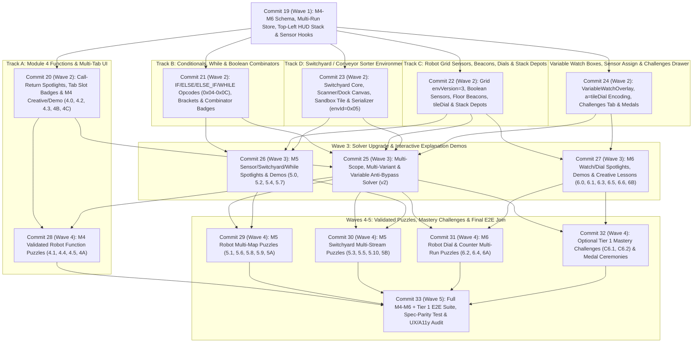

# Progressive Implementation Plan: Curriculum Modules 4–6 & Tier 1 Mastery Challenges

This document defines the progressive, commit-by-commit implementation plan as the direct follow-up to [`specs/curriculum_m1_m3_plan.md`](./curriculum_m1_m3_plan.md) (`Commits 1–18`), covering:
- [📚 Programming Curriculum (`docs/curriculum.md`)](../docs/curriculum.md) — focusing on **Module 4, Module 5, and Module 6** plus **Optional 🔥 Mastery Challenges Tier 1** (**33 activities total**: 31 core lessons/capstones + 2 Tier 1 Mastery Challenges)
- [🧒 Kid-Friendly UI Principles & Guidelines (`docs/ui_guidelines.md`)](../docs/ui_guidelines.md)
- [🛠️ Shared Language, Lesson Mechanics & Platform Requirements (`docs/platform_requirements.md`)](../docs/platform_requirements.md)
- [🚂 Switchyard / Conveyor Sorter Environment (`docs/env_switchyard.md`)](../docs/env_switchyard.md)
- [🤖 Robot Grid Planned Extensions (`docs/env_robot_extensions.md`)](../docs/env_robot_extensions.md)
- [🎵 Beat & Light Matrix Environment (`docs/env_beat_light.md`)](../docs/env_beat_light.md)
- [💾 Binary Serialization Format (`docs/binary_format.md`)](../docs/binary_format.md)

---

## 1. Engineering Principles & Commit Invariants

Every commit in this plan (`Commits 19–33`) MUST satisfy all six invariants inherited from `specs/curriculum_m1_m3_plan.md` plus the workspace UI contract in `docs/ui_guidelines.md` before merging/advancing:

1. **Standalone & Green CI:**
   - Compiles cleanly (`npm run build`) with zero TypeScript errors inside the standard sandbox (`BypassSandbox: false`).
   - Passes all unit tests (`npm run test:unit`, `BypassSandbox: false`) and Playwright E2E tests (`npm run test:e2e`, executed directly outside the sandbox with `BypassSandbox: true` per `AGENTS.md`).
2. **Always in a Working State:**
   - No half-wired buttons, dead modals, or broken existing features across **🤖 Robot Grid**, **🐢 Turtle LOGO**, **🎵 Beat & Light Matrix**, and **🚂 Switchyard** (Undo/Redo, Instant mode, QR Export/Import, Local Save/Load, Multi-Profile auto-saves, PWA update restore, and compact `360px`–`1920px+` layout).
3. **Humanly Testable:**
   - Every commit delivers a concrete, interactive capability in the live UI—never an invisible plumbing-only commit—accompanied by an explicit **"Human Verification"** checklist.
4. **Strict Save, Binary Compatibility & Same-Commit Spec Sync:**
   - Every existing Base64URL string (`envVersion = 1` classic Grid, `envVersion = 2` interactive Grid, v1 Generic, v1 Turtle, v1 Beat, `ENV_ID_LESSON = 0x04`, and multi-QR chunks), every existing `localStorage` entry (`robotemu_saved_programs`, `robotemu_profiles_v1`, `robotemu_lesson_autosave_v1`, `robotemu_curriculum_progress_v1`), and every PWA update snapshot (`robotemu_pending_update_state`) continues to load and run identically without data loss.
   - **Same-Commit `docs/binary_format.md` Sync:** `docs/binary_format.md` is kept continuously synchronized with live wire layouts (including the M1–M3 baseline: `VAR_ASSIGN`, `VAR_OP`, `PLACEHOLDER`, `MASK_HAS_VAR_PARAM`, Grid `envVersion = 2`, Beat `0x10..0x1D`, and `ENV_ID_LESSON = 0x04`). Every commit in this plan that introduces or activates a wire opcode, bitmask, environment ID, or `envVersion` (`C21`, `C22`, `C23`, `C24`) MUST update `docs/binary_format.md` in that **same commit**—never leaving intermediate commits with undocumented wire bytes—enforced by an automated spec-parity unit test in `C33`.
5. **Provably Constrained Validated Exercises (Anti-Bypass Gate):**
   - Every validated puzzle, puzzle capstone, and validated Mastery Challenge (**17 new validated exercises** in Modules 4–6 + Tier 1, bringing the automated suite to **31 verified puzzles**) MUST pass **Anti-Bypass Constraint Checks** within a **`< 200 ms` CI performance budget per puzzle** (`50 ms` diagnostic warning threshold), proving two facts:
     1. The reference solution (and any filled partial `?` scaffold) solves **all** configured map/stream variants within every per-tab and global slot/palette limit.
     2. **Attempting to solve the activity *without* applying the lesson's target concept** (e.g., unrolling in `Main` instead of calling `F1`/`F2`, omitting loops in `Main` or `F1`, hardcoding moves/switches across multi-variant runs without `If`/`Else`/`Else If`/`While`, omitting boolean combinators `NOT`/`AND`/`OR`, or hardcoding numbers instead of reading `tileDial` and stepping variables with `VAR_OP`) **yields zero valid solutions** within the lesson's palette and physical slot budget.
6. **Accessibility, Kid-Friendly Zero-Reading UX & Mandatory `docs/ui_guidelines.md` Contract:**
   - **5–7y Zero-Reading Rule:** Communicate through unmistakable icons, physical slot trays, color+shape memory boxes (`📦 a ●`), painted dock rules, and animated spotlights; keep educator prose inside collapsed **`📖 Parent / Teacher Tip`** disclosures (`aria-expanded="false"` by default) and never expose developer jargon or enum names in learner views.
   - **Strict Single-Row `<header>` Budget:** Never add world tabs, `VARS` bars, multi-run pips, or editor tools to `Toolbar.tsx`; maintain `header.scrollWidth <= header.clientWidth` from `360px` upward.
   - **Non-Overlapping `pane-simulation` HUD Slots:** Stack `BackpackHud` (`🎒` / `🎒 ×N`) and `VariableWatchOverlay` (`toolbar-variables`) inside the shared **Top-Left Stack** (`absolute top-3 left-3 flex flex-col items-start gap-1.5`), and render multi-map / multi-stream status pips (`[1 ✓] [2 ✗] [3 ·]`) inside the **Top-Center Pill** (`absolute top-3 left-1/2 -translate-x-1/2`).
   - **One Icon = One Meaning & 2-Tap Destructive Safety:** Structural closers (`LOOP_END`, `END_IF`, `END_WHILE`) use `CornerDownLeft` / closing-bracket glyphs (**never** `Undo2` or `RotateCcw`); preserve single smart 2-tap `btn-trash` and universal 1-tap Undo protection.
   - **Victory Celebration Multi-Run Spam Guards & Zustand v5 SSR:** `VictoryCelebrationModal` opens synchronously **only** when *all* variants in a multi-map/multi-stream run transition to `'SUCCESS'` (never on partial variant pass, `explanation` demos, `loadSolution()`, `importCode()`, or `undo()`/`redo()`), and all store-connected components follow the Zustand v5 SSR-safe read pattern (`useAppStore(); const { ... } = useAppStore.getState();`).
   - **Keyboard & Color-Blind Safety:** Logical `Tab` / `Enter` / `Space` / `Escape` navigation, `aria-live="polite"` status cues (variant pass/fail, dial read into box, challenge medal unlocked), and redundant shape+color coding (`● / ▲ / ■ / ◆`) on all beacons, keys/gates, Switchyard cargo, variable boxes, and conditional/loop brackets.

---

## 2. Scope Boundary: M1–M3 Baseline vs. Modules 4–6 vs. Modules 7–9

| Capability Area | M1–M3 Baseline (`Commits 1–18`) | Included in Modules 4–6 Plan (`Commits 19–33`) | Deferred to Modules 7–9 (Designed for Clean Extension) |
| :--- | :--- | :--- | :--- |
| **Curriculum Content** | **32 activities** in Modules 1–3 (`1.0`–`1C`, `2.1`–`2B`, `3.0`–`3C`) | **33 activities**: Module 4 (`4.0`–`4C`, 9), Module 5 (`5.0`–`5B`, 13), Module 6 (`6.0`–`6B`, 9) + **Tier 1 `🔥 Mastery Challenges`** (`C6.1`, `C6.2`, 2) | Modules 7–9 lessons/capstones (`7.0`–`9B`) & Tier 2–4 `🔥 Mastery Challenges` (`C7.1`–`C9.3`) |
| **Environments** | **🤖 Robot Grid** (`envVersion 1..2`), **🐢 Turtle LOGO**, **🎵 Beat & Light** (`Tier 1–3`) | **🚂 Switchyard / Conveyor Sorter** (`envId = 0x05`: 1–2 track switches, scanner gate, painted docks, scrap chute) + **🤖 Grid `envVersion = 3`** | Switchyard numeric weight/quota gauges (`itemWeight`, `dockQuota`, `dockCount`, balance beam in M7) |
| **Pedagogical Mechanics** | Staged palettes, Read-only maps, Physical slot trays, `?` Placeholders (`0..4`), Ghost-Step, 2-Tier Solutions, `📖 Explanation` tabs, Variation Cards, M1–M3 Anti-Bypass Solver | **Cross-env `📖 Explanation` tabs** (`6.0`), **Simultaneous Multi-Map / Multi-Stream Validation** (`[1 ✓] [2 ✗] [3 ·]`), **Visual Memory Watch Boxes** (`toolbar-variables`), `?` Hint Categories `5..8`, **Multi-Scope / Multi-Variant / Variable Anti-Bypass Solver** | Relational operator & `% /` spotlights (M7), Shape-socket plug spotlights (M8), **Call-Stack Recursion Visualizer** (M9) |
| **Language & Control Flow** | Sequences, `×N` badges, action params, `LOOP_START` / `LOOP_END`, sandbox `CALL_F1..F3`, sandbox `VAR_ASSIGN` / `VAR_OP` | Curriculum `F1..F3` decomposition & per-tab slot caps (*`F1..F2` in validated puzzles; `F3` intentionally creative-capstone-only in `4B`/`4C`*), **`IF` / `ELSE_IF` / `ELSE` / `END_IF`**, **`WHILE` / `END_WHILE`**, **Boolean combinators (`NOT`, `AND`, `OR`)**, world sensor assignments (`a = tileDial`) | Relational condition expressions (`<`, `>`, `==`, `%` inside `IF`/`WHILE`, M7), **Shape-socket function inputs `F1(●, ▲, ■)`** with local stack scope (M8), self-calls (M9) |
| **Robot Grid Extensions** | Ordered padlocks (`1 → 2 → Goal`), Keys/Gates, Planks/Water, Crates/Switches, 1-slot backpack | **Boolean sensors** (`pathAhead`, `pathLeft`, `pathRight`, `itemHere`, `carryingItem`, `atGoal`, `tileColor`), **Floor Beacons**, **Numbered Floor Dials (`tileDial`)**, **Stackable Supply Depots (`🎒 ×N`)** | `unvisitedAhead` footprint breadcrumb sensor, Relics, Tower-of-Hanoi sized energy rings (M9) |
| **Profiles, Saves & Rewards** | Avatar multi-profile, per-lesson auto-save, dual-path saves, version-mismatch modal, Module 1–3 Mastery Badges | **Module 4–6 Mastery Badges**, **Optional `🔥 Mastery Challenges` Drawer** (unlocked after M6, non-gating), **Tier 1 Challenge Medals** (`medal-c6-1`, `medal-c6-2`) included in Whole-Profile Backup | Module 7–9 Mastery Badges & Tier 2–4 `🔥 Challenge Medals` |

---

## 3. Save & Binary Compatibility Architecture

### 3.1 Binary Serialization Compatibility (`formatVersion = 1`)

All binary additions stay inside `FORMAT_VERSION = 1` without altering a single existing byte layout:

1. **Existing Opcodes & Envelopes Untouched:**
   - Universal opcodes `0x01..0x03` (`LOOP_START`, `LOOP_END`, `CALL_FN`) and `0x07..0x09` (`VAR_ASSIGN`, `VAR_OP`, `PLACEHOLDER`), Grid `0x10..0x15`, Turtle `0x10..0x1B`, Beat `0x10..0x1D`, and `ENV_ID_LESSON = 0x04` keep their exact byte representations.
2. **Conditional & Conditional-Loop Universal Opcodes (`0x04..0x06`, `0x0A..0x0C`):**
   - Activates already-reserved opcodes `OP_IF = 0x04`, `OP_ELSE = 0x05`, `OP_END_IF = 0x06` and assigns free universal opcodes `OP_ELSE_IF = 0x0A`, `OP_WHILE = 0x0B`, `OP_END_WHILE = 0x0C` (leaving `0x0D..0x0F` free for Modules 8–9).
   - `ELSE`, `END_IF`, and `END_WHILE` have zero parameter bytes (1 byte total per block).
   - `IF`, `ELSE_IF`, and `WHILE` are followed immediately by a compact recursive prefix-encoded **`ConditionExpr`** (`writeConditionExpr` / `readConditionExpr` in `src/engine/serialization/conditionSerializer.ts`):
     - **Grid Boolean Sensors (`0x01..0x08`):** `0x01` `pathAhead`, `0x02` `pathLeft`, `0x03` `pathRight`, `0x04` `itemHere`, `0x05` `carryingItem`, `0x06` `atGoal`, `0x07` `tileColor` (+ `colorIdx: uint8` for `0=red ●`, `1=blue ▲`, `2=green ■`, `3=amber ◆`), `0x08` `unvisitedAhead` (reserved M9).
     - **Switchyard Boolean Sensors (`0x10..0x13`):** `0x10` `hasNextItem`, `0x11` `itemDamaged`, `0x12` `itemColor` (+ `colorIdx: uint8`), `0x13` `itemIcon` (+ `iconIdx: uint8` for `0=crate`, `1=battery`, `2=gear`, `3=crystal`).
     - **Boolean Combinators (`0x20..0x22`):** `0x20` `NOT(innerExpr)`, `0x21` `AND(leftExpr, rightExpr)`, `0x22` `OR(leftExpr, rightExpr)`.
     - **Reserved Relational Comparison Tag (`0x30`):** Reserved for Module 7 numeric comparisons (`itemWeight > 10`, `count == dockQuota`, `count % 2 == 0`) so M7 requires zero opcode changes.
     - *Compactness:* `IF (itemHere)` = **2 bytes** (`[0x04, 0x04]`); `WHILE (NOT atGoal)` = **3 bytes** (`[0x0B, 0x20, 0x06]`); `IF (itemHere AND NOT carryingItem)` = **5 bytes** (`[0x04, 0x21, 0x04, 0x20, 0x05]`).
3. **Backward-Compatible Numeric Sensor Operands in `OP_VAR_ASSIGN (0x07)` & `OP_VAR_OP (0x08)` (`Byte 0` Header vs. Unconditional `Byte 1` `operandDescMask`):**
   - **Envelope Disambiguation (`docs/binary_format.md` §6.1 vs. §6.2):** Unlike standard opcodes (`§6.1`), where `Byte 0` (`blockHeaderByte`) sets `MASK_HAS_VAR_PARAM (0x80)` to gate an *optional* `Byte 1` (`paramVarMask`), `OP_VAR_ASSIGN (0x07)` and `OP_VAR_OP (0x08)` (`§6.2`) **never** set `HasVarParam` or `HasRep` (`Byte 0` is literally raw `0x07` or `0x08` with `bits 7..5 = 0`) and **always** emit an unconditional `Byte 1` operand descriptor byte (`operandDescMask`—historically named `paramVarMask` inside `codeSerializer.ts`, which `C24` renames to `operandDescMask` to prevent confusion with `§6.1`):
     ```
     OP_VAR_ASSIGN (0x07):
       Byte 0: 0x07 (blockHeaderByte — bits 7..5 MUST be 0; HasVarParam = 0, HasRep = 0)
       Byte 1: operandDescMask = [000 (b7..b5) | bIsSensor (b4: 0x10) | 00 (b3..b2) | typeB (b1..b0)]
       Byte 2: targetVarIdx (uint8: 0..25 for 'a'..'z')
       Byte 3+: sensorCode (uint8, when bIsSensor = 1 & typeB = 0) OR operandData(typeB)

     OP_VAR_OP (0x08):
       Byte 0: 0x08 (blockHeaderByte — bits 7..5 MUST be 0; HasVarParam = 0, HasRep = 0)
       Byte 1: operandDescMask = [00 (b7..b6) | cIsSensor (b5: 0x20) | bIsSensor (b4: 0x10) | typeC (b3..b2) | typeB (b1..b0)]
       Byte 2: targetVarIdx (uint8: 0..25 for 'a'..'z')
       Byte 3: opByte (uint8: 0x00..0x0C)
       Byte 4+: operandB (sensorCode: uint8 if bIsSensor = 1 else operandData(typeB)), then operandC
     ```
   - Existing M1–M3 `VAR_ASSIGN` writes `operandDescMask` using only bits `1..0` (`typeB`), and `VAR_OP` uses only bits `3..0` (`typeB` + `typeC << 2`); bits `7..4` are `0` in 100% of existing saves.
   - Setting **`MASK_OPERAND_B_SENSOR = 0x10`** (bit 4 of `operandDescMask`) marks operand `b` as a 1-byte **Numeric Sensor Readout** (`sensorCode: uint8`), and **`MASK_OPERAND_C_SENSOR = 0x20`** (bit 5 of `operandDescMask`) marks operand `c` in `VAR_OP` as a 1-byte sensor readout:
     - `0x01` = `tileDial` (Module 6 Robot floor dial integer `1..20`, `0` if none).
     - `0x10` = `itemWeight`, `0x11` = `dockQuota`, `0x12` = `dockCount` (reserved for Module 7 Switchyard).
   - Every existing `VAR_ASSIGN` and `VAR_OP` save has `(operandDescMask & 0x30) === 0` and round-trips byte-for-byte identically, while `a = tileDial` encodes cleanly in **4 bytes** (`[0x07, 0x10, varIdx, 0x01]`).
4. **Backward-Compatible Grid `envVersion = 3` (`1` vs. `2` vs. `3`):**
   - Classic maps still emit `envVersion = 1`; maps using only M2 elements (`waterCells`, `lockedGates`, `floorSwitches`, single `worldItems`) still emit **`envVersion = 2`** (preserving byte-for-byte compatibility with `tests/worldItemsAndGridV2.test.ts`).
   - Maps using Module 5–6 extensions (`beaconTiles`, `dialTiles`, stackable depot items with `count > 1`, or validation flags `requireAllItemsCollected` / `requireEmptyBackpackAtGoal` / `strictInteractionCollision`) emit **`envVersion = 3`**: `writeGridState` writes the exact `envVersion = 2` prefix first, followed by a `gridRulesMask: uint8` byte, `beaconTiles` VLE table, `dialTiles` VLE table, and optional item stack-count overrides. `readGridState(reader, envVersion)` reads v3 extensions only when `envVersion >= 3`.
5. **New `🚂 Switchyard` Environment (`ENV_ID_SWITCHYARD = 0x05`, `ENV_VERSION_SWITCHYARD = 1`):**
   - Assigned `0x05` (since `0x04` is `ENV_ID_LESSON`).
   - Switchyard action opcodes `0x10..0x13`:
     - `0x10` `SWITCH_LEFT` (`junctionId: uint8` — `0 = Switch A`, `1 = Switch B`)
     - `0x11` `SWITCH_RIGHT` (`junctionId: uint8` — `0 = Switch A`, `1 = Switch B`)
     - `0x12` `SEND_NEXT` (supports `HasRep` + `MASK_HAS_VAR_PARAM` for `×N` and variable counts)
     - `0x13` `SCRAP_ITEM` (no params)
   - **Dual-Path Curriculum & Sandbox Support:**
     - In Sandbox exports (`ENV_ID_SWITCHYARD = 0x05`, `envVersion = 1`), byte 3 begins with `hasLayout: uint8` (`1` = compact VLE Switchyard stream/switch/dock layout followed by `writeCodeScopes`; `0` = code-only Switchyard scopes for Path A `SavedProgramEntry`).
     - In standalone Curriculum Lesson QR/strings (`ENV_ID_LESSON = 0x04`), `innerEnvByte = 0x05` wraps Switchyard lesson attempts identically to Grid (`0x00`), Turtle (`0x02`), and Beat (`0x03`).
6. **Activation of `?` Placeholder Hint Categories `5..8`:**
   - `OP_PLACEHOLDER = 0x09` already encodes `hintCategory` `0..10` in `serialization/types.ts`. Modules 4–6 activate runtime palette highlighting and replacement matching in `placeholderHelpers.ts` for `5 = 'function'`, `6 = 'conditional'`, `7 = 'sensor'`, and `8 = 'variable'`.

### 3.2 Local Storage, Multi-Profile, Lesson Versioning & Challenge Medals Strategy

- **Unambiguous Mastery Challenge IDs (`'C6.1'`, `'C6.2'`):**
  - Module 6 contains Lesson `'6.1'` (*LOGO Constants*) and Lesson `'6.2'` (*Reading a Dial*). Optional Tier 1 Mastery Challenges use canonical IDs **`'C6.1'`** and **`'C6.2'`** (`format: 'challenge'`, `challengeTier: 1`, `unlockAfterModuleId: 'module-6'`) so auto-saves, manual slots, completion records, and `ENV_ID_LESSON = 0x04` share strings never collide with `'6.1'` or `'6.2'`.
- **Non-Gating Optional Challenges Drawer & Collectible Medals (`robotemu_curriculum_progress_v1`):**
  - Extends `ProfileCurriculumProgress` backwards-compatibly with `earnedMedals: string[]` (defaulting to `[]` when reading existing v1 profiles) and includes `earnedMedals` in Whole-Profile JSON/QR Export & Import (`profileService.ts`).
  - Completing Module 6 (`6A` & `6B`) awards `badge-module-6` and unlocks Tier 1 in the **🔥 Challenges** tab of `LessonPickerModal` (while also supporting teacher/dev preview unlock) without ever blocking progression to Modules 7–9.
  - Completing `C6.1` or `C6.2` awards `medal-c6-1` / `medal-c6-2` with the grand celebration showcase.
- **Physical Slot Tray Convention on Structural Closers (Aligned with `docs/curriculum.md`):**
  - Every `CodeBlock` card placed in `workspace[scope]`—including closing bracket cards (`LOOP_END`, `END_IF`, `END_WHILE`) and `ELSE` / `ELSE_IF`—continues to occupy **1 physical slot** in `WorkspaceCanvas` (`1 visual card = 1 [■] slot`) so young learners never see a mismatch between visible cards and tray slots. `docs/curriculum.md` (`§3` guardrails and Module 5 `5.1`, `5.3`, `5.5`, `5.10`, `5A`, `5B`) and the activity `slotCap` budgets in §4.3 and §7 are batch-aligned to these exact physical card counts while keeping every single-tab program compact and scroll-free on tablets.
- **Dual-Cap Slot Budgets (`perScope` + `maxTotal`) & Capstone `4A` Guardrail Relationship:**
  - `docs/curriculum.md` §3 specifies `8–14` total workspace cards and `≤ 8` cards in any single tab for validated puzzle capstones.
  - On Capstone `4A` (*Modular Station Repair*), `slotCap` sets `{ perScope: { MAIN: 5, F1: 5, F2: 5 }, maxTotal: 14 }`: each individual scope tab is tightened below the `≤ 8` single-tab guardrail to a physical **5-slot tray** (`≤ 5` cards/tab, preventing unrolled workarounds in any one tab), while `maxTotal: 14` simultaneously enforces the §3 global `≤ 14` capstone ceiling across all tabs (`5 + 5 + 5 = 15` raw tray slots clamped to `14` globally via `computeSlotBudget`'s `remainingForScope = Math.min(remByScope, remByTotal)` in `src/utils/curriculumStagePolicy.ts`—so if two tabs use `5 + 5 = 10` cards, the third tab dynamically caps at `4` cards).

---

## 4. Automated Anti-Bypass Constraint Solver Design (Modules 4–6)

To uphold Principle #3 (*"Constraint-Driven Discovery — No Brute Force"*) across multi-tab functions, adaptive multi-run conditionals, and stepping variables, `src/engine/verification/constraintSolver.ts` is extended with three fast, exact verification strategies while maintaining the strict **`< 200 ms` per-puzzle CI performance gate**.

### 4.1 Solver Algorithms & Performance CI Gate (`constraintSolver.ts` v2)

1. **Multi-Scope Function Decomposition Search (Module 4):**
   - Validates `referenceSolution` and filled `?` scaffolds across all active scopes (`MAIN`, `F1`, `F2`, `F3`) against both `slotCap.perScope` and `slotCap.maxTotal`.
   - For `forbidBlocks: ['CALL_F1']` / `['CALL_F2']`, restricts candidate generation to the remaining scopes within their tight `perScope` tray limits (e.g., `MAIN <= 5` slots on `4A`, `MAIN <= 4` slots on `4.4`). Memoizes deterministic helper transitions `state -> nextState | COLLISION | SUCCESS` so proving multi-wing puzzles unsolvable without `F1` or `F2` finishes in **`< 10 ms`**.
2. **Joint Multi-Variant Product-State BFS & Conditional/Loop Pruning (Module 5 Grid & Switchyard):**
   - Generalizes `SolverOptions` over `SimulationEnvironment<TState>` (`gridSimulationEnvironment` and `switchyardSimulationEnvironment`) across a variant vector `[V_1, V_2, ..., V_k]` (`k = 3..4`).
   - A candidate bypass program (e.g., `forbidBlocks: ['IF', 'ELSE', 'ELSE_IF', 'END_IF']` or `forbidBlocks: ['WHILE', 'END_WHILE']`) executes simultaneously over the product state `(s_1, s_2, ..., s_k)`.
   - **Early Joint Pruning:** The instant *any* single variant `V_i` collides (hits a wall on a shorter hall, routes a Red car into a Blue dock, scrap-misses a cracked car, or triggers `strictInteractionCollision` by calling `PICK_UP` on an empty tile or full backpack), that entire search branch is pruned immediately across all `k` variants—completing in **`< 15 ms`**.
   - For `forbidCombinators` (`5.9`) and `forbidBlocks: ['ELSE']` / `['ELSE_IF']` (`5.5`, `5.6`, `5.10`), enumerates bounded conditional AST templates (`slotCost` exact-matched to `slotCap`) over atomic sensors only and proves **0 winning programs** pass all `k` variants.
3. **Variable-Free, Arithmetic-Free & Sensor-Readout Impossibility Proofs (Module 6 & `C6.1`):**
   - `allowVariables: false` (`forbidBlocks: ['VAR_ASSIGN', 'VAR_OP']`) proves no fixed constant repeat/loop program (`×2..×9`) passes all 3 dial/warehouse variants (`6.2`, `6.4`, `6A`, `C6.1`).
   - `forbidBlocks: ['VAR_OP']` allows `VAR_ASSIGN` (`a = const` and `a = tileDial`) while forbidding arithmetic updates (`+`, `-`, `*`), proving stepping counters (`a = a + 1` in `6.4`, `c = c + 1` in `6A`) and multi-dial expressions (`a + b`, `b * 2` in `C6.1`) are strictly required.
   - `forbidSensors: ['tileDial']` allows variables and `VAR_OP` with constants while replacing `tileDial` reads, proving `6.2`, `6.4`, and `C6.1` cannot be solved without reading the world floor dials.

### 4.2 Extended Anti-Bypass Rule Types (`AntiBypassRule`)

In addition to all M1–M3 fields (`forbidBlocks`, `allowRepeatBadges`, `maxLoopNestingDepth`, `pureSingleLoopOnly`, `maxActionExecutions`, `unmodifiedStarterMustFail`, `directToGoalMustFailLock`), `AntiBypassRule` adds:
- `allowVariables?: boolean` — when `false`, forbids variable badges (`a..z`) on action/loop `repeatCount` and params alongside `VAR_ASSIGN` / `VAR_OP`.
- `forbidCombinators?: ('NOT' | 'AND' | 'OR')[]` — restricts `IF` / `ELSE_IF` / `WHILE` conditions to omit the specified boolean combinators.
- `forbidSensors?: string[]` — forbids specific boolean or numeric world sensors (e.g., `['tileDial']`, `['tileColor']`, `['itemDamaged']`).
- `maxLoopNestingDepthPerScope?: Partial<Record<ScopeType, number>>` — e.g., `{ MAIN: 0 }` or `{ F1: 0 }` on `4.4` to prove *both* `Main` and `F1` must use loops rather than unrolling either scope.
- `singleVariantBypassMustExist?: boolean` — optional sanity assertion for Module 5–6 multi-run puzzles verifying that at least 1 individual variant *could* be beaten by a hardcoded sequence, proving that **multi-variant validation** is genuinely doing work!

### 4.3 Module 4–6 & Tier 1 Anti-Bypass Verification Matrix (All 17 Validated Puzzles)

| ID | Target Concept | Variants | Physical Slot Cap | Automated Anti-Bypass Proofs Enforced in `npm run test:unit` |
| :--- | :--- | :---: | :---: | :--- |
| **`4.1`** | Define & Call Helper `F1` (non-adjacent maneuvers) | `1` | `Main: 6`, `F1: 4` (`≤ 9` total) | • `forbidBlocks: ['CALL_F1']` (`Main ≤ 6` slots) → **0 solutions** *(unrolled maneuver needs ≥ 11 slots; uneven gaps defeat a single loop)* |
| **`4.4`** | Functions + Loops Together (`Loop` in `Main` & `F1`) | `1` | `Main: 4`, `F1: 4` (`≤ 8` total) | • `forbidBlocks: ['CALL_F1']` (`Main ≤ 4` slots) → **0 solutions**<br>• `maxLoopNestingDepthPerScope: { MAIN: 0 }` → **0 solutions**<br>• `maxLoopNestingDepthPerScope: { F1: 0 }` → **0 solutions** |
| **`4.5`** | Layered Composition (`Main → F1 → F2`) | `1` | `Main: 4`, `F1: 4`, `F2: 3` (`≤ 10` total) | • `forbidBlocks: ['CALL_F1']` → **0 solutions**<br>• `forbidBlocks: ['CALL_F2']` (`Main + F1` only) → **0 solutions** |
| **`4A`** | *Modular Station Repair* (Multi-wing `Main + F1 + F2`) | `1` | `Main: 5`, `F1: 5`, `F2: 5` (`≤ 14` total) | • `forbidBlocks: ['CALL_F1']` → **0 solutions**<br>• `forbidBlocks: ['CALL_F2']` → **0 solutions**<br>• `maxLoopNestingDepth: 0` → **0 solutions** |
| **`5.1`** | Sensing & Simple `If (itemHere)` | `3` maps | `6` | • `forbidBlocks: ['IF', 'END_IF']` → **0 solutions** across 3 halls *(skipping `PICK_UP` fails `requireAllItemsCollected`; blind `PICK_UP` fails `strictInteractionCollision` on empty tiles)*<br>• `singleVariantBypassMustExist: true` |
| **`5.3`** | Switchyard Warmup — `If (itemDamaged) { Scrap }` | `3` streams | `6` | • `forbidBlocks: ['IF', 'END_IF']` → **0 solutions** *(sending damaged car to dock collides; scrapping intact car misses dock target)*<br>• `forbidBlocks: ['SCRAP_ITEM']` → **0 solutions** |
| **`5.5`** | Binary `If / Else` Sorting (`Red` vs. `Blue`) | `3` streams | `8` | • `forbidBlocks: ['IF', 'ELSE', 'END_IF']` → **0 solutions** across 3 randomized Red/Blue queues<br>• `forbidBlocks: ['ELSE']` (`≤ 8` slots) → **0 solutions** |
| **`5.6`** | Spatial `If / Else` (`tileColor`, `pathLeft`, `pathRight`) | `3` maps | `7` | • `forbidBlocks: ['IF', 'ELSE', 'END_IF']` → **0 solutions** across 3 beacon/junction maps<br>• `forbidBlocks: ['ELSE']` (`≤ 7` slots) → **0 solutions** |
| **`5.8`** | Conditional Loops (`While (pathAhead)`) | `3` maps | `6` | • `forbidBlocks: ['WHILE', 'END_WHILE']` (with `Loop 2..9` & `×2..×9` enabled, `≤ 6` slots) → **0 solutions** across 3 different-sized tunnels! |
| **`5.9`** | Boolean Combinators (`NOT`, `AND`, `OR`) | `3` maps | `7` | • `forbidBlocks: ['IF', 'END_IF']` → **0 solutions**<br>• `forbidCombinators: ['AND', 'NOT', 'OR']` (`≤ 7` slots) → **0 solutions** *(atomic `If (itemHere)` collides on 2nd item when backpack is full!)* |
| **`5.10`** | Chained Multi-Way Routing (`If / Else If / Else`) | `3` streams | `11` | • `forbidBlocks: ['IF', 'ELSE_IF', 'ELSE', 'END_IF']` → **0 solutions**<br>• `forbidBlocks: ['ELSE_IF']` (`≤ 11` slots) → **0 solutions** *(nested `If` inside `Else` requires an extra `END_IF` slot, overflowing `11` slots!)* |
| **`5A`** | *Autonomous Maze Rover* (4 Simultaneous Mazes) | `4` mazes | `Main: 8`, `F1: 6` (`≤ 12` total) | • `forbidBlocks: ['WHILE', 'END_WHILE']` → **0 solutions**<br>• `forbidBlocks: ['IF', 'ELSE', 'ELSE_IF', 'END_IF']` → **0 solutions** across all 4 mazes |
| **`5B`** | *Hazard & Priority Router* (Damaged + 3 Cargo Colors) | `4` streams | `Main: 8`, `F1: 6` (`≤ 13` total) | • `forbidBlocks: ['SCRAP_ITEM']` → **0 solutions**<br>• `forbidBlocks: ['IF', 'ELSE_IF', 'ELSE', 'END_IF']` → **0 solutions** across all 4 streams |
| **`6.2`** | Reading & Recalling a Dial Value (`a = tileDial`) | `3` maps | `6` | • `allowVariables: false` → **0 solutions** across 3 dial variants (`a ∈ {2, 3, 4}`)<br>• `forbidSensors: ['tileDial']` → **0 solutions** |
| **`6.4`** | Stepping Counters & Staircases (`a = a + 1`) | `3` maps | `7` | • `allowVariables: false` (`≤ 7` slots) → **0 solutions**<br>• `forbidBlocks: ['VAR_OP']` (`≤ 7` slots) → **0 solutions** *(proves `a = a + 1` stepping is mandatory!)* |
| **`6A`** | *Inventory Quartermaster* (Count `c`, Fetch `×c`, Install) | `3` maps | `Main: 8`, `F1: 6` (`≤ 13` total) | • `allowVariables: false` → **0 solutions** *(hardcoding `Pick Up ×4` leaves leftover cells at Goal on `<4`-node variants, failing `requireEmptyBackpackAtGoal`!)*<br>• `forbidBlocks: ['VAR_OP']` → **0 solutions** |
| **`C6.1`** | *Multi-Dial Vault Combination* (`a + b`, `b * 2`) | `3` maps | `Main: 8`, `F1: 8`, `F2: 8` (`≤ 18` total) | • `allowVariables: false` → **0 solutions**<br>• `forbidBlocks: ['VAR_OP']` → **0 solutions**<br>• `forbidSensors: ['tileDial']` → **0 solutions** |

### 4.4 Author Workflow When a Multi-Scope or Multi-Variant Check Fails

1. **Inspect the Counterexample:** `curriculumConstraintCheck.test.ts` (and the `/?dev=1` Solution Modal **🛡️ Constraint Proofs** inspector) prints the exact offending `WorkspaceState` and which variant(s) `[1..k]` it beat.
2. **Tighten Variant Diversity or Per-Scope Budget:** Add or adjust 1 variant layout/stream so no single constant path/switch sequence aligns across all `k` variants, enable `strictInteractionCollision` / `requireAllItemsCollected` / `requireEmptyBackpackAtGoal`, or tighten `slotCap.perScope` so unrolled workarounds overflow the tray while the target abstraction fits cleanly.
3. **Re-Verify (`< 200 ms`):** Re-run `npx vitest run tests/curriculumConstraintCheck.test.ts` until **0 bypasses** exist and all reference + `?` scaffold checks pass.
4. **Post-Release Versioning Rule:** Any change to an already-shipped activity's map, variants, or slot budget MUST preserve the prior definition in `historicalVersions[oldVersion]` and increment `activity.version`.

---

## 5. Concurrency Plan & Parallel Worktracks

**Commit 19 (Wave 1)** establishes the shared M4–M6 curriculum/multi-variant schema, non-overlapping `<SimulationTopLeftHud />` & `<MultiRunPipsBar />` containers, `<GridOverlayLayer />` `beaconAndDialSlot`, and optional `SimulationEnvironment` sensor hooks so the remaining **14 commits (`C20`–`C33`)** fan out cleanly across **5 parallel tracks** in **5 waves** without merge bottlenecks.

### 5.1 Parallel Dependency Graph (DAG)

*(Every edge below matches the exact `Depends On` list in §6; transitive `C19` edges through Wave 2 parents are omitted for clarity.)*



### 5.2 Wave-by-Wave Concurrent Execution Schedule

| Wave | Commits Runnable in Parallel | File-Ownership & Conflict Prevention Summary |
| :---: | :--- | :--- |
| **Wave 1** | **`C19`** *(Foundation)* | Establishes M4–M6 `CurriculumModule`s & `MASTERY_CHALLENGE_TIERS`, multi-variant runner state in `useAppStore.ts`, `<SimulationTopLeftHud />`, `<MultiRunPipsBar />`, `beaconAndDialSlot` in `<GridOverlayLayer />`, reserved opcode/mask constants in `serialization/types.ts`, and `evaluateSensor` / `readNumericSensor` interfaces in `simulation/types.ts`. |
| **Wave 2** | **`C20`** + **`C21`** + **`C22`** + **`C23`** + **`C24`** *(5-way parallel!)* | • `C20`: Scope tab slot pills, `call-stack-jump` spotlight, `module4CreativeAndDemo.ts` (`4.0`, `4.2`, `4.3`, `4B`, `4C`)<br>• `C21`: `conditionSerializer.ts`, `ConditionBadge.tsx`, `IF/ELSE/ELSE_IF/WHILE` in `interpreter.ts` & `WorkspaceCanvas.tsx` + `docs/binary_format.md` (§7.1)<br>• `C22`: `src/simulations/grid/sensors.ts`, `BeaconAndDialLayer.tsx`, `physics.ts`, `gridSerializer.ts` (`envVersion = 3`) + `docs/binary_format.md` (§4.3) — **zero shared serializer/interpreter edits!**<br>• `C23`: `src/simulations/switchyard/*`, `switchyardSerializer.ts` (`0x05`), 4th Sandbox World Tile + `docs/binary_format.md` (§2/§4.4/§7.5)<br>• `C24`: `VariableWatchOverlay.tsx` (`toolbar-variables`), `VAR_ASSIGN`/`VAR_OP` `operandDescMask` sensor bits, `LessonPickerModal` Challenges drawer & medals + `docs/binary_format.md` (§6.2) |
| **Wave 3** | **`C25`** + **`C26`** + **`C27`** *(3-way parallel!)* | • `C25`: `src/engine/verification/constraintSolver.ts` v2, `tests/curriculumConstraintCheck.test.ts`, `SolutionModal.tsx` (`?dev=1` multi-variant report)<br>• `C26`: M5 spotlights (`sensor-beam`, `branch-skip`) + `module5Demos.ts` (`5.0`, `5.2`, `5.4`, `5.7`)<br>• `C27`: Cross-env tab switching in `ExplanationDemoBar.tsx`, M6 spotlights (`dial-read`, `variable-watch`) + `module6CreativeAndDemo.ts` (`6.0`, `6.1`, `6.3`, `6.5`, `6.6`, `6B`) |
| **Wave 4** | **`C28`** + **`C29`** + **`C30`** + **`C31`** + **`C32`** *(5-way parallel!)* | Disjoint curriculum slice files, all verified automatically by `C25`:<br>• `C28`: `module4Robot.ts` (`4.1`, `4.4`, `4.5`, `4A`)<br>• `C29`: `module5Robot.ts` (`5.1`, `5.6`, `5.8`, `5.9`, `5A`)<br>• `C30`: `module5Switchyard.ts` (`5.3`, `5.5`, `5.10`, `5B`)<br>• `C31`: `module6Robot.ts` (`6.2`, `6.4`, `6A`)<br>• `C32`: `masteryTier1.ts` (`C6.1`, `C6.2`) |
| **Wave 5** | **`C33`** *(Final Join)* | Aggregates all 33 new activities in `src/data/curriculum/index.ts` (if not incrementally spread), adds automated `tests/binaryFormatSpecSync.test.ts`, and runs `e2e/curriculumM4M6.spec.ts` + full save/anti-bypass/HUD/accessibility regression suite. |

### 5.3 File-Isolation Rules & Shared-Component Merge Protocol

1. **HUD & Canvas Slot Isolation (Eliminating `GridCanvas.tsx` & `App.tsx` Conflicts):**
   - **Commit 19** mounts `<SimulationTopLeftHud />` (`absolute top-3 left-3`) and `<MultiRunPipsBar />` (`absolute top-3 left-1/2 -translate-x-1/2`) cleanly inside `pane-simulation`, and adds `beaconAndDialSlot` inside `GridOverlayLayer.tsx`.
   - `C22` (`BeaconAndDialLayer.tsx` + `BackpackHud` stack count) and `C24` (`VariableWatchOverlay.tsx`) drop into isolated child components without colliding on `GridCanvas.tsx`.
2. **Wave 2 Shared Wiring & `docs/binary_format.md` Merge Order:**
   - `C22` is 100% isolated from `codeSerializer.ts` and `interpreter.ts` (touching only `src/simulations/grid/`, `gridSerializer.ts`, and `docs/binary_format.md` §4.3).
   - Each Wave 2 wire-format commit updates a disjoint section of `docs/binary_format.md` in the same commit (`C21`: §7.1, `C22`: §4.3, `C23`: §2/§4.4/§7.5, `C24`: §6.2); merge Wave 2 branches in order **`C20 → C21 → C22 → C23 → C24`** for conflict-free integration across `codeSerializer.ts`, `interpreter.ts`, `BlockPalette.tsx`, `BlockSubpalette.tsx`, and `docs/binary_format.md`.
3. **Wave 3 `ExplanationDemoBar.tsx` / `DemoSpotlightOverlay.tsx` Ownership:**
   - If `C26` (M5 sensor/branch spotlights) and `C27` (M6 cross-env demo tabs + dial/watch spotlights) run concurrently, keep spotlight renderers in separate components (`SensorAndBranchSpotlight.tsx` in `C26`, `VariableAndDialSpotlight.tsx` in `C27`) and merge **`C26 → C27`**.
4. **One File per Curriculum Slice:**
   - Keep `module4CreativeAndDemo.ts`, `module4Robot.ts`, `module5Demos.ts`, `module5Robot.ts`, `module5Switchyard.ts`, `module6CreativeAndDemo.ts`, `module6Robot.ts`, and `masteryTier1.ts` in separate files spread into `CURRICULUM_ACTIVITIES` in canonical order (`4.0`..`4C`, `5.0`..`5B`, `6.0`..`6B`, `C6.1`..`C6.2`).
   - Static `badgeId` / `capstoneIds` for Modules 4–6 and `unlockAfterModuleId: 'module-6'` for Tier 1 Challenges are declared in `C19`, decoupling `C24` (Challenges UI) from `C31` (`6A` Capstone) and `C32` (`C6.1`/`C6.2` authoring).

---

## 6. Detailed Commit-by-Commit Breakdown

### Commit 19: Modules 4–6 Schema, Multi-Variant Runner Contract, Non-Overlapping HUD Containers & Sensor Hooks
- **Wave:** 1 (Foundation) · **Depends On:** M1–M3 Baseline (`C1`–`C18`) · **Unlocks:** `C20`, `C21`, `C22`, `C23`, `C24`
- **Goal:** Establish shared types, static Module 4–6 + Tier 1 Challenge catalog metadata, multi-variant store execution & `VictoryCelebrationModal` guards, non-overlapping `pane-simulation` HUD slots (`docs/ui_guidelines.md` §3), and reserved opcode/sensor interfaces so all five Wave 2 tracks run in parallel.
- **Changes:**
  - **[MODIFY] `src/data/curriculum/types.ts` & `src/data/curriculum/index.ts`**:
    - Add static `CURRICULUM_MODULES` entries for `module-4` (*Function Composer* `🧩`), `module-5` (*Sensor Navigator* `📡`), and `module-6` (*Memory Master* `📦`), plus `MASTERY_CHALLENGE_TIERS` (`tier-1`: `unlockAfterModuleId: 'module-6'`, `challengeIds: ['C6.1', 'C6.2']`).
    - Extend `ActivityVersionPayload` & `ExplanationDemoTab` with `gridVariants?: CurriculumGridDefinition[]`, `switchyard?: CurriculumSwitchyardDefinition`, `switchyardVariants?: CurriculumSwitchyardDefinition[]`, cross-env `ExplanationDemoTab.simId`, `ConditionExpr` AST types, and extended `AntiBypassRule` fields (§4.2).
  - **[MODIFY] `src/engine/simulation/types.ts` & `src/engine/serialization/types.ts`**:
    - Add optional `evaluateSensor?(sensor, state, params): boolean` and `readNumericSensor?(sensor, state, params): number` hooks on `SimulationEnvironment<TState>`.
    - Declare `OP_ELSE_IF = 0x0A`, `OP_WHILE = 0x0B`, `OP_END_WHILE = 0x0C`, `ENV_ID_SWITCHYARD = 0x05`, `ENV_VERSION_GRID_V3 = 3`, `MASK_OPERAND_B_SENSOR = 0x10`, and `MASK_OPERAND_C_SENSOR = 0x20`.
  - **[NEW] `src/components/SimulationTopLeftHud.tsx` & `src/components/MultiRunPipsBar.tsx`** + **[MODIFY] `GridOverlayLayer.tsx`, `GridCanvas.tsx`, `App.tsx`, `useAppStore.ts`**:
    - Mount `<SimulationTopLeftHud />` (`absolute top-3 left-3 flex flex-col items-start gap-1.5`) hosting `BackpackHud` and a slot for `VariableWatchOverlay` (`C24`), and mount `<MultiRunPipsBar />` (`absolute top-3 left-1/2 -translate-x-1/2`) displaying interactive `[1 ✓] [2 ✗] [3 ·]` pips whenever an activity defines multiple variants.
    - Add `beaconAndDialSlot` to `<GridOverlayLayer />`.
    - Wire multi-variant synchronized execution in `useAppStore.ts` (`variantRuns`, `focusedVariantIndex`, `setFocusedVariantIndex`): `VictoryCelebrationModal` triggers **if and only if** all variants reach `'SUCCESS'` on an active user run/edit.
- **Save & Test Compatibility:** Single-map M1–M3 activities run identically with zero visual pips (`variants.length <= 1`); all existing unit & E2E suites stay green.
- **Human Verification:**
  1. Open `LessonPickerModal` (`🎓 Learn`) and verify Modules 4, 5, and 6 appear cleanly in the roadmap with their static badge icons.
  2. Verify `<header>` stays strictly single-row (`360px`–`1920px+`) and `BackpackHud` renders cleanly inside `<SimulationTopLeftHud />` with zero canvas collisions.
  3. Test keyboard focus and `aria-live` status announcements on `<MultiRunPipsBar />` using a multi-variant unit/dev fixture.

---

### Commit 20: Multi-Tab Slot Badges, Call-Return Spotlights, Hint Category `5` & Module 4 Creative/Demo Activities (`4.0`, `4.2`, `4.3`, `4B`, `4C`)
- **Wave:** 2 · **Depends On:** `C19` · **Concurrent With:** `C21`, `C22`, `C23`, `C24`
- **Goal:** Make multi-tab helper functions (`Main`, `F1`, `F2`, `F3`) effortless for non-readers to follow and budget, and ship Module 4's interactive explanation demo plus all LOGO & Beat creative composition activities.
- **Changes:**
  - **[MODIFY] `src/components/BlockPalette.tsx`, `WorkspaceCanvas.tsx`, `src/engine/placeholderHelpers.ts`**:
    - Display compact visual per-tab slot pills (`e.g. 2/5`) on `[Main]`, `[1]`, `[2]`, `[3]` scope tabs whenever `slotCap.perScope` is configured, and auto-switch/highlight the active tab during stepped playback when execution enters `F1`..`F3` and returns to `Main` (in non-instant speeds).
    - Activate `PlaceholderHintCategory = 'function'` (`5`) so `?` function placeholders highlight `CALL_F1..F3` in the palette.
    - Align `LOOP_END` icon in `BlockPalette.tsx` / `BlockItem.tsx` to `CornerDownLeft` closing-bracket family per `docs/ui_guidelines.md` §4 (keeping `Undo2` strictly for top-bar `btn-undo`).
  - **[MODIFY] `src/components/ExplanationDemoBar.tsx`**: Add `call-stack-jump` visual spotlight badge animating `Main → F1 → Main` call/return transitions.
  - **[NEW] `src/data/curriculum/module4CreativeAndDemo.ts`**:
    - `4.0` [📖 🤖 Demo]: *Jumping to `F1` and Returning* (2 runnable stepped tabs tracing `Call F1` jump and return).
    - `4.2` [🐢 Sandbox]: *Shape Stamps & State Hygiene* (`F1` star stamp restoring heading/pen + 3 illustrated variations: 4-window house, 3 pine trees, Big Dipper).
    - `4.3` [🎵 Sandbox]: *Chorus & Verse Composition (`F1`, `F2`)* (starter `F1, F1, F2, F1` + 3 playable variations: `A–B–A–B` dance track, 4-frame sprite animation, call-and-response melody).
    - `4B` [🎨 🐢 Capstone]: *Castle Architect* (`F1` Tower, `F2` Wall, `F3` Flag + 3 illustrated variations: city skyline, sailboat fleet, flower garden).
    - `4C` [🎨 🎵 Capstone]: *Full Song Choreography* (`F1` Intro, `F2` Verse, `F3` Chorus + 3 playable variations: chiptune boss theme, fireworks finale, pixel story).
    - *(Intentional `F3` Staging Note: In Module 4, 4-tab scope access `['MAIN', 'F1', 'F2', 'F3']` is intentionally reserved for unbounded creative capstones `4B` and `4C` where learners compose 3 named artistic/musical sections, whereas validated Robot puzzles `4.1`–`4.5` and `4A` cap at `['MAIN', 'F1', 'F2']` to prevent 4-tab cognitive/scrolling overhead during constrained puzzle solving.)*
- **Save & Test Compatibility:** Uses existing `SCOPE_ID_F1..F3` (`0x81..0x83`) and `OP_CALL_FN` (`0x03`).
- **Human Verification:**
  1. Step through Lesson `4.0` at `1×` speed and watch execution jump visibly from `Call F1` into tab `1`, run `F1`, and resume at the next block in `Main`.
  2. Explore `4.2`, `4.3`, `4B`, and `4C`, testing `VariationCardsPanel` SVG thumbnails (`4.2`, `4B`) and in-card `▶` audio/LED previews (`4.3`, `4C`) plus 1-tap Undo after **Load Code**.

---

### Commit 21: Conditional & `While` Control Blocks (`IF`, `ELSE_IF`, `ELSE`, `END_IF`, `WHILE`, `END_WHILE`), Boolean Combinators & Binary Serialization
- **Wave:** 2 · **Depends On:** `C19` · **Concurrent With:** `C20`, `C22`, `C23`, `C24`
- **Goal:** Implement universal structured branching and conditional loops (`0x04..0x06`, `0x0A..0x0C`) with color-blind safe visual brackets, zero-reading sensor/combinator badges (`NOT`, `AND`, `OR`), structural block validation, and same-commit `docs/binary_format.md` updates.
- **Changes:**
  - **[NEW] `src/engine/serialization/conditionSerializer.ts`** & **[MODIFY] `src/engine/serialization/codeSerializer.ts`, `docs/binary_format.md`**:
    - Encode/decode `OP_IF (0x04)`, `OP_ELSE (0x05)`, `OP_END_IF (0x06)`, `OP_ELSE_IF (0x0A)`, `OP_WHILE (0x0B)`, `OP_END_WHILE (0x0C)` and prefix-tree `ConditionExpr` (§3.1.2).
    - Update `docs/binary_format.md` §7.1 with universal opcodes `0x04..0x06`, `0x0A..0x0C` and §7.1.2 `ConditionExpr` prefix-tree tag table.
  - **[MODIFY] `src/engine/interpreter.ts` & `src/engine/placeholderHelpers.ts`**:
    - Extend `validateControlStructure` (backward-compatibly aliasing `validateLoopStructure`) to detect unmatched `IF` / `ELSE` / `ELSE_IF` / `END_IF` and `WHILE` / `END_WHILE` blocks so `Play` / `Step` highlights structural mismatches cleanly before running.
    - Execute `IF` / `ELSE_IF` / `ELSE` / `END_IF` (jumping cleanly to the first matching branch or past `END_IF`) and `WHILE` / `END_WHILE` (looping while `evaluateConditionExpr` is `true`, guarded by `MAX_TOTAL_STEPS = 1000`), delegating atomic sensors to `simEnv.evaluateSensor`.
    - Activate `PlaceholderHintCategory` `6 ('conditional')` and `7 ('sensor')`.
  - **[NEW] `src/components/ConditionBadge.tsx`** & **[MODIFY] `BlockPalette.tsx`, `BlockSubpalette.tsx`, `BlockItem.tsx`, `WorkspaceCanvas.tsx`, `curriculumStagePolicy.ts`**:
    - Add staged control blocks (`IF`, `ELSE_IF`, `ELSE`, `END_IF`, `WHILE`, `END_WHILE`) using distinct branch/loop icons and `CornerDownLeft` / closing-bracket glyphs on `END_IF` and `END_WHILE` (`docs/ui_guidelines.md` §4).
    - Render nested visual bracket connectors in `WorkspaceCanvas.tsx` pairing color with stroke style (`purple` solid/dashed for `Loop`, `cyan` solid for `If/Else`, `amber` dotted/double for `While`).
    - Render zero-reading visual sensor & combinator pills (`NOT` `!`, `AND` `&`, `OR` `∥`, color+shape swatches) in `BlockSubpalette.tsx` gated by `PaletteConfig` (`allowedSensors`, `allowedCombinators`).
- **Save & Test Compatibility:** Unit tests in `tests/conditionalsAndWhile.test.ts` and `tests/codeSerializer.test.ts` verify round-trip serialization of nested `IF/ELSE_IF/ELSE`, `WHILE`, and `NOT/AND/OR` trees while confirming all v1 fixtures remain byte-identical.
- **Human Verification:**
  1. In **🛠️ Sandbox**, build nested `If / Else` and `While` programs; verify visual bracket connectors, color+stroke redundancy, and disabled Play indicator when an `END_IF` or `END_WHILE` is missing.
  2. Export to Base64URL/QR and re-import; verify exact `ConditionExpr` reconstruction and keyboard operation of `BlockSubpalette` sensor/combinator buttons.

---

### Commit 22: Robot Grid Sensors, Floor Beacons, Numbered `tileDial` Tiles, Stackable Depots & `envVersion = 3`
- **Wave:** 2 · **Depends On:** `C19` · **Concurrent With:** `C20`, `C21`, `C23`, `C24`
- **Goal:** Equip **🤖 Robot Grid** with all Module 5–6 world sensors, color+shape floor beacons, numbered floor dials (`1..20`), stackable repair-cell depots (`🎒 ×N`), and backward-compatible `envVersion = 3` serialization documented in `docs/binary_format.md`.
- **Changes:**
  - **[NEW] `src/simulations/grid/sensors.ts` & `src/simulations/grid/components/BeaconAndDialLayer.tsx`**:
    - Implement `evaluateGridSensor` (`pathAhead`, `pathLeft`, `pathRight`, `itemHere`, `carryingItem`, `atGoal`, `tileColor`) and `readGridNumericSensor` (`tileDial`).
    - Render color+shape floor beacons (`Red ●`, `Blue ▲`, `Green ■`, `Amber ◆`), bold high-contrast floor dials (`1..20`), subtle sensor scan-pulse highlights on evaluated tiles, and stack count badges (`×N`) on floor depots & `BackpackHud` (`🎒 ×3`).
  - **[MODIFY] `src/types/index.ts`, `src/engine/physics.ts`, `gridEnvironment.tsx`, `GridToolbarTools.tsx`, `mapThumbnailGenerator.ts`**:
    - Support stackable `WorldItem.count` + `RobotState.carriedCount` so `PICK_UP ×c` / `USE_DROP` works seamlessly with Module 6 supply depots while keeping 1-slot capacity on standard non-stackable M2–M5 items.
    - Support optional read-only curriculum rules `requireAllItemsCollected` (displayed via a mini item badge on the Goal padlock), `requireEmptyBackpackAtGoal`, and `strictInteractionCollision` (making blind `PICK_UP` on empty tile / full backpack or invalid `USE_DROP` trigger `COLLISION` on M5–M6 sensor puzzles, while preserving gentle non-fatal feedback in Sandbox and M2 lessons!).
    - Add `Beacon`, `Dial (1..20)`, and `Stack Depot` placement tools inside `GridToolbarTools` (`World Items` popover in Sandbox).
  - **[MODIFY] `src/engine/serialization/env/gridSerializer.ts` & `docs/binary_format.md`**:
    - Emit `envVersion = 1` on classic maps, `envVersion = 2` on M2 interactive maps, and `envVersion = 3` only when beacons, dials, stack counts, or M5/M6 rule flags are present (§3.1.4).
    - Document Grid `envVersion = 3` (`gridRulesMask`, `beaconTiles`, `dialTiles`, and stack-count overrides) in `docs/binary_format.md` §4.3.
- **Save & Test Compatibility:** Unit tests in `tests/gridSensorsAndV3.test.ts` assert classic `v1` and M2 `v2` payloads remain byte-for-byte unchanged while `envVersion = 3` maps round-trip losslessly.
- **Human Verification:**
  1. Open **🛠️ Sandbox → 🤖 Robot Grid**, place Floor Beacons (`●/▲/■/◆`), Floor Dials (`1..20`), and a Stack Depot; verify `GridToolbarTools` stays inside the Top Dock (`collapsible behind ✏️ Edit Map on <640px`) and `BackpackHud` updates cleanly in `<SimulationTopLeftHud />`.
  2. Save/Load and QR Export/Import a custom `envVersion = 3` map.

---

### Commit 23: `🚂 Switchyard / Conveyor Sorter` Simulation Environment (`envId = 0x05`), Scanner/Dock Canvas & Sandbox World Tile
- **Wave:** 2 · **Depends On:** `C19` · **Concurrent With:** `C20`, `C21`, `C22`, `C24`
- **Goal:** Ship the complete **🚂 Switchyard** constrained-puzzle & sandbox environment (`docs/env_switchyard.md`) with zero-reading painted docks, hazard scrap chute, 1–2 track switches, animated scanner gate, and binary serialization documented in `docs/binary_format.md`.
- **Changes:**
  - **[NEW] `src/simulations/switchyard/types.ts`, `physics.ts`, `presets.ts`, `switchyardEnvironment.tsx`, `components/SwitchyardCanvas.tsx`, `components/SwitchyardToolbarTools.tsx`**:
    - Incoming conveyor/rail queue rendering high-contrast car colors (`Red`, `Blue`, `Green`, `Amber`) paired with distinct cargo emblems (`Crate`, `Battery`, `Gear`, `Crystal`), cracked/sparking hazard visuals (`itemDamaged`), and optional numeric weight tags (ready for M7).
    - Illuminated **Inspection Scanner Gate** highlighting active sensor readouts (`hasNextItem`, `itemDamaged`, `itemColor`, `itemIcon`), 1–2 animated track diverters (`Switch A`, `Switch B`), **Scrap Chute**, and **Self-Documenting Target Docks** with painted acceptance emblems/swatches and collision mismatch highlights if a wrong/damaged item enters or unsorted cars remain at program end.
    - Action blocks: `SWITCH_LEFT` (`A`/`B` junction badge shown only on 2-switch maps), `SWITCH_RIGHT`, `SEND_NEXT` (supports `×N` & variable count), `SCRAP_ITEM`.
    - Sandbox Top-Dock editor (`SwitchyardToolbarTools.tsx`, hidden in Read-Only Curriculum mode where Top-Right shows `🔒` `switchyard-readonly-badge`).
  - **[NEW] `src/engine/serialization/env/switchyardSerializer.ts`** & **[MODIFY] `codeSerializer.ts`, `registry.ts`, `LessonPickerModal.tsx`, `useAppStore.ts`, `localSaveService.ts`, `pwaStateRestoreService.ts`, `mapThumbnailGenerator.ts`, `docs/binary_format.md`**:
    - Register `'switchyard'` (`ENV_ID_SWITCHYARD = 0x05`, plus `innerEnvByte = 0x05` inside `ENV_ID_LESSON = 0x04`), generate SVG Switchyard thumbnails, and expand `LessonPickerModal` Sandbox World Tiles cleanly to include **🚂 Switchyard**.
    - Document `ENV_ID_SWITCHYARD = 0x05` (`hasLayout` stream/switch/dock payload in §4.4, `innerEnvByte = 0x05` in §2.2, and action opcodes `0x10..0x13` in §7.5) in `docs/binary_format.md`.
- **Save & Test Compatibility:** Uses `ENV_ID_SWITCHYARD = 0x05`; `0x00..0x04` untouched. Unit tests in `tests/switchyardEnvironment.test.ts`.
- **Human Verification:**
  1. Open `LessonPickerModal → 🛠️ Sandbox → 🚂 Switchyard`; test `Switch Left`, `Switch Right`, `Send Next`, and `Scrap Item` via **Play** and **Step**, verifying wrong-dock / unscrapped-hazard collisions and clean **Rewind (`⏮`)**.
  2. Test Local Save/Load, QR Export/Import, and mobile (`375×667`) + desktop (`1280×800`) layout non-overlap.

---

### Commit 24: Visual Memory Watch Boxes (`toolbar-variables`), `a = tileDial` Sensor Assignment & Optional `🔥 Mastery Challenges` Drawer
- **Wave:** 2 · **Depends On:** `C19` · **Concurrent With:** `C20`, `C21`, `C22`, `C23`
- **Goal:** Make variables concrete, zero-reading memory boxes (`📦 a ●`) inside `<SimulationTopLeftHud />`, support assigning world numeric sensors (`a = tileDial`) with unambiguous `operandDescMask` encoding documented in `docs/binary_format.md`, and upgrade the `🔥 Mastery Challenges` drawer & **Challenge Medals** reward flow.
- **Changes:**
  - **[NEW] `src/components/VariableWatchOverlay.tsx`** & **[MODIFY] `SimulationTopLeftHud.tsx`**:
    - Render `data-testid="toolbar-variables"` inside the Top-Left HUD stack (**never** in `<header>`!), showing compact color+shape-tagged memory boxes (`📦 a ●`, `📦 b ▲`, `📦 c ■`, `📦 s ★`, `📦 p ♪`, `📦 x ↔`) *only* for variables referenced in the active workspace (or pinned by a Module 6 demo), with a crisp pulse animation whenever a box value updates on tick.
  - **[MODIFY] `src/engine/serialization/codeSerializer.ts`, `src/engine/interpreter.ts`, `BlockSubpalette.tsx`, `BlockItem.tsx`, `placeholderHelpers.ts`, `docs/binary_format.md`**:
    - Rename the local Byte 1 descriptor inside `OP_VAR_ASSIGN (0x07)` and `OP_VAR_OP (0x08)` branches of `codeSerializer.ts` from `paramVarMask` to `operandDescMask` (keeping Byte 0 raw `0x07` / `0x08` with `HasVarParam = 0`), implement `MASK_OPERAND_B_SENSOR = 0x10` / `MASK_OPERAND_C_SENSOR = 0x20` (§3.1.3), evaluate `simEnv.readNumericSensor` (`tileDial`) in `tickInterpreter`, and document `operandDescMask` bits `5..4` + numeric sensor codes in `docs/binary_format.md` §6.2.
    - Upgrade `VAR_ASSIGN` and `VAR_OP` block faces & `BlockSubpalette` to kid-friendly visual badges (`📦 a ← 60`, `📦 a ← 🎯 Dial`, `📦 a ← a + 1`), filtering allowed operators (`e.g. ['+', '-']` in Module 6 before `%` and `/` in Module 7) via `PaletteConfig.allowedOperators`.
    - Activate `PlaceholderHintCategory = 'variable'` (`8`).
  - **[MODIFY] `src/services/profileService.ts`, `LessonPickerModal.tsx`, `VictoryCelebrationModal.tsx`**:
    - Persist `earnedMedals: string[]` in `robotemu_curriculum_progress_v1` (included in Whole-Profile Export/Import).
    - Upgrade `LessonPickerModal` (`picker-mode-challenges`) into a dedicated **🔥 Mastery Challenges** view showing Tier 1 unlocking upon Module 6 completion (plus optional educator/dev preview toggle) and displaying earned **Challenge Medals** alongside **Module Mastery Badges**.
- **Save & Test Compatibility:** All existing `VAR_ASSIGN` and `VAR_OP` saves (`tests/variables.test.ts`, `tests/codeSerializer.test.ts`) decode byte-for-byte identically; legacy profile backups without `earnedMedals` sanitize cleanly to `[]`.
- **Human Verification:**
  1. In **🛠️ Sandbox → 🤖 Robot Grid**, place a Floor Dial (`5`), add `a = tileDial` and `Move Forward ×a`, step through execution, and watch `[📦 a ●: 5]` appear and pulse in the Top-Left HUD stack underneath `BackpackHud` with zero overlap.
  2. Check `LessonPickerModal` Challenges view and verify `VictoryCelebrationModal` renders the Challenge Medal showcase cleanly above the fold on `375×667` and `1280×800`.

---

### Commit 25: Multi-Scope, Multi-Variant & Variable Anti-Bypass Constraint Solver (`constraintSolver.ts` v2)
- **Wave:** 3 · **Depends On:** `C20`, `C21`, `C22`, `C23`, `C24` · **Concurrent With:** `C26`, `C27` · **Unlocks:** `C28`, `C29`, `C30`, `C31`, `C32`
- **Goal:** Upgrade the automated constraint-proving engine (§4) so every Module 4 multi-tab puzzle, Module 5 multi-map/multi-stream conditional puzzle, and Module 6 / Tier 1 variable puzzle is mathematically proven non-bypassable in `< 200 ms`.
- **Changes:**
  - **[MODIFY] `src/engine/verification/constraintSolver.ts` & `tests/curriculumConstraintCheck.test.ts`**:
    - Add multi-scope function verification (`perScope` + `maxTotal`, `forbidBlocks: ['CALL_F1' | 'CALL_F2']`, `maxLoopNestingDepthPerScope`).
    - Add generic `SimulationEnvironment<TState>` support (`GridState` & `SwitchyardState`) across `gridVariants` / `switchyardVariants` with early joint product-state pruning, `forbidCombinators`, `forbidSensors`, `allowVariables: false`, and `singleVariantBypassMustExist`.
    - Enforce the `< 200 ms` per-puzzle CI runtime gate (`50 ms` warning) across all validated activities (`puzzle`, puzzle `capstone`, and puzzle `challenge`).
  - **[MODIFY] `src/components/SolutionModal.tsx`**:
    - Upgrade the `/?dev=1` **🛡️ Constraint Proofs** inspector to display per-variant pass/fail pills (`[1 ✓] [2 ✓] [3 ✓]`) and multi-scope counterexamples.
- **Save & Test Compatibility:** Read-only verification engine; zero impact on runtime saves. Unit tests in `tests/constraintSolverM4M6.test.ts` exercise synthetic M4, M5 (Grid & Switchyard), and M6 bypass cases (both passing and caught-bypass counterexamples).
- **Human Verification:**
  1. Run `npm run test:unit` and confirm all M1–M3 + synthetic M4–M6 solver tests pass well below `200 ms` per puzzle.
  2. Open `/?dev=1` Solution Modal and inspect the multi-variant proof report disclosure via mouse and keyboard.

---

### Commit 26: Module 5 Interactive `📖 Explanation` Spotlights & Demo Activities (`5.0`, `5.2`, `5.4`, `5.7`)
- **Wave:** 3 · **Depends On:** `C21`, `C22`, `C23` · **Concurrent With:** `C25`, `C27` · **Unlocks:** `C29`, `C30`
- **Goal:** Deliver Strict One-Concept-Per-Lesson visual onboarding for Robot Grid sensors, the new `🚂 Switchyard` environment, `If / Else` two-way branching, and `While` conditional loops before learners face validated puzzles.
- **Changes:**
  - **[NEW] `src/simulations/grid/components/SensorAndBranchSpotlight.tsx`** & **[MODIFY] `ExplanationDemoBar.tsx`, `SwitchyardCanvas.tsx`**:
    - Synchronized `sensor-beam` spotlight (illuminating the scanned tile/car and sensor badge result `✓` / `✗` during Step/Play) and `branch-skip` spotlight (animating execution entering `If` and arcing cleanly over `Else`—or jumping straight to `Else` when false!).
  - **[NEW] `src/data/curriculum/module5Demos.ts`**:
    - `5.0` [📖 🤖 Demo]: *Sensors, `If`, and Multi-Map Runs* (contrasts fixed sequence failing across 3 simultaneous hallways vs. `If (itemHere) { Pick Up }` passing all 3).
    - `5.2` [📖 🚂 Demo]: *Meet the Switchyard (Scanner, Docks & Scrap Chute)* (pure environment tour using only familiar `Loop` + single-branch `If (itemDamaged) { Scrap }`).
    - `5.4` [📖 🚂 Demo]: *Two-Way Decisions (`If / Else`)* (watches Red crates run `Switch Left` and skip `Else`, while Blue crates jump directly to `Else → Switch Right`).
    - `5.7` [📖 🤖 Demo]: *`While` Loops vs. Fixed Repeat Counts* (side-by-side tabs showing `While (pathAhead)` stopping cleanly at walls in both 2-tile and 7-tile halls).
- **Save & Test Compatibility:** Version `1` definitions for `5.0`, `5.2`, `5.4`, `5.7`; `VictoryCelebrationModal` spam guard confirmed silent on all demo tabs.
- **Human Verification:**
  1. Step through `5.0`, `5.2`, `5.4`, and `5.7`; verify multi-run pips `[1 ✓] [2 ✓] [3 ✓]` update across demo variants, `branch-skip` arcs clearly over skipped branches, and **Continue (`→`)** marks each explanation lesson complete without victory modal spam.

---

### Commit 27: Cross-Env `📖 Explanation` Tabs, Dial-to-Watch Animations & Module 6 Creative/Demo Activities (`6.0`, `6.1`, `6.3`, `6.5`, `6.6`, `6B`)
- **Wave:** 3 · **Depends On:** `C22`, `C24` · **Concurrent With:** `C25`, `C26` · **Unlocks:** `C31`, `C32`
- **Goal:** Enable cross-environment `📖 Explanation` tabs (`🐢` + `🤖` in `6.0`), animate numbers flying from floor dials into Watch Boxes (`📦 a`), and ship all Module 6 explanations and LOGO / Beat variable sandboxes.
- **Changes:**
  - **[NEW] `src/components/VariableAndDialSpotlight.tsx`** & **[MODIFY] `ExplanationDemoBar.tsx`, `useAppStore.ts`**:
    - Support per-tab `simId` switching inside `ExplanationDemoBar` so Tab `[1]` (`🐢 LOGO`) and Tab `[2]` (`🤖 Robot`) in Lesson `6.0` switch simulation renderers seamlessly.
    - Add `dial-read` spotlight (animating the integer on `tileDial` lifting off the floor tile into `[📦 a ●]` in `<SimulationTopLeftHud />`) and `variable-watch` counter-step spotlight (`1 → 2 → 3 → 4` on `a = a + 1`).
  - **[NEW] `src/data/curriculum/module6CreativeAndDemo.ts`**:
    - `6.0` [📖 🐢/🤖 Demo]: *Variable Memory Boxes* (Tab 1: `s = 60` scaling multiple LOGO strokes; Tab 2: stepping onto `tileDial` and capturing `a = tileDial`).
    - `6.1` [🐢 Sandbox]: *Variables as Single-Point Constants* (proportioned house scaled by `s = 60` + 3 illustrated variations: tiny vs. giant house, scalable robot head, twin `s` and `s + 40` shapes).
    - `6.3` [📖 🤖 Demo]: *Updating a Variable (`a = a + 1`)* (stepped Watch Box animation `1 → 2 → 3 → 4` inside a loop).
    - `6.5` [🐢 Sandbox]: *Growing & Shrinking Loops (Spirals)* (square spiral `a = a + 8` + 3 illustrated variations: skewed star spiral, growing-radius `Arc` seashell, shrinking tunnel `a = a - 8`).
    - `6.6` [🎵 Sandbox]: *Sweeping Coordinates & Scales* (increments pitch `p` and column `x` in a loop + 3 playable variations: diagonal laser sweep, growing equalizer bars `1..8`, up-and-down siren scale).
    - `6B` [🎨 🐢 Capstone]: *Spiral & Wave Studio* (growing segment length + shifting turn angle + 3 illustrated variations: double-ended scroll, shell horn, pyramid steps).
- **Save & Test Compatibility:** Uses standard `OP_VAR_ASSIGN`, `OP_VAR_OP`, and `MASK_HAS_VAR_PARAM` on LOGO & Beat blocks (`beatSerializer.ts` already supports variable parameters from Commit 10/13!).
- **Human Verification:**
  1. Open `6.0`, switch between Tab `[1]` (`🐢`) and Tab `[2]` (`🤖`), and watch the floor dial value animate into `[📦 a ●]`.
  2. Remix `6.1`, `6.5`, `6.6`, and `6B`—changing `s = 60` in one block on `6.1` to scale the entire house, and previewing all 3 playable Beat sweeps on `6.6`.

---

### Commit 28: Module 4 Validated Robot Function Puzzles (`4.1`, `4.4`, `4.5`) & Capstone `4A` (*Modular Station Repair*)
- **Wave:** 4 · **Depends On:** `C20`, `C25` · **Concurrent With:** `C29`, `C30`, `C31`, `C32`
  - *(Dependency Note: `4.1`, `4.4`, `4.5`, and `4A` rely exclusively on classic M1 barriers/padlocks and Module 2 interactive Grid elements—`Keys/LockedGates`, `Planks/Water`, `Crates/FloorSwitches`—already shipped in M1–M3 Commit 14 (`envVersion = 2`), so `C28` has no dependency on `C22`.)*
- **Goal:** Complete Module 4 with four anti-bypass-verified decomposition puzzles (intentionally capping validated M4 scope depth at `Main → F1 → F2` while leaving `F3` to creative capstones `4B`/`4C`) and unlock the **Module 4 Mastery Badge** (`badge-module-4`).
- **Changes:**
  - **[NEW] `src/data/curriculum/module4Robot.ts`**:
    - `4.1` [🤖 Puzzle]: *Defining & Calling a Helper (`F1`)* (`Main: 6`, `F1: 4`, `maxTotal: 9` — identical 3-block maneuver across uneven intermediate steps; proven `0` solutions without `CALL_F1`).
    - `4.4` [🤖 Puzzle]: *Functions + Loops Together* (`Main: 4`, `F1: 4`, `maxTotal: 8` — branch-clearing loop inside `F1` called from a loop in `Main`; proven `0` solutions without `CALL_F1` or without loops in *both* `Main` and `F1`).
    - `4.5` [🤖 Puzzle]: *Layered Composition (`Main → F1 → F2`)* (`Main: 4`, `F1: 4`, `F2: 3`, `maxTotal: 10` — `F2` unlocks M2 gate/switch mechanism, `F1` clears room via `F2`, `Main` clears all rooms; proven `0` solutions skipping `F1` or `F2`).
    - `4A` [🏆 🤖 Capstone]: *Modular Station Repair* (**5-slot physical trays per tab** `perScope: { MAIN: 5, F1: 5, F2: 5 }`, `maxTotal: 14` — tightens each tab well below the `≤ 8` single-tab capstone guardrail while `computeSlotBudget` simultaneously clamps the `5 + 5 + 5 = 15` tray sum to the `≤ 14` global capstone guardrail; multi-wing repair station solved cleanly in `11–14` blocks across `Main`, `F1`, `F2`).
    - Each puzzle includes a non-spoiling Tier 1 `?` Partial Scaffold (e.g., revealing `F1` structure with `?` Hint Category `5` in `Main`) and Tier 2 Full Solution.
- **Save & Test Compatibility:** All 4 puzzles verified in `curriculumConstraintCheck.test.ts` (`< 200 ms` each); dual-path code-only saves preserve `MAIN`, `F1`, `F2` scopes losslessly.
- **Human Verification:**
  1. Solve `4.1`, `4.4`, `4.5`, and `4A`, checking per-tab slot caps (`5/5` tray shake on `4A`) and `/?dev=1` anti-bypass proofs.
  2. Complete `4A`, `4B`, and `4C` to trigger the **Module 4 Mastery Badge** (`🧩 Function Composer`) celebration!

---

### Commit 29: Module 5 Validated Robot Sensor, `While` & Combinator Multi-Map Puzzles (`5.1`, `5.6`, `5.8`, `5.9`) & Capstone `5A` (*The Autonomous Maze Rover*)
- **Wave:** 4 · **Depends On:** `C25`, `C26` · **Concurrent With:** `C28`, `C30`, `C31`, `C32`
- **Goal:** Ship all five adaptive multi-map Robot Grid puzzles in Module 5, verified across 3–4 simultaneous layouts so hardcoded paths fail every anti-bypass check.
- **Changes:**
  - **[NEW] `src/data/curriculum/module5Robot.ts`**:
    - `5.1` [🤖 Multi-Map]: *Sensing & Simple `If`* (3 corridor variants, `6-slot` tray — `Loop + Move Fwd + If (itemHere) { Pick Up }`, proven `0` conditional-free solutions).
    - `5.6` [🤖 Multi-Map]: *Spatial `If / Else` & Directional Sensors* (3 beacon/corridor-opening variants, `7-slot` tray — reacts to `tileColor` / `pathLeft` / `pathRight`, proven `0` solutions without `ELSE`).
    - `5.8` [🤖 Multi-Map]: *Conditional Loops (`While`)* (3 variable-dimension spiral tunnels, `6-slot` tray — `Loop ×3 { While (pathAhead) { Move Fwd } Turn Right }`, proven `0` solutions using fixed repeat counts without `WHILE`).
    - `5.9` [🤖 Multi-Map]: *Boolean Combinators (`NOT`, `AND`, `OR`)* (3 variable-length multi-item halls, `7-slot` tray — `While (NOT atGoal) { Move Fwd; If (itemHere AND NOT carryingItem) { Pick Up } }`, proven `0` solutions without boolean combinators).
    - `5A` [🏆 🤖 Capstone]: *The Autonomous Maze Rover* (**4 simultaneous maze layouts**, `Main: 8, F1: 6`, `maxTotal: 12` — solved in `9–12` blocks using `While (NOT atGoal)` + wall/beacon sensors, proven `0` solutions without `WHILE` or without `IF`).
- **Save & Test Compatibility:** Code-only saves store just the learner's adaptive block workspace while `gridVariants` stay read-only in `module5Robot.ts`.
- **Human Verification:**
  1. Test a hardcoded Variant-1 solution on `5.1` and `5.8`—confirm Pip `[1 ✓]` passes while Pip `[2 ✗]` fails and focuses the failing map automatically without opening `VictoryCelebrationModal`.
  2. Solve `5.1`, `5.6`, `5.8`, `5.9`, and all 4 mazes of `5A` simultaneously!

---

### Commit 30: Module 5 Validated `🚂 Switchyard` Multi-Stream Puzzles (`5.3`, `5.5`, `5.10`) & Capstone `5B` (*Hazard & Priority Router*)
- **Wave:** 4 · **Depends On:** `C25`, `C26` · **Concurrent With:** `C28`, `C29`, `C31`, `C32`
- **Goal:** Complete Module 5 with four progressive multi-stream Switchyard routing puzzles—separating single-branch `If` hazard filtering (`5.3`), binary `If / Else` (`5.5`), chained `If / Else If / Else` (`5.10`), and combined priority+hazard routing (`5B`)—unlocking the **Module 5 Mastery Badge** (`badge-module-5`).
- **Changes:**
  - **[NEW] `src/data/curriculum/module5Switchyard.ts`**:
    - `5.3` [🚂 Multi-Stream]: *Switchyard Warmup — Hazard Filtering (`If`)* (3 incoming queues, `6-slot` tray — `Loop + If (itemDamaged) { Scrap } + Send Next`, proven `0` solutions without `IF` or `SCRAP_ITEM`).
    - `5.5` [🚂 Multi-Stream]: *Binary `If / Else` Sorting* (3 randomized RedCrate vs. BlueBattery queues, `8-slot` tray — `Loop + If (Red) { Left } Else { Right } + Send Next`, proven `0` solutions without `ELSE`).
    - `5.10` [🚂 Multi-Stream]: *Chained Multi-Way Routing (`If / Else If / Else`)* (3 3-cargo queues across `Switch A` & `Switch B` into 3 painted docks, `11-slot` tray — proven `0` solutions without `ELSE_IF` within `11` slots).
    - `5B` [🏆 🚂 Capstone]: *Hazard & Priority Router* (**4 simultaneous streams** mixing cracked hazardous cars with Red/Blue/Green cargo, `Main: 8, F1: 6`, `maxTotal: 13` — diverts `itemDamaged` to `Scrap` while routing all valid cars cleanly).
- **Save & Test Compatibility:** Round-trips via both `SavedProgramEntry` (`simId: 'switchyard'`) and `ENV_ID_LESSON = 0x04` (`innerEnvByte = 0x05`).
- **Human Verification:**
  1. Play through `5.3` → `5.5` → `5.10` → `5B`, testing `?` partial scaffolds, multi-stream pip inspection, and color-blind cargo emblems (`Crate`, `Battery`, `Gear` + cracked hazard sparks).
  2. Complete `5A` and `5B` to earn the **Module 5 Mastery Badge** (`📡 Sensor Navigator`)!

---

### Commit 31: Module 6 Validated Robot Dial & Counter Multi-Run Puzzles (`6.2`, `6.4`) & Capstone `6A` (*Inventory Quartermaster*)
- **Wave:** 4 · **Depends On:** `C25`, `C27` · **Concurrent With:** `C28`, `C29`, `C30`, `C32`
- **Goal:** Complete Module 6's core track with anti-bypass-verified world-dial recall, stepping arithmetic staircases, and multi-run warehouse counting—unlocking the **Module 6 Mastery Badge** (`badge-module-6`) and opening the **Optional 🔥 Tier 1 Mastery Challenges** drawer!
- **Changes:**
  - **[NEW] `src/data/curriculum/module6Robot.ts`**:
    - `6.2` [🤖 Multi-Run]: *Reading & Recalling a Dial Value* (3 variants where Room 1 `tileDial` reads `a ∈ {2, 3, 4}`, `6-slot` tray — stores `a = tileDial` in Room 1 and moves/bridges `×a` in Room 2; proven `0` solutions without `tileDial` or variables).
    - `6.4` [🤖 Multi-Run]: *Stepping Counters & Staircases* (3 dial-seeded arithmetic staircase variants, `7-slot` tray — `[a = tileDial, Loop ×3, Move Fwd ×a, Turn Right, a = a + 1, Loop End]`, proven `0` solutions without `VAR_OP`).
    - `6A` [🏆 🤖 Capstone]: *Inventory Quartermaster* (**3 randomized warehouse variants**, `Main: 8, F1: 6`, `maxTotal: 13` — surveys corridor hazard beacons into `c = c + 1`, picks up exact `Pick Up ×c` repair cells at the Supply Depot stack, and installs them onto switches with `0` leftover cells at Goal; proven `0` solutions without variables or without `VAR_OP`).
- **Save & Test Compatibility:** Uses `OP_VAR_ASSIGN` (`MASK_OPERAND_B_SENSOR` for `tileDial`), `OP_VAR_OP`, and `MASK_HAS_VAR_PARAM` on `MOVE_FWD` / `PICK_UP`.
- **Human Verification:**
  1. Solve `6.2`, `6.4`, and `6A`, watching `[📦 a ●]` and `[📦 c ■]` update live in `<SimulationTopLeftHud />` alongside `[🎒 ×c]` on `6A`.
  2. Complete `6A` and `6B`—confirm the **Module 6 Mastery Badge** (`📦 Memory Master`) ceremony fires and the **🔥 Challenges** tab badge lights up in `LessonPickerModal`!

---

### Commit 32: Optional `🔥 Tier 1 Mastery Challenges` (`C6.1`, `C6.2`) & Challenge Medal Ceremonies
- **Wave:** 4 · **Depends On:** `C25`, `C27` · **Concurrent With:** `C28`, `C29`, `C30`, `C31`
- **Goal:** Populate the bonus **Optional Mastery Challenges (Tier 1)** drawer unlocked at the end of Module 6 (`docs/curriculum.md` §6), awarding collectible **Challenge Medals** (`medal-c6-1`, `medal-c6-2`) without gating main module progression.
- **Changes:**
  - **[NEW] `src/data/curriculum/masteryTier1.ts`**:
    - `C6.1` [🔥 🤖 Challenge]: *The Multi-Dial Vault Combination* (3 multi-chamber vault variants, `Main: 8, F1: 8, F2: 8`, `maxTotal: 18` — reads 3 separate floor dials `a`, `b`, `c` and computes compound quantities `a + b` and `b * 2` to fetch exact supply stacks and pace unmarked crossings; `13–16` ref blocks, backed by `?` Partial Scaffold + Full Solution + anti-bypass proofs!).
    - `C6.2` [🔥 🐢 Creative Challenge]: *Counter-Rotating Opposing Spirals* (starter demonstrates single growing variable; 3 illustrated copyable challenge target cards weave expanding `a = a + 6` against shrinking `b = b - 6` into interlocking geometric tapestries in `12–16` blocks).
- **Save & Test Compatibility:** Saved under canonical IDs `'C6.1'` and `'C6.2'`; earned medals (`medal-c6-1`, `medal-c6-2`) persist per profile and round-trip in Whole-Profile Backup.
- **Human Verification:**
  1. Open `LessonPickerModal → 🔥 Challenges`, solve `C6.1` across all 3 vault runs, and explore/complete `C6.2`.
  2. Verify the grand Challenge Medal celebration (`🏅`) fires, medals appear on the profile card / `LessonPickerModal`, and `Next ▶` never blocks or hijacks standard curriculum order.

---

### Commit 33: Full Modules 4–6 & Tier 1 Playwright E2E Suite, Automated Binary Spec-Parity Check & UI/Accessibility Audit
- **Wave:** 5 (Final Join) · **Depends On:** `C28`, `C29`, `C30`, `C31`, `C32`
- **Goal:** Verify all **33 new activities** (`65` total across Modules 1–6 + Tier 1), enforce automated parity between `src/engine/serialization/types.ts` and `docs/binary_format.md` (already updated incrementally in `C21`–`C24`), and run comprehensive Playwright E2E (`BypassSandbox: true`), backward-compatibility, anti-bypass performance, and `docs/ui_guidelines.md` layout/accessibility audits.
- **Changes:**
  - **[NEW] `tests/binaryFormatSpecSync.test.ts`** & **[MODIFY] `docs/binary_format.md`** *(editorial cross-check only, since wire tables land incrementally in `C21`–`C24`)*: Automated unit test asserting every `OP_*`, `ENV_ID_*`, `ENV_VERSION_*`, `MASK_*`, and `ConditionExpr` tag constant in `src/engine/serialization/` appears in `docs/binary_format.md` so the spec can never drift again in Modules 7–9.
  - **[NEW] `e2e/curriculumM4M6.spec.ts`**: End-to-end Playwright suite (`BypassSandbox: true` per `AGENTS.md`) covering:
    - Multi-tab `F1..F3` decomposition & per-tab physical slot caps (`4A`),
    - Multi-map Robot Grid & multi-stream `🚂 Switchyard` live pip validation + partial-pass victory spam guard (`5.1`, `5.5`, `5A`, `5B`),
    - `VariableWatchOverlay` (`toolbar-variables`) + `BackpackHud` non-overlapping Top-Left stack & `a = tileDial` (`6.0`, `6.2`, `6A`),
    - Module 4–6 Mastery Badges + Tier 1 `🔥 Mastery Challenges` unlock & Challenge Medals (`C6.1`, `C6.2`),
    - Strict single-row `<header>` check (`scrollWidth <= clientWidth` at `360px`, `375px`, `768px`, `1280px`), keyboard navigation, and v1/v2/v3 binary + profile backup round-tripping.
- **Save & Test Compatibility:** Full 65-activity catalog check + all 31 validated puzzles (`14` M1–M3 + `17` M4–M6/Tier 1) proven non-bypassable in `< 200 ms` per puzzle.
- **Human Verification:**
  1. Play end-to-end highlights across Modules 4, 5, 6, and Tier 1 Challenges on both mobile (`375×667`) and desktop (`1280×800`).
  2. Export a full profile containing M1–M6 badges, Tier 1 medals, and Switchyard/Grid/LOGO/Beat saves, re-import as a new profile, and confirm 100% fidelity.

---

## 7. Complete Module 4–6 & Tier 1 Activity & Guardrail Verification Matrix

*(Note: Physical slot caps and `docs/curriculum.md` block counts are batch-aligned to count every placed `CodeBlock` card—including `LOOP_END`, `ELSE`, `END_IF`, and `END_WHILE`—so `1 card = 1 [■] slot` visually (`4–11` lesson cards, `8–14` capstone cards per `docs/curriculum.md` §3). Logical statement counts excluding structural closers are shown in parentheses for Module 5 reference.)*

| ID | Env & Format | Title | Final Commit (Wave) | Allowed Palette Stage | Variants & Physical Slot Cap | Ref Blocks (Cards) |
| :--- | :---: | :--- | :---: | :--- | :--- | :---: |
| `4.0` | 📖 🤖 Demo | Jumping to `F1` and Returning | C20 (W2) | `Main` + `F1` (`Fwd`, `Turn`, `Call F1`) | 2 demo tabs (`4×4`) | 4–6 |
| `4.1` | 🤖 Puzzle | Defining & Calling a Helper (`F1`) | C28 (W4) | M2 Robot + `Call F1`, scopes `['MAIN', 'F1']` | `6×5` grid, **`Main: 6`, `F1: 4` (`≤ 9`)** | 8–9 |
| `4.2` | 🐢 Sandbox | Shape Stamps & State Hygiene | C20 (W2) | M3 LOGO + `Call F1`, scopes `['MAIN', 'F1']` | Unbounded + 3 img cards | 8–12 |
| `4.3` | 🎵 Sandbox | Chorus & Verse Composition (`F1`, `F2`) | C20 (W2) | M3 Beat + `Call F1/F2`, `['MAIN', 'F1', 'F2']` | 8×8 LED + 3 playable cards | 8–12 |
| `4.4` | 🤖 Puzzle | Functions + Loops Together | C28 (W4) | M3 Robot + `Loop` + `Call F1`, `['MAIN', 'F1']` | `5×5` 3-wing, **`Main: 4`, `F1: 4` (`≤ 8`)** | 8 |
| `4.5` | 🤖 Puzzle | Layered Composition (`Main → F1 → F2`) | C28 (W4) | M3 Object Robot + `Call F1/F2`, `['MAIN', 'F1', 'F2']` | `6×5` rooms, **`Main: 4, F1: 4, F2: 3` (`≤ 10`)** | 9–10 |
| `4A` | 🏆 🤖 Cap | *Modular Station Repair* | C28 (W4) | M3 Object Robot + `Loop` + `Call F1/F2`, `Main/F1/F2` | `6×6` station, **`5` slots/tab (`≤ 14`)** | 11–14 |
| `4B` | 🎨 🐢 Cap | *Castle Architect* | C20 (W2) | M3 LOGO + `Call F1..F3`, `Main/F1/F2/F3` | Unbounded + 3 img cards | 12–15 |
| `4C` | 🎨 🎵 Cap | *Full Song Choreography* | C20 (W2) | Full Beat + `Call F1..F3`, `Main/F1/F2/F3` | 8×8 LED + 3 playable cards | 12–15 |
| `5.0` | 📖 🤖 Demo | Sensors, `If`, and Multi-Map Runs | C26 (W3) | `Loop`, `If(itemHere)`, `Pick Up`, `Fwd` | 2 tabs × **3 hallway variants** | 4–6 |
| `5.1` | 🤖 Puzzle | Sensing & Simple `If` | C29 (W4) | `Fwd`, `Pick Up`, `Loop`, `If/EndIf` (`itemHere`) | **3 halls** (`5×3`), **6-slot tray** | 6 *(4 stmts)* |
| `5.2` | 📖 🚂 Demo | Meet the Switchyard (Scanner, Docks & Scrap) | C26 (W3) | `Loop`, `If(itemDamaged)`, `Scrap`, `Send Next` | 2 tabs × **3 streams** | 4–6 |
| `5.3` | 🚂 Puzzle | Switchyard Warmup — Hazard Filtering (`If`) | C30 (W4) | `Send`, `Scrap`, `Loop`, `If/EndIf` (`itemDamaged`) | **3 streams**, **6-slot tray** | 6 *(4 stmts)* |
| `5.4` | 📖 🚂 Demo | Two-Way Decisions (`If / Else`) | C26 (W3) | `Loop`, `If/Else/EndIf` (`itemColor`), `Switch L/R`, `Send` | 2 tabs × **3 streams** | 6–8 |
| `5.5` | 🚂 Puzzle | Binary `If / Else` Sorting | C30 (W4) | `Switch L/R`, `Send`, `Loop`, `If/Else/EndIf` (`itemColor`) | **3 streams** (twin docks), **8-slot tray** | 8 *(5 stmts)* |
| `5.6` | 🤖 Puzzle | Spatial `If / Else` & Directional Sensors | C29 (W4) | M2 Robot + `If/Else/EndIf` (`tileColor`, `pathLeft/Right`) | **3 maps** (`5×5`), **7-slot tray** | 7 *(5 stmts)* |
| `5.7` | 📖 🤖 Demo | `While` Loops vs. Fixed Repeat Counts | C26 (W3) | `Fwd ×4` vs `While(pathAhead) { Fwd }` | 2 tabs × **2 hall lengths** (`2` vs `7`) | 2–4 |
| `5.8` | 🤖 Puzzle | Conditional Loops (`While`) | C29 (W4) | M3 Robot + `While/EndWhile` (`pathAhead`, `atGoal`) | **3 variable tunnels**, **6-slot tray** | 6 *(4 stmts)* |
| `5.9` | 🤖 Puzzle | Boolean Combinators (`NOT`, `AND`, `OR`) | C29 (W4) | M5 Robot + `NOT`, `AND`, `OR` (`itemHere`, `carryingItem`, `atGoal`) | **3 multi-item halls**, **7-slot tray** | 6 *(4 stmts)* |
| `5.10` | 🚂 Puzzle | Chained Multi-Way Routing (`If / Else If / Else`) | C30 (W4) | Switchyard (`A`, `B`) + `While(hasNextItem)` + `If/ElseIf/Else` | **3 3-color streams**, **11-slot tray** | 11 *(8 stmts)* |
| `5A` | 🏆 🤖 Cap | *The Autonomous Maze Rover* | C29 (W4) | M5 Robot + `While`, `If/Else`, Combinators, `F1` | **4 simultaneous mazes**, **`Main: 8, F1: 6` (`≤ 12`)** | 9–12 |
| `5B` | 🏆 🚂 Cap | *Hazard & Priority Router* | C30 (W4) | Full M5 Switchyard + `While`, `If/ElseIf/Else`, `F1` | **4 simultaneous streams**, **`Main: 8, F1: 6` (`≤ 13`)** | 10–13 |
| `6.0` | 📖 🐢/🤖 Demo | Variable Memory Boxes (`s = 60` & `a = tileDial`) | C27 (W3) | Tab 1 (`🐢` `s = 60`), Tab 2 (`🤖` `a = tileDial`) | 2 cross-env tabs | 4–6 |
| `6.1` | 🐢 Sandbox | Variables as Single-Point Constants | C27 (W3) | M3 LOGO + `VAR_ASSIGN`, `VAR_OP (+, -)`, var `s` | Unbounded + 3 img cards | 7–11 |
| `6.2` | 🤖 Puzzle | Reading & Recalling a Dial Value | C31 (W4) | M2 Robot + `VAR_ASSIGN (a = tileDial)`, var `a` | **3 dial variants** (`6×4`), **6-slot tray** | 5–6 |
| `6.3` | 📖 🤖 Demo | Updating a Variable (`a = a + 1`) | C27 (W3) | `VAR_ASSIGN`, `Loop`, `VAR_OP (+)`, `Fwd ×a` | 2 stepped demo tabs (`6×6`) | 5–6 |
| `6.4` | 🤖 Puzzle | Stepping Counters & Staircases | C31 (W4) | M3 Robot + `VAR_ASSIGN (tileDial)`, `VAR_OP (+)`, `Loop`, `a` | **3 stair variants** (`7×7`), **7-slot tray** | 6–7 |
| `6.5` | 🐢 Sandbox | Growing & Shrinking Loops (Spirals) | C27 (W3) | M4 LOGO + `VAR_ASSIGN`, `VAR_OP (+, -)`, `Loop`, var `a` | Unbounded + 3 img cards | 6–10 |
| `6.6` | 🎵 Sandbox | Sweeping Coordinates & Scales | C27 (W3) | Full Beat + `VAR_ASSIGN`, `VAR_OP (+, -)`, `Loop`, `p, x, y` | 8×8 LED + 3 playable cards | 6–10 |
| `6A` | 🏆 🤖 Cap | *Inventory Quartermaster* | C31 (W4) | M5/M6 Robot (`If(tileColor)`, `PickUp ×c`, `UseDrop`, `c = c + 1`, `F1`) | **3 warehouse variants**, **`Main: 8, F1: 6` (`≤ 13`)** | 11–13 |
| `6B` | 🎨 🐢 Cap | *Spiral & Wave Studio* | C27 (W3) | Full LOGO + `Loop`, `F1..F2`, `VAR_ASSIGN`, `VAR_OP (+, -)` | Unbounded + 3 img cards | 10–14 |
| `C6.1` | 🔥 🤖 Chal | *The Multi-Dial Vault Combination* | C32 (W4) | M6 Robot + `F1..F2` + vars `a, b, c` + `+, -, *` | **3 vault variants** (`7×6`), **`Main/F1/F2: 8` (`≤ 18`)** | 13–16 |
| `C6.2` | 🔥 🐢 Chal | *Counter-Rotating Opposing Spirals* | C32 (W4) | M6 LOGO + `F1..F2` + vars `a, b` + `+, -` | Unbounded + 3 challenge cards | 12–16 |

---

## 8. Forward-Compatibility Hooks for Modules 7–9

Completing Commits 19–33 as designed ensures zero breaking changes or refactoring when proceeding to Modules 7–9:
- **Module 7 (Comparisons `<, >, ==`, Quotas & Modulo `% /`):**
  - `ConditionExpr` in `conditionSerializer.ts` (`C21`) already reserves tag `0x30` (`CMP`) for numeric comparisons (`itemWeight > 10`, `count == dockQuota`, `count % 2 == 0`), `OP_VAR_ASSIGN` / `OP_VAR_OP` (`C24`) already reserves sensor codes `0x10..0x12` (`itemWeight`, `dockQuota`, `dockCount`), `BINARY_OPS` in `serialization/types.ts` already encodes `/` (`0x03`) and `%` (`0x04`), and `ExplanationDemoBar` (`C27`) already supports cross-environment demo tabs for Lesson `7.3` (`🚂` + `🐢`).
- **Module 8 (Shape-Socket Function Parameters `F1(●, ▲, ■)`):**
  - `StackFrame` in `src/types/index.ts` can add `localSockets?: [number?, number?, number?]` without altering unparameterized `OP_CALL_FN (0x03)` (using `MASK_HAS_VAR_PARAM` or free universal opcode `0x0D` when socket arguments are passed), and `PlaceholderHintCategory = 'socket'` (`10`) is already serialized.
- **Module 9 (Recursion, Fractals & Footprint Backtracking):**
  - `<SimulationTopLeftHud />` (`C19`) already reserves the third non-overlapping vertical slot below `BackpackHud` and `VariableWatchOverlay` for the live **Call Stack Visualizer** (`docs/ui_guidelines.md` §3), `ConditionExpr` reserves `0x08` for `unvisitedAhead` (computed directly from `GridState.trace`), and `LessonPickerModal` (`C24`) automatically groups Tier 2–4 `🔥 Mastery Challenges` as Modules 7–9 unlock.
