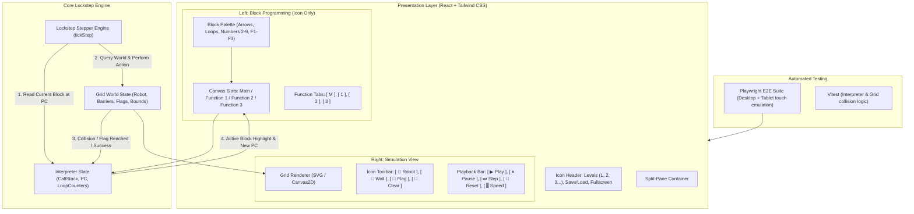
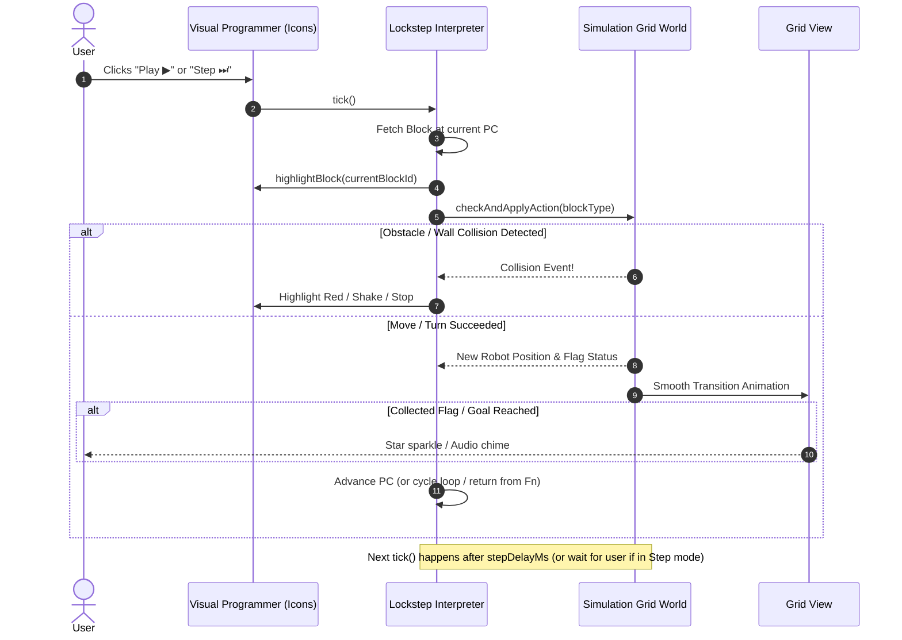

# Robot Emulator: Architecture Design & Implementation Plan

A kid-friendly, icon-driven visual programming and 2D grid robot simulation app designed to run offline on both Windows PCs and Android tablets.

---

## 1. Executive Summary & Core Requirements

| Requirement | Solution Architecture |
| :--- | :--- |
| **Zero-Text / Pre-Reader UI** | **Icon-only interface with numbers**. No required text reading. All actions, blocks, buttons, and tools use universally recognized visual icons + digits (e.g., `1`, `2`, `3`). |
| **Platforms & Offline Support** | **Progressive Web App (PWA)** built with Vite + React + TypeScript + Workbox. Installs on Windows (Desktop PWA) and Android (WebAPK / Add to Home Screen) with full offline caching. |
| **E2E Testing from the Start** | **Playwright** setup from day 1 with automated tests simulating mouse, touch gestures, block drag-and-drop, and grid collision verification on both desktop and tablet viewports. |
| **Split-Pane Layout** | Left pane: Icon Block Palette, Main Sequence & Functions (1, 2, 3) tabs. Right pane: 2D Robot Simulation Grid, Edge Barrier tool, Flag tool, and Playback controls. |
| **Lockstep Interpreter** | **Real-time step-by-step state machine interpreter** (not pre-compiled/pre-flattened). Evaluates one instruction at a time in direct lockstep with simulation feedback (designed for future sensors and conditional branching). |
| **Loop Structure** | `Loop Start` and `Loop End` blocks. Loop count is assigned by dragging a **number badge** directly onto/under the `Loop Start` block, maintaining consistent tactile interaction. |
| **Subroutines / Functions** | Fixed subroutines: **Function 1 (`1`), Function 2 (`2`), Function 3 (`3`)**. Visual color-coded tabs with icon call blocks `[ 📞 1 ]`, `[ 📞 2 ]`, `[ 📞 3 ]`. |
| **Simulation Engine** | Discrete 2D uniform coordinate system with edge-based barrier walls, checkpoint/goal flags, robot heading (N, E, S, W), and an animated interpolation layer with optional path tracing. |

---

## 2. System Architecture & Tech Stack



### Technology Stack Specifications

1. **Framework & Language**: React 18+ with TypeScript (strict mode) & Vite.
2. **Icons**: Lucide Icons (rendered with high contrast, large touch targets, color-coded).
3. **Drag & Drop**: Pointer-event-based drag-and-drop system supporting seamless touch on Android tablets and mouse drag on Windows.
4. **State Machine / Lockstep Stepper**: Custom interpreter maintaining execution pointer `PC`, Call Stack for `1`, `2`, `3`, and active loop stack `{ loopStartPc, currentIteration, targetCount }`.
5. **Testing Architecture**:
   - **Playwright**: End-to-end tests for desktop (1920x1080) and Android tablet emulation (e.g. Pixel C / Galaxy Tab viewports with touch enabled).
   - **Vitest**: Fast unit test runner for the lockstep interpreter and collision logic.
6. **Offline PWA**: `vite-plugin-pwa` with CacheFirst strategy for all assets, manifest icons, and standalone display.

---

## 3. Non-Text / Icon-Only UI Design

Every UI element is visual and accessible to pre-readers or users of any language:

| Concept | Visual Icon / Badge Representation |
| :--- | :--- |
| **Move Forward** | Large Upward Arrow `⬆` on blue card |
| **Move Backward** | Large Downward Arrow `⬇` on blue card |
| **Turn Left** | 90° Curved Left Arrow `↶` on orange card |
| **Turn Right** | 90° Curved Right Arrow `↷` on orange card |
| **Number Multipliers** | Round badge chips with digits: `2`, `3`, `4`, `5`, `6`, `7`, `8`, `9` |
| **Loop Start** | Purple opening bracket `🔁` with an empty circular badge slot for the number token |
| **Loop End** | Purple closing bracket `⏹` |
| **Functions (1, 2, 3)** | Tabs with badge numbers: `[ 1 ]`, `[ 2 ]`, `[ 3 ]` (and Main `[ ★ ]`). Calling blocks: `[ 📞 1 ]`, `[ 📞 2 ]`, `[ 📞 3 ]` |
| **Execution Controls** | `▶` (Green Play), `⏸` (Amber Pause), `⏭` (Blue Step), `🔄` (Red Reset), `⚡` (Speed toggle) |
| **Grid Editing Tools** | `🤖` (Place/Rotate Robot), `🧱` (Toggle Edge Wall), `🏁` (Goal Flag), `⛳` (Intermediate Flag), `🧹` (Clear) |
| **Trace Toggle** | `👣` / `〰` (Toggle visual footstep path) |
| **Result Feedback** | Confetti / Star animation `⭐` on victory, Gentle wobble / `💥` on barrier collision |

---

## 4. Lockstep Interpreter & Execution State Machine

### Why Lockstep?
Unlike a compiler that flattens code into static lists, this interpreter executes **one micro-step per tick**, checking the world state live before making any decision. This ensures future extensions (e.g. `If Wall Ahead?`, `If Flag on Cell?`) plug directly into the engine without modifying the architectural foundation.

### Interpreter State Definition

```typescript
export interface StackFrame {
  scope: 'MAIN' | 'F1' | 'F2' | 'F3';
  pc: number; // Index of the block currently executing in this scope
  currentBlockRepeatLeft: number; // Remaining repeats if basic block has a number badge
}

export interface LoopFrame {
  scope: 'MAIN' | 'F1' | 'F2' | 'F3';
  loopStartPc: number;
  loopEndPc: number;
  currentIteration: number;
  totalIterations: number;
}

export interface InterpreterState {
  callStack: StackFrame[];
  loopStack: LoopFrame[];
  activeBlockId: string | null;
  status: 'IDLE' | 'RUNNING' | 'PAUSED' | 'SUCCESS' | 'COLLISION';
}
```

### Single-Step Step Cycle (`step()` function):
1. **Fetch**: Read `currentFrame = callStack[top]`. If no more blocks, pop frame. If `callStack` empty, evaluate win condition (all flags collected?).
2. **Inspect Block at `pc`**:
   - **Basic Move/Turn**:
     - Check world state (collision with wall or edge).
     - If collision: halt with `COLLISION` status, highlight colliding block in red.
     - If valid: apply delta to robot, record trace, decrement `currentBlockRepeatLeft`.
     - If repeats exhausted, advance `pc++`.
   - **Loop Start**:
     - Read attached number badge (default 1 if none).
     - Push new `LoopFrame` with iteration 1. Advance `pc++`.
   - **Loop End**:
     - Check top `LoopFrame`. If `currentIteration < totalIterations`, increment iteration and jump `pc = loopStartPc + 1`.
     - Else, pop `LoopFrame` and advance `pc++`.
   - **Call Function (`1`, `2`, `3`)**:
     - Guard against infinite recursion (max call stack depth e.g. 32).
     - Push new `StackFrame { scope: F1, pc: 0 }`.
3. **Emit Event**: Notify UI of `activeBlockId` and new robot position for synchronized animation.

### 4.2 Simulation & Grid State

```typescript
export type Direction = 'NORTH' | 'EAST' | 'SOUTH' | 'WEST';

export interface CellCoord {
  x: number;
  y: number;
}

export interface WallEdge {
  // Horizontal wall between (x, y) and (x, y+1)
  // or Vertical wall between (x, y) and (x+1, y)
  orientation: 'HORIZONTAL' | 'VERTICAL';
  x: number;
  y: number;
}

export interface FlagObjective {
  id: string;
  x: number;
  y: number;
  isGoal: boolean; // true = final goal, false = intermediate objective
  orderIndex: number; // 1, 2, 3...
  collected: boolean;
}

export interface SimulationState {
  gridWidth: number;   // e.g. 6 to 10
  gridHeight: number;  // e.g. 6 to 10
  robot: {
    x: number;
    y: number;
    direction: Direction;
    initialX: number;
    initialY: number;
    initialDirection: Direction;
  };
  barriers: WallEdge[];
  flags: FlagObjective[];
  trace: CellCoord[];
  status: 'IDLE' | 'RUNNING' | 'PAUSED' | 'SUCCESS' | 'COLLISION' | 'OUT_OF_BOUNDS';
  activeBlockId: string | null;
}
```

---

## 5. Lockstep Execution & Live Simulation Sync



### Lockstep Stepper Characteristics:
- **No Ahead-of-Time Instruction Flattening**: The engine maintains a runtime state machine (`callStack`, `loopStack`, `pc`). Each step inspects the active block and world state right now.
- **Future Sensor / Condition Ready**: Condition evaluation (e.g. `If Wall Ahead`) checks the current live simulation state at the moment the block is reached.
- **Dual Mode**:
  - **Auto Play (`▶`)**: Recurring interval timer fires `tick()` every $N$ ms (adjustable via speed toggle: 1x = 600ms, 2x = 350ms, 4x = 150ms).
  - **Single Step (`⏭`)**: Fires exactly one `tick()`, updates block glow and robot pose, then returns control to the user.

---

## 6. Icon-Only Block System Specification

### 6.1 Basic Movement Blocks (Zero Text)
- **`⬆` Forward**: Sky-blue block with bold upward arrow.
- **`⬇` Backward**: Sky-blue block with bold downward arrow.
- **`↶` Turn Left**: Amber block with 90° CCW curved arrow.
- **`↷` Turn Right**: Amber block with 90° CW curved arrow.

### 6.2 Number Repeat Badges
- Floating circular tokens containing digits: `[ 2 ]`, `[ 3 ]`, `[ 4 ]`, `[ 5 ]`, `[ 6 ]`, `[ 7 ]`, `[ 8 ]`, `[ 9 ]`.
- **Drop target**: Each basic movement block and loop start block has a round snap-zone at the bottom.
- Dragging a number token into this slot docks the number (e.g. `[ ⬆ ]` with badge `[ 3 ]` moves 3 steps forward).
- Tapping an attached number badge returns it or cycles/removes it.

### 6.3 Structured Loop Blocks
- **`🔁` Loop Start**: Purple container block with an empty round badge slot for the number token.
  - If no badge is attached, default loop count is 2.
  - Dropping badge `[ 4 ]` sets the loop to repeat 4 times.
- **`⏹` Loop End**: Purple block indicating the end of the loop body.
- Visual indentation and connected rail line group the blocks inside the loop.

### 6.4 Function Blocks (Fixed: 1, 2, 3)
- Subroutine tabs at the top of the programming pane:
  - `[ ★ Main ]` (Program entry point)
  - `[ 1 ]` (Function 1 - Emerald Green)
  - `[ 2 ]` (Function 2 - Royal Blue)
  - `[ 3 ]` (Function 3 - Ruby Red)
- Palette contains call blocks:
  - `[ 📞 1 ]` (Calls Function 1)
  - `[ 📞 2 ]` (Calls Function 2)
  - `[ 📞 3 ]` (Calls Function 3)
- When executing a function call, the active tab switches visually to show the subroutine and highlight the sub-block being executed, with a call stack depth indicator.

---

## 7. Phased Implementation Roadmap

### Phase 1: Foundation, Simulation & E2E Test Suite
- [ ] Initialize project with Vite + React + TypeScript + Tailwind CSS.
- [ ] Configure **Playwright** with Chromium/WebKit/Firefox and mobile/tablet viewport configs (`iPad Pro` / `Pixel C`).
- [ ] Write first Playwright E2E smoke tests:
  - App loads without errors.
  - Split screen layout is visible (left coding pane, right grid pane).
- [ ] Build 2D Grid Canvas (SVG) with:
  - Cell coordinates and robot representation with directional arrow.
  - Edge barriers (horizontal and vertical walls between cells).
  - Intermediate flags (`⛳ 1`, `⛳ 2`) and Goal flag (`🏁`).
  - Interactive grid editing tools: tap edge to toggle wall, tap cell to place robot/flag.
- [ ] Build and E2E-test discrete grid physics and collision checks.

### Phase 2: Lockstep Interpreter Engine & Vitest
- [ ] Implement lockstep state machine (`tick()`):
  - Stack frame tracking for `MAIN`, `F1`, `F2`, `F3`.
  - Loop stack for `Loop Start [N]` / `Loop End`.
  - Number badge multiplier resolution.
- [ ] Unit test interpreter with Vitest covering:
  - Multipliers (e.g. Move Forward with badge 3 takes 3 ticks).
  - Nested loops.
  - Function calls and returns (`1` calling `2`).
  - Wall collisions halting execution immediately.

### Phase 3: Icon-Only Block Programming UI & Drag-and-Drop
- [ ] Build touch/mouse Drag-and-Drop palette:
  - Draggable icon cards: `⬆`, `⬇`, `↶`, `↷`.
  - Draggable number badges: `2`, `3`, `4`, `5`, `6`, `7`, `8`, `9`.
  - Draggable control blocks: `🔁 Loop Start`, `⏹ Loop End`, `📞 1`, `📞 2`, `📞 3`.
- [ ] Drop target zones:
  - Program sequence slots (reordering, inserting).
  - Multiplier slot under basic blocks and `Loop Start`.
  - Bin / trash zone to delete blocks.
- [ ] Tabs for `★ Main`, `1`, `2`, `3`.
- [ ] Playwright E2E test: Drag blocks onto canvas, snap a number badge, run playback, verify robot moves correctly.

### Phase 4: Full Integration, Offline PWA & Polish
- [ ] Real-time block highlighting during Play (`▶`) and Step (`⏭`).
- [ ] Smooth robot movement animation with optional footstep trace (`👣`).
- [ ] Configure `vite-plugin-pwa` for 100% offline functionality.
- [ ] Built-in icon-based challenge levels (no reading needed: Level 1, 2, 3... with progressive difficulty).
- [ ] Full Playwright E2E test suite running across desktop and tablet viewports.
