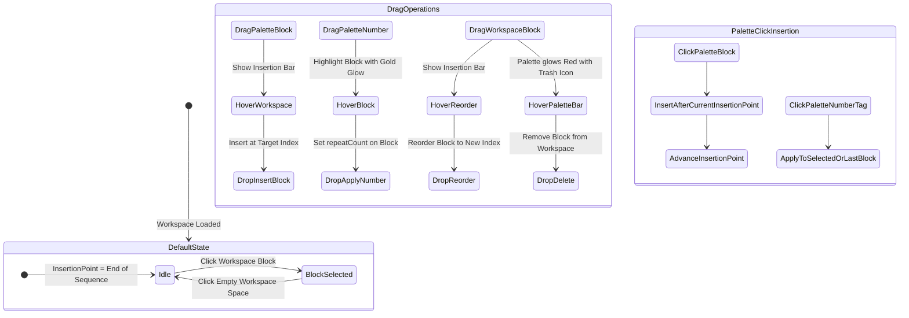

# UI Improvements Specification & Implementation Plan: Programming Workspace

This specification details the improvements to the visual block programming UI, focusing on drag-and-drop workflows, insertion point semantics, uncluttered block visuals, 90-degree rotation iconography, clearer loop termination, and explicit unclosed loop validation.

---

## 1. Overview & Objectives

| Objective | Specification |
| :--- | :--- |
| **Workspace Drag-and-Drop Reordering** | Drag existing blocks within the workspace to reorder them, with real-time insertion indicator line before drop. |
| **Palette Drag-and-Drop (Blocks & Tags)** | Drag blocks from palette to insert anywhere in sequence; drag number tags (2–9) from palette directly onto blocks to set multiplier. |
| **Drag-to-Palette Deletion** | Drag any workspace block back to the block palette bar to delete it, with prominent visual drop zone feedback. Remove individual `(X)` buttons from blocks. |
| **Insertion Point Semantics** | Clicking a block selects it and sets the insertion point immediately after it (and targets it for clicked number tags). Default insertion point is at the end. Clicking empty workspace area resets to default. |
| **Clean Multiplier Badges** | Do not display any number badge if the multiplier is 1 (or undefined). Badges only render when multiplier is > 1. |
| **Harmonized Spacing** | Retain existing block palette spacing (`gap-2`) and align the workspace canvas layout to match the palette spacing. |
| **Icon Clarity** | Replace circular rotation arrows with true 90-degree corner/elbow arrows. Replace square loop-end box with a distinct return-to-loop-start arrow. |
| **Unclosed Loop Diagnostics** | Detect unclosed loops (`LOOP_START` missing matching `LOOP_END` or orphan `LOOP_END`). Visually highlight offending blocks, show clear error banner, and safeguard execution. |

---

## 2. Interaction & State Machine

---

## 3. Detailed Component & UX Specifications

### 3.1. Drag-and-Drop Architecture
1. **Drag Source Types (`data-dnd-type`)**:
   - `PALETTE_BLOCK`: payload contains `blockType: BlockType`.
   - `PALETTE_NUMBER`: payload contains `number: number` (2..9).
   - `WORKSPACE_BLOCK`: payload contains `scope: ScopeType`, `blockId: string`, `index: number`.

2. **Drop Targets & Visual Feedback**:
   - **Between Blocks / Sequence Slots**:
     - Visual indicator: A vertical insertion bar (`w-1.5 h-14 bg-yellow-400 rounded-full shadow-[0_0_10px_rgba(250,204,21,0.8)] animate-pulse`) appearing between blocks indicating the exact insertion index.
   - **On Existing Block (Number Tag drop)**:
     - Target block displays an active yellow/gold ring (`ring-4 ring-yellow-400/80 scale-105 transition-transform`).
     - Dropping sets `updateBlockRepeat(scope, block.id, number)`.
   - **On Palette Bar (Workspace Block deletion)**:
     - Palette bar container displays red border and backdrop (`border-red-500 bg-red-950/40 ring-2 ring-red-500/50`).
     - Temporary trash banner overlay displays `🗑️ Drop here to delete`.
     - Dropping calls `removeBlock(scope, block.id)`.
   - **Dragging Workspace Block**:
     - The item being dragged renders with reduced opacity (`opacity-40`) in place.

### 3.2. Block Selection & Insertion Point Rules
1. **Selection State**:
   - Managed in workspace state: `selectedBlockId: string | null`.
   - When `selectedBlockId` is set, `insertionIndex` is `indexOf(selectedBlock) + 1`.
   - When `selectedBlockId` is `null`, `insertionIndex` defaults to `blocks.length` (end of sequence).
2. **Click Actions**:
   - **Clicking a block**:
     - Sets `selectedBlockId = block.id`.
     - Keeps the block's natural visual (no ring/border outline around the block itself).
     - Renders an animated insertion caret (`data-testid="selection-insertion-pip"`) immediately after the selected block.
   - **Clicking empty workspace canvas**:
     - Resets `selectedBlockId = null` (insertion point moves back to the end of the sequence).
   - **Clicking a block in Palette**:
     - Inserts the new block at `insertionIndex`.
     - Advances selection to the newly inserted block (so consecutive clicks append in sequence).
   - **Clicking a number badge in Palette**:
     - If a block is selected: sets multiplier on `selectedBlockId`.
     - If no block is selected: sets multiplier on the last block in the sequence (if eligible).

### 3.3. Number Tag Display & Removal Rules
1. **Hidden for 1 or Undefined**:
   - For movement, turns, and functions: If `repeatCount === undefined || repeatCount <= 1`, do not render the number badge.
   - For `LOOP_START`: If repeat count is <= 1, hide badge.
2. **Rendered for > 1**:
   - When `repeatCount > 1`, render the rounded badge with yellow accent styling (`bg-yellow-400 text-slate-950 font-black`).
   - Positioned **absolutely** at the bottom-right corner of the node, ensuring that all workspace nodes maintain **identical vertical alignment** regardless of whether a tag is visible.
3. **Clicking Tag to Remove**:
   - Clicking directly on a visible number badge immediately removes it (sets `repeatCount = undefined`).
   - Badge displays a red hover state (`hover:bg-red-500 hover:text-white`) indicating click-to-remove.

### 3.4. Layout, Spacing & Alignment
1. **Zero-Phantom Spacing**:
   - Spacers between nodes are only rendered when a drop indicator line or insertion caret is active. When inactive, no placeholder or padding is allocated between nodes, eliminating wide gaps.
   - Workspace sequence uses compact `gap-1.5` flex layout with `items-center` alignment.
2. **Uniform Node Bounding Box**:
   - All workspace block tiles have identical dimensions (`56x56px`), guaranteeing uniform vertical centerlines.

### 3.5. Runtime Active Node Styling
1. **Color Change (No Circle/Ring)**:
   - When a block is active during interpreter execution, its background transitions directly to radiant yellow (`bg-yellow-400 border-yellow-200 shadow-[0_0_14px_rgba(250,204,21,0.85)]`) and its icon/text turns to dark slate (`text-slate-950`).
   - No outer rings or circles are drawn around the active node.

### 3.6. Drag-and-Drop Reliability & Between-Node Insertion
1. **Always Insert Between Nodes**:
   - Hovering or dropping over a node dynamically calculates cursor position (left vs. right half) and inserts between nodes at `index` or `index + 1`. Dropping on a node never results in a no-op.
2. **Phantom Mode Prevention**:
   - `onDragEnd` unconditionally resets all drag states (`draggingBlockId = null`, `dropIndicatorIndex = null`), ensuring dragged source nodes never remain in dimmed phantom mode.

### 3.5. Iconography
1. **Turn Blocks (`TURN_LEFT`, `TURN_RIGHT`)**:
   - Replace circular arrows (`RotateCcw`, `RotateCw`) with sharp 90-degree corner/elbow arrows:
     - `TURN_LEFT`: Upward stem bending 90° sharply to the left (`CornerUpLeft` with `stroke-[3]`).
     - `TURN_RIGHT`: Upward stem bending 90° sharply to the right (`CornerUpRight` with `stroke-[3]`).
2. **Loop End Block (`LOOP_END`)**:
   - Replace generic solid purple square (`Square`) with a clear return-to-start icon:
     - Return hook/loop arrow (`Undo2` or custom return arc `↩` with `stroke-[3]`), explicitly communicating "loop back up".

### 3.6. Unclosed Loop Validation & Error States
1. **Syntax Validator (`validateLoopStructure(blocks)`)**:
   - Iterates through the active scope blocks tracking open `LOOP_START` indices.
   - Identifies:
     - Unclosed `LOOP_START` (missing corresponding `LOOP_END`).
     - Orphan `LOOP_END` (without preceding `LOOP_START`).
2. **UI Error Indications**:
   - **Block Highlighting**: Any unclosed `LOOP_START` or orphan `LOOP_END` displays a pulsing red outline (`ring-2 ring-red-500 border-red-500 animate-pulse`) with a warning badge overlay (`⚠️`).
   - **Workspace Warning Banner**: A red alert strip above the sequence canvas:
     - *"⚠️ Loop not closed: Missing matching Loop End block"*
   - **Execution Protection**:
     - Toolbar `Play` and `Step` buttons display visual disabled/warning state when an active unclosed loop exists, preventing undefined execution.

---

## 4. Implementation Steps

1. **Store Enhancements (`useAppStore.ts`)**:
   - Add `selectedBlockId: string | null` and action `setSelectedBlockId(id: string | null)`.
   - Update `addBlock(scope, type, repeatCount, insertAtIndex?: number)`.
   - Ensure `reorderBlocks` and `removeBlock` seamlessly cooperate with selection.

2. **Icons & Visual Upgrades (`BlockItem.tsx`, `BlockPalette.tsx`)**:
   - Import `CornerUpLeft`, `CornerUpRight`, `Undo2` (or custom SVG components).
   - Update `PALETTE_ITEMS` and `renderBlockContent`.
   - Remove individual `(X)` delete button from `BlockItem`.
   - Conditionally render repeat badge only when `repeatCount > 1`.

3. **Drag & Drop Integration**:
   - Make palette items draggable with HTML5 DnD / pointer events.
   - Make workspace blocks draggable for reordering and deletion.
   - Implement drop indicator in `WorkspaceCanvas.tsx` for precise insertion feedback.
   - Implement drop-to-delete drop target in `BlockPalette.tsx` with animated red trash state.

4. **Insertion Point & Selection Handling**:
   - Wire up click handlers in `WorkspaceCanvas.tsx` and `BlockItem.tsx` for selection and background click clearing.
   - Connect palette block addition and number tag clicks to respect `selectedBlockId`.

5. **Loop Validation & Error Rendering**:
   - Create loop analyzer helper in `interpreter.ts` / `useAppStore.ts`.
   - Add warning banner and block error styling in `WorkspaceCanvas.tsx`.
   - Guard `play` and `step` execution triggers when loops are unclosed.

6. **Test Suite Verification**:
   - Update unit tests in `tests/interpreter.test.ts` for loop validation.
   - Update E2E tests in `e2e/app.spec.ts` for drag-and-drop, drag-to-delete, selection insertion, and error indicators.
