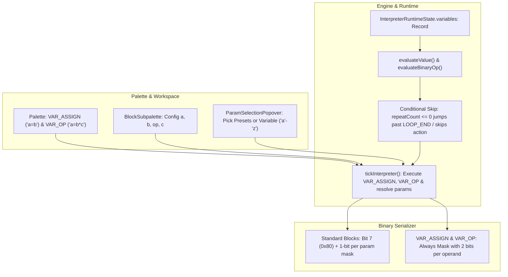

# Implementation Plan: Variable Concept & Blocks

This plan details the addition of a simple, robust variable concept to the visual programming environment.

## Goal Description
Add simple variable support where:
- Variables are single lowercase letters (`'a'` through `'z'`) represented as a branded `newtype` (`VariableName`).
- Variables have a single type (`double`, IEEE 754 float in JavaScript) with implicit conversions to boolean (zero is false, non-zero is true; comparisons output `1.0` or `0.0`) and integer (e.g., `Math.round` for repetition counts or discrete parameters).
- Only two dedicated variable blocks are introduced:
  1. `a = b`: Assign variable `a` to `b` (where `b` can be a variable or constant number).
  2. `a = b * c`: Binary operation assignment where `a` is a variable, `b` and `c` can be either variables or constant numbers, and `*` can be any binary operator (`+`, `-`, `*`, `/`, `%`, `==`, `!=`, `<`, `<=`, `>`, `>=`, `&&`, `||`).
- Variables can be used as the value for any numerical parameter (e.g., `angle`, `radius`, `penWidth`, and `repeatCount`).
- **Conditional / Loop Execution with value 0:** When `repeatCount` evaluates to `0` (or $\le 0$), the entire loop body or action block is skipped immediately (`LOOP_START` jumps directly to `matchingEnd + 1`; action blocks skip simulation execution and advance `pc`), allowing loops to function directly as `if` conditionals using boolean variables.
- **Binary Serialization:**
  - For standard blocks: Header bit 7 (`0x80`) indicates variable parameters, followed by a 1-byte bitmask and 1-byte variable name indices.
  - For `VAR_ASSIGN` (0x07) and `VAR_OP` (0x08): Always include a specialized `paramVarMask` byte immediately following the header using **2 bits per operand parameter** (`00` = variable, `01` = `+int`, `10` = `-int`, `11` = `double`), eliminating all per-parameter tag bytes.

---

## User Review Required

> [!IMPORTANT]
> **Repeat Count = 0 Skip Semantics (If-Conditional Behavior)**
> - **Loop Blocks (`LOOP_START`):** When `loopCount <= 0` (e.g. from a boolean condition evaluating to `0.0`), the interpreter immediately jumps to `matchingEnd + 1`, skipping the entire loop body. When `1.0`, it executes exactly once (`if (cond)` behavior).
> - **Action Blocks:** When `totalRepeats <= 0`, the action is skipped entirely without performing physical moves/turns, advancing directly to the next block.

> [!IMPORTANT]
> **Binary Format for VAR_ASSIGN and VAR_OP (2-Bits-Per-Parameter Mask)**
> - Both opcodes always write a `paramVarMask` byte immediately after the header byte.
> - **2-Bit Operand Type Enum:**
>   - `00` (`0`): Variable Name (`1 byte`: `0..25` for `'a'`..`'z'`)
>   - `01` (`1`): Positive / Non-negative Integer (`VLE(n)`)
>   - `10` (`2`): Negative Integer (`VLE(abs(n))`)
>   - `11` (`3`): Double (`8 bytes` IEEE 754 float64 via DataView)
> - **`VAR_ASSIGN` (0x07):** Mask bits `0..1` encode type of operand `b`.
> - **`VAR_OP` (0x08):** Mask bits `0..1` encode operand `b`, bits `2..3` encode operand `c`.
> - Eliminates all per-parameter tag bytes.

---

## Proposed Changes



---

### 1. Types & Data Models

#### [MODIFY] [src/types/index.ts](file:///g:/Project/antigravity/robotemu/src/types/index.ts)
- Define generic Brand type and branded `VariableName` newtype:
  ```ts
  // 1. Define the Brand tracking type
  declare const brand: unique symbol;

  export type Brand<T, TBrand extends string> = T & {
    readonly [brand]: TBrand;
  };

  // 2. Declare Newtype for VariableName
  export type VariableName = Brand<string, "VarName">;

  // 3. Helper validators & constructors
  export function toVariableName(name: string): VariableName {
    const lower = name.toLowerCase().trim();
    if (!/^[a-z]$/.test(lower)) {
      throw new Error(`Invalid variable name '${name}'. Must be a single lowercase letter 'a'-'z'.`);
    }
    return lower as VariableName;
  }

  export function isVariableName(val: unknown): val is VariableName {
    return typeof val === 'string' && /^[a-z]$/.test(val);
  }

  export const ALL_VARIABLE_NAMES: readonly VariableName[] = [
    'a', 'b', 'c', 'd', 'e', 'f', 'g', 'h', 'i', 'j', 'k', 'l', 'm',
    'n', 'o', 'p', 'q', 'r', 's', 't', 'u', 'v', 'w', 'x', 'y', 'z'
  ].map((ch) => ch as VariableName);
  ```

- Extend `BlockType` to include `'VAR_ASSIGN'` and `'VAR_OP'`:
  ```ts
  export type BlockType =
    | 'MOVE_FWD'
    | 'MOVE_BACK'
    | 'TURN_LEFT'
    | 'TURN_RIGHT'
    | 'LOOP_START'
    | 'LOOP_END'
    | 'CALL_F1'
    | 'CALL_F2'
    | 'CALL_F3'
    | 'VAR_ASSIGN'
    | 'VAR_OP';
  ```

- Update `CodeBlock`:
  ```ts
  export interface CodeBlock {
    id: string;
    type: string;
    repeatCount?: number | VariableName;
    params?: Record<string, any>;
  }
  ```

- Define parameter shapes for the two variable blocks:
  ```ts
  export type BinaryOp =
    | '+'
    | '-'
    | '*'
    | '/'
    | '%'
    | '=='
    | '!='
    | '<'
    | '<='
    | '>'
    | '>='
    | '&&'
    | '||';

  export type OperandValue = number | VariableName;

  export interface VarAssignParams {
    a: VariableName;
    b: OperandValue;
  }

  export interface VarOpParams {
    a: VariableName;
    b: OperandValue;
    op: BinaryOp;
    c: OperandValue;
  }
  ```

- Update `InterpreterRuntimeState`:
  ```ts
  export interface InterpreterRuntimeState {
    callStack: StackFrame[];
    loopStack: LoopFrame[];
    activeBlockId: string | null;
    activeScope: ScopeType;
    status: SimulationStatus;
    stepCount: number;
    activeRepeatProgress?: { blockId: string; current: number; total: number } | null;
    variables: Record<VariableName, number>;
  }
  ```

---

### 2. Interpreter & Evaluation Engine

#### [MODIFY] [src/engine/interpreter.ts](file:///g:/Project/antigravity/robotemu/src/engine/interpreter.ts)
- Add evaluation utilities:
  ```ts
  export function evaluateValue(
    val: number | string | undefined,
    variables: Record<string, number>,
    defaultValue: number = 0
  ): number {
    if (val === undefined || val === null) return defaultValue;
    if (typeof val === 'number') return isNaN(val) ? defaultValue : val;
    if (typeof val === 'string') {
      const trimmed = val.trim();
      if (/^[a-z]$/.test(trimmed)) {
        return variables[trimmed] ?? 0;
      }
      const num = Number(trimmed);
      return isNaN(num) ? defaultValue : num;
    }
    return defaultValue;
  }

  export function evaluateBinaryOp(b: number, op: BinaryOp | string, c: number): number {
    switch (op) {
      case '+': return b + c;
      case '-': return b - c;
      case '*': return b * c;
      case '/': return c === 0 ? 0 : b / c; // Safe divide by zero
      case '%': return c === 0 ? 0 : b % c;
      case '==': return b === c ? 1 : 0;
      case '!=': return b !== c ? 1 : 0;
      case '<': return b < c ? 1 : 0;
      case '<=': return b <= c ? 1 : 0;
      case '>': return b > c ? 1 : 0;
      case '>=': return b >= c ? 1 : 0;
      case '&&': return (b !== 0 && c !== 0) ? 1 : 0;
      case '||': return (b !== 0 || c !== 0) ? 1 : 0;
      default: return 0;
    }
  }
  ```
- In `createInitialInterpreterState()`:
  - Initialize `variables: {}`.
- In `tickInterpreter`:
  - **`VAR_ASSIGN` execution:**
    - Read target variable `a` (`currentBlock.params?.a || 'a'`).
    - Evaluate operand `b` via `evaluateValue(currentBlock.params?.b, runtime.variables, 0)`.
    - Update: `nextVariables = { ...runtime.variables, [a]: evaluatedB }`.
    - Advance `pc++`, return updated runtime state.
  - **`VAR_OP` execution:**
    - Read target variable `a`.
    - Evaluate operands `b` and `c`, compute `result = evaluateBinaryOp(valB, op, valC)`.
    - Update: `nextVariables = { ...runtime.variables, [a]: result }`.
    - Advance `pc++`, return updated runtime state.
  - **`LOOP_START` (with 0-repeat conditional skip):**
    ```ts
    const rawCount = currentBlock.repeatCount !== undefined
      ? evaluateValue(currentBlock.repeatCount, runtime.variables, 2)
      : 2;
    const loopCount = Math.round(rawCount);
    const matchingEnd = findMatchingLoopEnd(scopeBlocks, currentFrame.pc);

    if (loopCount <= 0) {
      // Conditional skip: Jump directly past the matching LOOP_END block!
      if (matchingEnd !== -1) {
        currentFrame.pc = matchingEnd + 1;
      } else {
        currentFrame.pc++;
      }
      callStack[callStack.length - 1] = currentFrame;
      return {
        nextRuntime: { ...runtime, callStack, activeBlockId, activeScope, stepCount: runtime.stepCount + 1, activeRepeatProgress: null },
        nextGrid: simState,
        done: false,
      };
    }
    ```
  - **Domain Actions (with 0-repeat skip):**
    ```ts
    const rawRepeats = currentBlock.repeatCount !== undefined
      ? evaluateValue(currentBlock.repeatCount, runtime.variables, 1)
      : 1;
    const totalRepeats = Math.round(rawRepeats);

    if (totalRepeats <= 0) {
      // 0-repeat skip: Do not execute simulation action, advance directly to next block
      currentFrame.pc++;
      currentFrame.subTickLeft = 0;
      callStack[callStack.length - 1] = currentFrame;
      return {
        nextRuntime: { ...runtime, callStack, activeBlockId, activeScope, stepCount: runtime.stepCount + 1, activeRepeatProgress: null },
        nextGrid: simState,
        done: false,
      };
    }

    // Resolve numerical parameters in params
    const resolvedParams: Record<string, any> = {};
    if (currentBlock.params) {
      for (const [k, v] of Object.entries(currentBlock.params)) {
        if (typeof v === 'string' && /^[a-z]$/.test(v)) {
          resolvedParams[k] = evaluateValue(v, runtime.variables, 0);
        } else {
          resolvedParams[k] = v;
        }
      }
    }
    const actionRes = simEnv.executeAction(blockType, simState, {
      repeatCount: totalRepeats,
      params: resolvedParams,
    });
    ```

---

### 3. Binary Serialization: Bit 7 Mask & 2-Bits-Per-Param for Variable Blocks

#### [MODIFY] [src/engine/serialization/binaryWriter.ts](file:///g:/Project/antigravity/robotemu/src/engine/serialization/binaryWriter.ts) & [binaryReader.ts](file:///g:/Project/antigravity/robotemu/src/engine/serialization/binaryReader.ts)
- Add `writeFloat64(val: number): void` and `readFloat64(): number` using `DataView` (little-endian, 8 bytes).

#### [MODIFY] [src/engine/serialization/types.ts](file:///g:/Project/antigravity/robotemu/src/engine/serialization/types.ts)
- Add universal control flow opcodes:
  ```ts
  export const OP_VAR_ASSIGN = 0x07;
  export const OP_VAR_OP = 0x08;
  export const MASK_HAS_VAR_PARAM = 0x80; // Bit 7 of block header byte
  export const MASK_HAS_REP = 0x40;       // Bit 6 of block header byte
  ```
- Define 2-bit operand types:
  ```ts
  export const OPERAND_TYPE_VAR = 0;    // 00: Variable (1 byte: 0..25)
  export const OPERAND_TYPE_POS_INT = 1;// 01: Positive / non-negative integer (VLE)
  export const OPERAND_TYPE_NEG_INT = 2;// 10: Negative integer (VLE(abs(n)))
  export const OPERAND_TYPE_DOUBLE = 3; // 11: Double (8 bytes IEEE 754)
  ```
- Operator IDs (`0x00` through `0x0C`).
- Helpers `varNameToIndex(name: VariableName): number` (`0..25`) and `indexToVarName(idx: number): VariableName`.

#### [MODIFY] [src/engine/serialization/codeSerializer.ts](file:///g:/Project/antigravity/robotemu/src/engine/serialization/codeSerializer.ts)
- **Special Case for `VAR_ASSIGN` (0x07):**
  - **Header:** `OP_VAR_ASSIGN` (0x07).
  - **Mask Byte (`paramVarMask`):** Always written immediately after header.
    - Bits `0..1`: Operand `b` type (`OPERAND_TYPE_*`).
  - **Target Variable `a`:** 1 byte (`0..25`).
  - **Operand `b` Data:**
    - If `00` (Var): `writer.writeUint8(varNameToIndex(b))` (1 byte)
    - If `01` (+Int): `writer.writeVLE(b)`
    - If `10` (-Int): `writer.writeVLE(Math.abs(b))`
    - If `11` (Double): `writer.writeFloat64(b)` (8 bytes)
- **Special Case for `VAR_OP` (0x08):**
  - **Header:** `OP_VAR_OP` (0x08).
  - **Mask Byte (`paramVarMask`):** Always written immediately after header.
    - Bits `0..1`: Operand `b` type.
    - Bits `2..3`: Operand `c` type.
  - **Target Variable `a`:** 1 byte (`0..25`).
  - **Operator ID:** 1 byte (`0x00..0x0C`).
  - **Operand `b` Data** (written according to bits 0..1).
  - **Operand `c` Data** (written according to bits 2..3).
- **Standard Action Blocks (e.g. Turtle / Movement / Loop):**
  - Header bit 7 (`0x80`) is set if any parameter (or repeatCount) is a variable.
  - If bit 7 is set:
    - Write `paramVarMask` byte:
      - Bit 0: `repeatCount` is variable (if `hasRep`).
      - Bit 1: Action param 0 is variable.
      - Bit 2: Action param 1 is variable.
  - Marked parameters are written as 1 byte (`0..25`); unmarked parameters are written as standard `VLE`.

---

### 4. UI: Palette, Badges, and Parameter Selection

#### [MODIFY] [src/components/BlockPalette.tsx](file:///g:/Project/antigravity/robotemu/src/components/BlockPalette.tsx)
- Add variable blocks to the control palette:
  - `VAR_ASSIGN` button displaying `a=b`.
  - `VAR_OP` button displaying `a=b*c`.
- Allow dragging or adding `VAR_ASSIGN` and `VAR_OP` to workspace.

#### [MODIFY] [src/components/BlockItem.tsx](file:///g:/Project/antigravity/robotemu/src/components/BlockItem.tsx)
- Render `VAR_ASSIGN`: Clean inline layout `[ a ] = [ b ]`.
- Render `VAR_OP`: Clean inline layout `[ a ] = [ b ] [ op ] [ c ]`.
- Render variable letters on the repeat count badge when `typeof block.repeatCount === 'string'`.

#### [MODIFY] [src/components/params/VisualParamBadges.tsx](file:///g:/Project/antigravity/robotemu/src/components/params/VisualParamBadges.tsx)
- When a parameter value is a `VariableName`, render an italicized monospace variable badge `a` in amber/violet.

#### [MODIFY] [src/components/params/ParamSelectionPopover.tsx](file:///g:/Project/antigravity/robotemu/src/components/params/ParamSelectionPopover.tsx)
- For numerical parameters (`angle`, `radius`, `penWidth`, `number`):
  - Add a "Variables" section to pick from `a` through `z`.

#### [MODIFY] [src/components/BlockSubpalette.tsx](file:///g:/Project/antigravity/robotemu/src/components/BlockSubpalette.tsx)
- When `VAR_ASSIGN` is selected:
  - Subpalette provides target variable selector (`'a'`..`'z'`) and operand selector (variable or constant number).
- When `VAR_OP` is selected:
  - Subpalette provides selectors for `a`, `b`, `op` (`+`, `-`, `*`, `/`, `%`, `==`, `!=`, `<`, `<=`, `>`, `>=`, `&&`, `||`), and `c`.

#### [MODIFY] [src/components/Toolbar.tsx](file:///g:/Project/antigravity/robotemu/src/components/Toolbar.tsx)
- Add a runtime variables indicator when running/stepping with active variables (e.g. `a = 10, b = 2.5`).

---

## Verification Plan

### Automated Tests
Run unit tests with Vitest:
```bash
npm run test:unit
```

New unit tests in `tests/variables.test.ts`:
1. **Newtype typing & helpers**:
   - `toVariableName` accepts `'a'`..`'z'`, rejects invalid or multi-char strings.
   - `isVariableName` properly narrows types.
2. **Variable evaluation**:
   - Assign constant double: `a = 5.5`.
   - Copy variable: `b = a` $\rightarrow$ `b = 5.5`.
   - Unassigned variable reads as `0.0`.
3. **Binary operations**:
   - Arithmetic: `+`, `-`, `*`, `/`, `%`.
   - Division by zero: `a / 0` $\rightarrow$ `0.0`.
   - Comparison: `<`, `<=`, `>`, `>=`, `==`, `!=` (returns `1.0` or `0.0`).
   - Logical operators: `&&`, `||` with implicit bool conversions.
4. **Conditional & Loop skip semantics (repeatCount = 0)**:
   - `a = 0; LOOP_START (repeatCount: 'a') ... LOOP_END`: Verify loop body is never executed; PC jumps directly past `LOOP_END`.
   - `a = 1; LOOP_START (repeatCount: 'a') ... LOOP_END`: Verify loop body executes exactly once (`if` conditional pattern).
   - `a = 0; MOVE_FWD (repeatCount: 'a')`: Verify move action is skipped in 0 ticks without changing robot position.
5. **Numerical action parameters**:
   - Turtle turn angle: `a = 45; TURN_LEFT (angle: 'a')` turns 45 degrees.
   - Turtle arc radius: `r = 75; ARC_LEFT (radius: 'r')` arcs with radius 75.
6. **Binary Serialization with 2-Bits-Per-Param Mask**:
   - Roundtrip `VAR_ASSIGN` with variable, +int, -int, and double operands.
   - Roundtrip `VAR_OP` with variable, +int, -int, and double operands across `b` and `c`.
   - Roundtrip standard blocks with bit 7 set and `paramVarMask` byte.
   - Verify legacy serialized codes continue to decode without errors.

### Manual Verification
1. Open web app (`npm run dev`).
2. Test Grid simulation:
   - Conditional test: `a = 0`, `LOOP_START (repeatCount: a)`, `MOVE_FWD`, `LOOP_END`. Verify robot does NOT move.
   - Set `a = 1`. Verify robot moves 1 step.
3. Test Turtle simulation:
   - Add `a = 30`, `LOOP_START (repeatCount: 12)`, `FORWARD (repeatCount: 2)`, `TURN_RIGHT (angle: a)`, `a = a + 10`, `LOOP_END`.
   - Run in instant mode and normal mode to verify dynamic spiral drawing.
4. Export code to clipboard, clear workspace, import code, and verify restoration.
